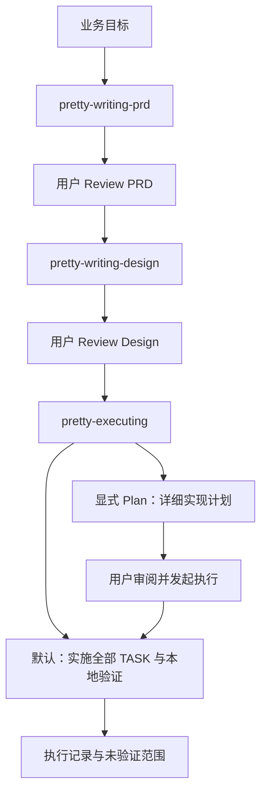

# pretty-ai-harness

面向 Java/Spring 项目的 AI 工程工作流，通过 **PRD、Design、Executing 三个 Skill**，把业务目标转化为可评审的需求与设计，再落实为代码、行为测试和可核验的执行记录。

- [第一部分：pretty-ai-harness是什么、能做什么、如何安装与使用](#第一部分是什么能做什么如何安装与使用)
- [第二部分：从软件工程工作流到 AI Harness：基于三个 Skill 的工程实践](#第二部分从软件工程工作流到-ai-harness基于三个-skill-的工程实践)

## 第一部分：pretty-ai-harness是什么、能做什么、如何安装与使用

### 1.1 是什么

pretty-ai-harness 是一组运行在 Codex 中的 **Skill、文档模板和校验脚本**。它以实际业务仓库为工作对象，为功能开发、Bug 修复和行为保持型重构提供一套从需求到本地交付的协作方式。

| 核心 Skill | 回答的问题 | 主要产物 |
| --- | --- | --- |
| [pretty-writing-prd](skills/pretty-writing-prd/SKILL.md) | 要解决什么问题？业务规则和验收结果是什么？ | `prd.md` |
| [pretty-writing-design](skills/pretty-writing-design/SKILL.md) | 系统如何承担需求？职责、边界和失败语义是什么？ | `design.md` |
| [pretty-executing](skills/pretty-executing/SKILL.md) | 如何实现目标？用什么证据判断本地工作完成？ | 生产代码、行为测试、执行记录；显式指定 `Plan` 时只生成详细计划 |

当前实现与覆盖率工具面向 **Java/Spring、Maven/Gradle 和 JaCoCo**。三个核心 Skill 组织主流程，外部依赖 Skill 提供领域建模、代码质量和行为测试等专项能力，Codex 提供文件、终端、工具调用和权限环境。

### 1.2 能做什么

- **澄清需求。** 明确业务术语、范围、成功与失败结果，以及重复、并发、状态变化等边界，用 `REQ-*` 和 `AC-*` 固定需求与验收标准。
- **设计改动。** 基于现有入口、规则所有者、Schema 和外部协议，确定职责、数据所有权、依赖方向、运行时语义和实施任务。
- **生成计划或直接实现。** 需要先审查实现细节时生成详细 Plan；目标与合同明确时直接修改代码，完成范围内全部 TASK。
- **完成质量与验证闭环。** 检查实际代码增量，修复阻断问题，执行编译、相关模块测试和适用的 JaCoCo 增量覆盖率验收。
- **交付可追溯结果。** 记录 TASK 结果、实际修改、验证命令、退出码、覆盖率和未验证范围，后续执行使用新批次保留历史。

这里的交付范围是**本地代码及验证**：DDL 只作为文件交付；配置数据 DML、真实数据库验证、服务联调、部署和发布由人工流程承担。Executing 不提交或推送代码。

### 1.3 如何安装：把这段 Prompt 发给 Codex

在 Codex 中打开要开发的业务项目，将下面的 Prompt 整段发给 Codex，即可让它安装三个核心 Skill 和八个外部依赖 Skill。

安装需要 Git，以及访问内部 GitLab 和 GitHub 的网络与凭证。运行校验脚本需要 Python 3；执行 Java 任务还需要项目要求的 JDK、Maven/Gradle 或对应 wrapper，以及可生成 JaCoCo XML 的构建配置。如果安装时选择 `npx skills`，还需要 Node.js/npm。

默认安装到当前业务项目的 `.agents/skills/`。需要跨项目共用时，将 Prompt 中的安装位置改为 `~/.agents/skills/`。

```text
请为当前项目安装 pretty-ai-harness 及其依赖 Skill。
安装位置：项目根目录的 .agents/skills/。

1. 安装三个核心 Skill
来源：git@gitlab-inner.haidilao.com:zhangy114/pretty-ai-harness.git
只安装 skills/ 下的：
- pretty-writing-prd
- pretty-writing-design
- pretty-executing

如果当前项目就是 pretty-ai-harness，优先使用本地 skills/；否则获取远程默认分支。
每个 Skill 都要完整安装，保留 SKILL.md 和实际存在的 agents、assets、references、scripts、tests 等配套目录。

2. 安装八个外部依赖 Skill
从以下仓库按名称定位并安装完整 Skill 目录，不安装整个仓库的全部 Skill：
- https://github.com/mattpocock/skills.git
  domain-modeling、grilling、codebase-design、tdd
- https://github.com/amelnagdy/guard-skills.git
  clean-code-guard
- https://github.com/jabrena/cursor-rules-java.git
  122-java-type-design
- https://github.com/decebals/claude-code-java.git
  java-code-review
- https://github.com/github/awesome-copilot.git
  refactor

3. 核对安装结果
先检查当前项目可发现的已有 Skill；同名 Skill 已可用时复用并报告来源，避免重复安装。
不要静默覆盖已有本地改动。可使用可用的 Skill 安装器、npx skills，或克隆后复制目录。
以源仓库 SKILL.md 的 name 为准；若来源或名称不存在，报告具体缺项，不用近似 Skill 替代。
核对三个核心 Skill、八个依赖 Skill 的名称、SKILL.md 和配套文件，报告实际安装路径。
模板和脚本路径按实际安装位置解析，不假定它们位于业务项目的 skills/ 下。
检查 Codex 能否发现这些 Skill；若尚未显示，提示我重启 Codex 后检查。
只完成安装与核对，不启动业务开发。
```

Codex 支持项目级与用户级 `.agents/skills/`，会自动发现新安装的 Skill；未显示时可重启 Codex。安装范围和调用方式见 [Codex 官方 Skill 文档](https://developers.openai.com/codex/skills/)。

#### 依赖 Skill 的分工

安装时准备好全部依赖，运行时按阶段和实际风险调用。

| 依赖 Skill | 在工作流中的作用 |
| --- | --- |
| `domain-modeling` | PRD 命中术语、状态、身份、唯一性或跨上下文关系等信号时，澄清领域模型并维护 `CONTEXT.md` 等共享上下文 |
| `grilling` | 外部行为或需求语义不明确时，逐项与用户澄清 |
| `clean-code-guard` | 为非平凡生产代码提供持续质量约束和阻断审查 |
| `codebase-design` | 检查模块边界、职责归属、接口和可测试性 |
| `122-java-type-design` | 检查值对象、类型层级、精度和签名混淆等类型设计问题 |
| `java-code-review` | 检查并发、事务、资源、响应式链路和外部依赖 API 风险 |
| `tdd` | 指导公共入口行为测试、测试边界和替身设计 |
| `refactor` | 针对质量 finding 中的职责、抽象、耦合或方法结构问题，进行限定范围修复 |

专项 Skill 提供对应规则，执行节奏、验证次数和交付边界由 `pretty-executing` 统一组织。测试守卫是 Executing 内置的审查职责，无需另装一个同名 Skill。

可选安装 [`i-have-adhd`](https://github.com/ayghri/i-have-adhd)，调整对话与交付消息的表达。三个核心 Skill 已内置结果先行、减少重复、聚焦当前行为的要求，它不属于必需依赖：

```text
请从 https://github.com/ayghri/i-have-adhd.git 安装 i-have-adhd，使用与 pretty-ai-harness 相同的安装范围。
```

### 1.4 如何使用

需求与技术边界尚未确定时，按 **PRD → 用户 Review → Design → 用户 Review → Executing** 推进。PRD 和 Design 完成后都会停止，由用户审阅并显式发起下一阶段。



| 当前情况 | 从哪里开始 |
| --- | --- |
| 需求模糊，业务规则或预期结果需要确认 | `$pretty-writing-prd` |
| 已有批准的 PRD，需要确定技术方案 | `$pretty-writing-design` |
| 已有批准的 Design，希望直接实施 | `$pretty-executing` |
| 需要先审查完整实现提案 | `$pretty-executing`，明确指定 `Plan` |
| 小任务的目标、范围和行为约束已明确 | 直接向 `$pretty-executing` 提供 Prompt |

下面用“同一事件重复请求创建工单”演示完整用法。

#### 第一步：编写 PRD，确认需求

```text
$pretty-writing-prd
为“同一事件重复请求创建工单”的问题编写 PRD，topic 使用 event-work-order-idempotency。
当前重复请求可能创建多张工单；希望明确重复请求、并发请求和已有工单失效后的业务结果。
请结合必要的仓库事实澄清规则，完成后交给我 Review。
```

产物：`docs/pretty/event-work-order-idempotency/prd.md`。重点审阅业务术语、范围、`REQ/AC` 和失败边界；有歧义时先修订。

#### 第二步：编写 Design，确认技术合同

```text
$pretty-writing-design
我已 Review 并批准 docs/pretty/event-work-order-idempotency/prd.md。
请基于它和当前仓库编写 design.md，完成后交给我 Review。
```

重点审阅职责与数据归属、幂等和失败语义、结果 TASK、执行交接，以及本地验证与人工外部验证的划分。

#### 第三步：实施并验证

```text
$pretty-executing
我已 Review 并批准 docs/pretty/event-work-order-idempotency/design.md。
请直接实施全部 TASK，完成质量审查、编译、测试和适用的增量覆盖率验证，交付本次执行记录。
```

如果需要先审查代码提案，第三步改为：

```text
$pretty-executing
Plan：依据已批准的 docs/pretty/event-work-order-idempotency/design.md，
生成 execution-plan.md，包含完整核心生产 symbol 和行为测试代码，仅生成计划。
```

`Plan` 是唯一的计划模式名称；未明确指定时默认直接实施。Plan 只写计划文档，完成结构与静态质量检查，不修改生产代码或测试文件，不运行编译、测试与覆盖率。已有计划需明确要求“更新已有计划”才会覆盖。

审阅计划后，显式发起执行：

```text
$pretty-executing
请实施 docs/pretty/event-work-order-idempotency/execution-plan.md，
保持同目录 Design 的业务合同，完成全部 TASK 和最终验证。
```

#### 小任务：直接给出目标与范围

```text
$pretty-executing
修复 <仓库相对路径#公共入口> 的问题：当前 <实际结果>，期望 <明确结果>。
本次只涉及 <修改范围>，必须保持 <兼容或行为约束>。请实现并完成本地验证。
```

这条路径会做受限的内部设计调查，不额外生成 PRD、Design 或 Plan。若业务结果、数据所有权、外部协议或一致性语义仍需决定，则返回需求或设计阶段澄清。

### 1.5 产物、完成标准与继续执行

同一主题使用小写 kebab-case 目录名。文件按实际路径生成，Plan 可选：

```text
docs/pretty/<topic>/
├── prd.md                 # 需求与验收合同
├── design.md              # 技术合同与执行交接
├── execution-plan.md      # 仅显式 Plan 模式生成
├── execution.md           # 首次执行结果
└── execution-002.md        # 后续批次；历史记录只读
```

**完成以全部 TASK 和最终门禁为准。** 执行记录应说明实际修改、质量问题的关闭结果、最终命令及退出码、覆盖率范围和未验证事项。单个测试或某个 TASK 通过，不代表整个任务完成。

继续执行时，提供主题和已经解决的阻塞：

```text
$pretty-executing
继续 docs/pretty/event-work-order-idempotency/ 下的任务，依据已批准的 Design 和现有执行记录。
上次记录的 <具体阻塞> 已通过 <事实或决定> 解决，请核对当前状态并完成剩余工作。
使用新的执行批次，不覆盖历史记录。
```

候选修改文件包含用户未提交改动时，Skill 会停止以处理冲突；无关脏文件不阻塞。执行中的临时质量与覆盖率证据写入主题目录的 `tmp/`，最终校验或停止记录完成后清理。Maven 覆盖率运行默认使用业务项目的 `.pretty/maven-repository/`，作为持久缓存保留并加入该项目的 Git 忽略规则。

## 第二部分：从软件工程工作流到 AI Harness：基于三个 Skill 的工程实践

### 写在前面

#### 这篇文章要回答什么问题

使用 AI 编程时，最容易看到的是结果：AI 可以解释代码、生成测试、修改多个文件，甚至独立完成一个功能。真正决定这些结果能否进入真实项目的，却是另外几个问题：

- AI 是否理解了真正要解决的业务问题？
- 技术方案是否符合当前仓库，而不是来自通用经验的猜测？
- 实施安排是否具体到执行者能够据此开始工作？
- 测试通过是否真的覆盖了目标行为？
- AI 在什么时候可以继续，什么时候必须停下来让人决策？
- 最终的“完成”有没有代码、测试和命令输出作为证据？

这些问题不能只靠一个更长的 Prompt 解决。它们需要一套覆盖软件交付全过程的控制机制。

本文的核心结论是：

> `pretty-writing-prd`、`pretty-writing-design` 和 `pretty-executing` 把传统软件工程中的需求、设计、计划和实施活动转换成 AI 可以遵循的阶段合同；三个 Skill 再与仓库事实、人工 Review、自动校验和质量工具结合，构成了一套软件研发 AI Harness 的主干。

当前版本中，计划与实施由 `pretty-executing` 统一承担：用户明确指定 `Plan` 时，只生成详细实施计划；默认直接实施并完成本地验证。软件工程中的四类活动仍然存在，独立 Plan 文档按需生成。

这个结论包含三层意思：

1. **软件工程工作流是基础。** 先理解需求、设计、计划和实施各自解决什么问题，才能理解三个 Skill 的分工，以及为什么计划可以成为执行模式中的可选产物。
2. **Skill 是流程的可执行载体。** 它规定输入、动作、产物、门禁和停止条件，是可重复使用的工作协议。
3. **Harness 是完整控制系统。** 三个 Skill 串起来提供主干，还需要项目规范、代码仓库、测试工具、权限环境和验证证据共同运行。

全文将沿着这条逻辑展开：

```text
软件工程如何交付功能
        ↓
AI 参与后增加了哪些风险
        ↓
什么是 AI Harness
        ↓
三个 Skill 如何映射开发工作流
        ↓
新人如何使用这套编排
        ↓
一个需求如何走过需求、设计、可选计划和实施
```

### （一）先理解软件工程开发工作流

#### 1. 软件开发不是“收到需求，然后写代码”

从表面看，一个功能的开发过程似乎很简单：产品或业务提出需求，开发人员修改代码，测试通过后上线。但在成熟的软件工程中，“修改代码”只是中间的一步。

一个想法要成为可交付的软件能力，至少需要连续回答四类问题：

| 工程活动 | 要回答的核心问题 | 典型产物 |
| --- | --- | --- |
| 需求 | 为什么做、为谁做、做成什么样 | 产品需求文档、用户故事、验收标准 |
| 设计 | 系统如何承担需求、边界和契约是什么 | 技术设计、接口与数据模型、关键决策记录 |
| 计划 | 修改什么、按什么顺序、由谁完成、如何验证 | 实施计划、任务清单、依赖关系与验证安排 |
| 实施与验证 | 是否实现目标、有哪些证据、是否具备交付条件 | 代码、测试、评审记录与验证报告 |

这四类问题存在自然的依赖关系：如果“做什么”还没有确定，讨论数据库表和接口没有稳定依据；如果架构职责没有确定，列文件修改清单很可能返工；如果行为和验收口径没有明确，实施阶段就会临时决定“怎样才算完成”。

阶段划分是一种风险隔离机制：让不同类型的决策尽早被发现和修正，减少错误扩散后的返工。

```text
需求错误在需求评审时修正
        ↓
架构错误在技术设计时修正
        ↓
实施错误在编码与测试时修正
        ↓
问题进入生产环境后，需要连同数据和运行影响一起修正
```

这些活动可以在一个迭代中反复发生，也可以围绕一个小功能快速完成。团队不必为每项活动创建独立的长文档，但需要对相应问题形成共同认识。需求和技术风险较高时，书面记录与评审有助于协作；范围明确的小改动，可以用简短说明和任务记录承载同样的决定。

下面依次介绍需求、设计、计划和实施，说明它们各自解决的问题以及相互衔接的方式。

#### 2. 需求阶段：先把“正确的问题”说清楚

##### 2.1 PRD 是什么

PRD 是 Product Requirements Document，即产品需求文档。通俗地说，它是一份关于“我们要解决什么问题、给谁解决、结果应该表现成什么样”的共同约定。

一个合格的 PRD 重点回答：

- 用户或业务角色是谁；
- 当前问题和预期价值是什么；
- 哪些行为在范围内，哪些明确不做；
- 主流程、边界场景和失败行为是什么；
- 如何从外部观察到需求已经满足；
- 验收标准是什么。

例如，“同一个事件不要重复创建工单”看似明确，实际上至少隐藏了以下问题：

- “同一个事件”由哪个业务标识判断？
- 已关闭或已取消工单是否算重复？
- 重复请求应该报错，还是返回已有工单？
- 两个并发请求同时到达时，是否必须只创建一张有效工单？
- 历史数据不完整时如何处理？

如果这些问题没有在需求阶段解决，开发人员就会在写代码时替业务做决定。代码可能完全符合开发人员的理解，却不符合真实业务。

需求可以通过用户故事、业务流程图和具体示例表达。验收标准则要把预期结果写到可以判断的程度。例如：“某事件已存在有效工单时，再次发起创建请求，应返回原工单，且不增加有效工单数量。”这样的描述能够同时指导设计、测试和业务验收。

##### 2.2 PRD 不应该写什么

PRD 的重点是外部可观察行为。以下内容通常不应在需求阶段被提前锁定为未来实现：

- 某个类或方法名称；
- 使用数据库唯一索引还是分布式锁；
- 事务边界和重试实现；
- 数据传输对象和持久化对象的具体结构；
- 实施文件清单和代码片段。

这是因为需求应该比实现稳定。同一个业务目标可能有多种技术方案，如果在 PRD 中过早指定实现，就会把业务决策和技术决策混在一起。

已经存在的法律要求、外部协议、兼容承诺或业务约束，需要作为设计输入明确记录。例如，必须兼容已发布接口是一项约束，具体怎样组织内部代码则由技术设计决定。需求分析也可以调查现有系统，以确认当前行为、问题成因和影响范围。

##### 2.3 需求阶段的完成标准

一份可以进入设计的需求，通常需要满足：

1. 目标、范围和关键业务术语清楚；
2. 会影响本次设计的业务歧义已经解决；
3. 主流程、重要边界和失败结果有可判断的验收标准；
4. 业务、产品、开发和测试等相关人员对需求达成一致。

需求评审的目的，是确认团队在解决同一个问题。设计可以选择实现途径，但应保持已经确认的用户价值、范围和行为。后续出现新的业务信息时，需要说明变化及影响，更新需求共识。

#### 3. 设计阶段：决定系统如何承担需求

##### 3.1 技术设计是什么

技术设计也叫 Design 或 Technical Design。通俗地说，它负责把“业务上要发生什么”翻译成“系统中的哪些部分以什么方式协作”。

技术设计通常回答：

- 当前调用入口和上下游是谁；
- 业务规则属于哪个领域对象或模块；
- 模块之间通过什么接口或契约协作；
- 数据如何流动、转换和持久化；
- 异常、事务、并发和幂等如何处理；
- 是否影响兼容性、迁移、回滚、安全和性能；
- 哪一层测试最适合验证目标行为。

以“同一事件不得重复创建工单”为例，需求可能已经规定并发下只能存在一张有效工单。设计需要结合现有系统比较应用层查询、数据库唯一约束、分布式锁或多种机制组合，判断各自的正确性、复杂度和运行成本。

设计者不能只说“使用唯一约束”，还要说明约束的业务键、冲突后的恢复行为、历史数据迁移、不同状态是否参与约束，以及上层如何返回已有工单。应用层先查询再创建是否足够，也必须结合并发要求判断。

技术方案还应说明从现状到目标的过渡。例如，已有历史重复数据时，增加唯一约束可能失败，需要先评估数据处理方式；新旧版本需要同时运行时，字段与接口变更还要考虑兼容顺序。

##### 3.2 技术设计和代码有什么区别

技术设计描述稳定的职责、边界和关键决定，让评审者能判断方案，让开发人员能据此拆解工作。它通常不需要枚举每一行代码；复杂算法或高风险接口可以借助原型、伪代码或小型实验验证可行性。

| 内容 | 更适合放在哪里 |
| --- | --- |
| 同一事件只能关联一张有效工单 | 需求与验收标准 |
| 规则归属、原子性方案、冲突恢复和迁移方式 | 技术设计 |
| 修改哪些模块、任务依赖、负责人和验证安排 | 实施计划 |
| 具体实现、测试断言和运行结果 | 代码、测试与验证记录 |

设计的详略取决于风险。沿用成熟模块的小改动可能只需说明局部变化；涉及跨系统状态、一致性或数据迁移时，需要更清楚的模型、时序、失败恢复和兼容说明。

##### 3.3 设计阶段的完成标准

技术设计通常需要满足：

- 范围内需求都能找到对应的技术安排；
- 关键方案有现有系统事实支持，主要取舍和代价已说明；
- 职责、数据所有权、依赖方向和接口契约清晰；
- 本次相关的异常、并发、兼容、迁移和安全风险已处理；
- 测试策略、重要假设和剩余风险清楚；
- 相关技术负责人和实施人员完成评审，对关键决定达成一致。

不确定性较高时，可以通过技术调研、原型、性能测试或集成实验获得依据。实验应回答具体问题，例如目标数据库的约束能否表达业务唯一性，而不只是展示代码能够运行。

设计为实施提供技术基线。开发过程中发现方案无法成立时，需要回到相应决定，说明事实和影响，再调整方案及后续安排。

#### 4. 计划阶段：把设计变成可执行步骤

##### 4.1 实施计划不是普通任务清单

“修改 Service、增加 Mapper、补充测试”是一份任务摘要，实施人员仍然需要确认范围、依赖、验证方法和完成条件。

可执行的计划需要把设计转换为大小适当、顺序明确的任务。每项任务通常说明：

- 要产生什么结果，对应哪项需求或设计决定；
- 涉及哪些模块、接口、数据或文件；
- 由谁负责，依赖哪些前置工作；
- 如何验证，满足什么条件才算完成；
- 有哪些风险、资源或环境要求。

任务可以按可观察行为拆分。例如，“重复请求返回已有工单”可能同时涉及接口、业务逻辑和数据访问，但能够形成一个可验收的结果。多人并行工作时，还需要提前约定接口、集成顺序和冲突处理方式。

计划细节应足以支持实施和协作。关键路径、复杂算法或接口适配可以补充代码示例；常规实现通常无需在计划阶段写出全部生产代码和测试代码。工期估计也应说明假设和不确定性，并随调查结果调整。

##### 4.2 为什么计划需要了解现有系统

计划中的模块、接口、依赖和测试环境需要有事实依据。一个看似简单的字段变更，可能同时影响数据库、序列化、外部消费者和历史数据；不了解这些关系，就容易低估工作量或遗漏集成步骤。

因此，制定计划时需要核对受影响代码、现有测试、依赖版本、构建流程以及相关团队和环境的可用性。已有设计结论可以复用，尚未验证的假设应明确标出，并安排必要调查。

好的计划同时做到两件事：让实施人员知道从哪里开始、如何衔接；让团队看见风险和依赖，能够据此安排资源及调整顺序。

##### 4.3 计划阶段的完成标准

一份可执行的计划通常需要满足：

- 需求和关键设计决定都有实施落点；
- 任务范围、交付结果和完成条件明确；
- 依赖关系、负责人和里程碑可协调；
- 开发、测试、集成及必要迁移工作没有遗漏；
- 高风险假设已有验证安排，阻塞依赖有处理方式；
- 参与实施的人员理解并接受任务分工。

计划是基于当前知识作出的安排。实际开发中可能出现新事实，需要调整任务、估计或顺序；影响业务范围和技术方案的变化，还应同步给相关负责人，更新对应决定。

#### 5. 实施阶段：改变代码，并证明改变是正确的

##### 5.1 TDD 是什么

TDD 是 Test-Driven Development，即测试驱动开发。它是一种组织编码与反馈的实践，按行为重复以下循环：

```text
RED：先写描述目标行为的测试，并观察它因缺少目标行为而失败
  ↓
GREEN：编写让当前测试通过的最小实现
  ↓
REFACTOR：在测试保护下审视并改善结构，保持行为不变
  ↓
下一个行为
```

RED 的价值容易被低估。一个从未失败过的测试，可能只测试已有行为，也可能没有有效断言。观察它因目标行为缺失而失败，有助于确认测试能捕捉目标差异。GREEN 强调最小实现，减少同时加入过多逻辑带来的诊断困难。

重构阶段关注职责、重复和可读性，在保持测试通过的前提下改善结构；没有需要调整的问题时，可以进入下一个行为。小步实现和频繁反馈能缩短定位错误的距离。

TDD 是可选择的开发实践，团队也可以采用其他测试安排。无论编码顺序如何，测试都需要验证有意义的结果，并在代码变化后提供及时反馈。

##### 5.2 覆盖率是什么，又不是什么

覆盖率用于衡量测试执行过多少代码。常见指标包括：

- **行覆盖率**：有多少可执行代码行在测试中执行过；
- **分支覆盖率**：条件判断的不同路径有多少被执行过。

覆盖率能发现明显的测试空白，却不能单独证明测试有效。一个没有业务断言的测试也可能执行大量代码。因此，覆盖率需要与场景和断言审查结合：核心状态、异常、重复请求和恢复分支不仅要执行，还要验证正确结果。

团队可以观察整个模块的覆盖情况，也可以关注本次变更的增量覆盖率。阈值和统计范围应结合业务风险、代码性质与既有质量标准制定，软件工程没有适用于所有项目的统一百分比。

发现未覆盖代码时，需要判断它是否代表遗漏的行为、难以到达的分支或无用代码。测试的期望值应来自需求与接口契约；如果直接复制实现算法来计算期望值，同一个错误可能同时存在于代码与测试中。

##### 5.3 什么是质量门禁

质量门禁是进入下一阶段或宣布完成之前必须满足的条件。未通过时，需要修复、补证或说明具体阻塞。

软件开发中的质量门禁可以分为两类：

- **机械门禁**：编译、自动化测试、静态分析、格式检查、安全扫描和覆盖率阈值；
- **语义门禁**：需求是否遗漏、架构是否合理、断言是否有效、职责是否清晰、异常是否符合业务语义。

机械门禁适合自动化，但只能验证工具能够观察的事实。例如，测试报告可以证明哪些用例运行并通过，却不能单独判断这些用例是否覆盖了关键业务风险。因此，自动检查需要与代码评审、设计评审及业务验收配合。

评审发现应有具体位置、问题依据和影响说明，修复后检查问题是否解决，并执行相关回归验证。持续集成可以在代码集成时重复运行自动检查，帮助团队及时发现组合后的问题。

##### 5.4 什么叫“有证据地完成”

在工程语境中，“我完成了”是一项声明。可靠的完成结论需要与团队约定的交付范围对应，通常包括：

- 实际代码和配置变更；
- 需求与验收标准对应的测试结果；
- 构建、静态检查和相关回归结果；
- 代码评审发现的处理情况；
- 适用的覆盖率、安全或性能验证结果；
- 集成、数据迁移和发布准备情况；
- 尚未验证的事项、已知风险及后续负责人。

不同验证层级证明不同事实。单元测试可以验证隔离逻辑，集成测试可以验证数据库、事务或服务契约之间的实际配合，端到端测试可以验证完整用户路径。模拟依赖返回竞争冲突，可以检查应用代码的恢复行为；真实唯一约束和事务隔离是否生效，还需要在适当环境中验证。

“编码完成”“具备合并条件”“通过业务验收”和“已经发布”也应分别说明。涉及数据库变更、部署和回滚时，团队需要按发布要求验证兼容性、执行顺序和恢复方案，不能仅凭本地测试通过推断整个交付已经完成。

实施与验证由此把需求、设计和计划落实为可检查的软件结果，并为后续集成、验收和发布提供依据。

#### 6. 四类活动之间如何承上启下

需求、设计、计划和实施形成一条逐步增加确定性的决策链：

```text
需求：明确用户价值、范围和可观察结果
  ↓  提供目标与验收依据
设计：确定职责、数据、接口和运行机制
  ↓  提供技术方案与约束
计划：拆解任务，安排依赖、分工和验证
  ↓  提供实施顺序与完成条件
实施与验证：产生代码、测试和评审结果
  ↓  对照需求与设计，确认交付条件
集成、验收与发布：在目标环境中交付并观察运行结果
```

每项活动解决对应的问题，并把已确认结论交给后续工作。需求决定什么结果有价值，设计决定系统如何承担，计划组织协作和顺序，实施与验证提供实际结果。

这条链也包含反馈。测试可能发现需求遗漏，原型可能推翻技术假设，实施可能暴露新的依赖。团队应把问题送回负责相应决定的位置，并同步调整受影响的设计、任务和验收标准。

这样的分工适用于不同开发方式：在较长周期的项目中可以形成正式阶段，在迭代开发中可以围绕小批量需求持续进行。核心是让目标、技术选择、实施安排和验证结果保持一致。

### （二）从软件工程走向 AI Harness

#### 7. AI 提高了执行速度，也放大了失控速度

AI 的优势非常明显：它可以快速读取代码、生成方案、批量修改文件和运行命令。但同一种能力也带来新的工程风险：

- **快速错误**：误解需求后，可以在几分钟内把错误扩散到多个模块；
- **合理化猜测**：根据常见模式编造不存在的类、接口或命令；
- **上下文丢失**：长任务中忘记早期约束，导致前后决策不一致；
- **过早实现**：在关键业务和技术决定未确认时直接写代码；
- **完成幻觉**：看到局部测试通过，就宣称整体任务完成；
- **权限越界**：把“实现功能”理解为可以提交、推送甚至部署；
- **不可审计**：结论只存在于对话中，后续无法还原依据。

对人类开发者，团队可以依靠培训、Code Review、流程制度和责任分工来降低这些风险。对 AI，仅仅说一句“请认真一点”没有稳定效果。工程规则必须转化成 AI 能识别并执行的输入、步骤、工具和停止条件。

这就是 AI Harness 出现的背景。

#### 8. Prompt、Skill、Agent、Workflow 和 Harness 的区别

这些概念经常混用。理解它们的层级，有助于判断三个核心 Skill 为什么既是 Harness 的组成部分，又不等于 Harness 的全部。

##### 8.1 Prompt：一次任务指令

Prompt 告诉模型当前要做什么。例如：

```text
请分析工单重复创建问题，并给出修复方案。
```

它适合表达当前目标，但通常不会完整携带团队长期规则、工具选择和质量门禁。在当前 Executing 中，用户 Prompt 还决定目标、范围、模式和本次修改授权，优先于既有 Design 或 Plan。

##### 8.2 Skill：可复用的专业工作协议

Skill 把某类任务的成熟方法固化下来，例如如何澄清需求、如何形成技术合同、如何编写行为测试。一个工程化 Skill 通常包含：

- 适用条件；
- 必须读取的上下文；
- 标准步骤；
- 需要调用的工具或专项 Skill；
- 产物格式；
- 质量门禁；
- 停止条件和禁止事项。

因此，Skill 更像一份可重复使用的团队作业指导书，模板和脚本帮助其中一部分要求得到实际检查。

##### 8.3 Agent：执行工作的主体

Agent 是能够读取上下文、调用工具、修改文件和持续推进任务的执行者。模型提供推理能力，Agent Runtime 提供文件、终端和权限控制等行动能力；具体可用工具由当前运行环境决定。

##### 8.4 Workflow：多个步骤或 Skill 的流转关系

Workflow 规定工作按什么顺序进行。例如先澄清需求，再形成 Design，经用户 Review 后执行；需要提前审查实现时插入 Plan。如果业务或技术合同不成立，就返回对应阶段。

##### 8.5 Harness：约束 Agent 可靠运行的整体系统

Harness 原意是“挽具、线束或测试夹具”。在 AI 工程中，它可以理解为围绕模型和 Agent 的控制系统：提供上下文、工作流程、工具、权限、质量标准和反馈闭环。

```text
用户目标
   ↓
Workflow / Skill 编排
   ↓
Agent + Model
   ↓
代码仓库、终端、测试和其他工具
   ↓
机械门禁 + 语义门禁 + 人工 Review
   ↺ 失败时修复，或返回缺少决定的阶段
```

Prompt 表达这次做什么，Skill 规定这类工作如何做，Workflow 决定多个工作如何流转，Harness 把整个 Agent 系统组织在共同的上下文、权限和质量约束下。

#### 9. 软件研发 AI Harness 的核心组成

一套可用于真实研发的软件工程 Harness，至少需要以下六个部分。

##### 9.1 上下文管理

AI 必须读取项目的真实信息，而不是只依赖模型训练中的通用知识。上下文包括：

- 当前代码和受影响调用链；
- 项目目录、分层和命名规范；
- 领域语言和业务不变量；
- API、事件、数据库等边界契约；
- 适用的 Context、ADR 和既有设计决定；
- 公共行为测试、构建配置和覆盖率工具；
- 工作树状态、修改前基线和用户未提交改动。

上下文管理既要防止事实不足，也要防止无边界探索。当前流程采用渐进读取：入口已知就沿受影响链路补齐本次需要的事实，未知才定向定位；同会话中已经读取且未变化的内容直接复用。没有新的合同缺口或失败线索时，结束调查。

PRD 不遍历内部调用图；Design 不额外创建调查报告或证据清单；Executing 从有效 Design/Plan 锚点出发，不重新读取 PRD、Context 和 ADR 证明同一知识。路径、签名或文件发生变化时，围绕失效项核验和重定位。

##### 9.2 流程编排

Harness 要知道当前进行的是需求、设计、计划还是执行活动，并按对应规则行动。PRD 和 Design 完成后停止，由用户 Review 并显式发起下一阶段；Executing 在明确授权的合同内持续完成全部 TASK。

当前的 `Plan` 是 Executing 唯一的计划模式名称，未明确指定就直接实施。已有 Design、已有 Plan 和只有 Prompt 是不同输入路径，不是另外三种模式。流程因此需要同时识别当前输入与用户要求的输出。

##### 9.3 阶段合同

每个阶段都要定义：

- 允许的输入；
- 必须完成的动作；
- 权威产物及其负责的信息；
- 机械和语义门禁；
- 人类需要批准的内容；
- 可以进入下一阶段的条件；
- 必须停止或回退的情况。

阶段合同让 Agent 的自主性有明确边界。PRD 保存需求语义，Design 保存技术合同，Plan 按需保存实现提案，执行记录保存实际结果。下游引用稳定 ID 和路径，减少同一决定在多份文档中的重复表达。

##### 9.4 人工 Review 与关键决定

AI 可以探索、比较和提出推荐，用户负责确认业务目标与关键设计决定。选择 Plan 路径时，用户还可以在改动真实代码前审阅完整实现提案，再显式发起实施。

Human-in-the-loop 的目的，是在高价值决策点保留控制权。已批准合同内的普通命名、文件补齐和明确授权的边界变更由 Executing 自主完成；出现当前合同无法推导的业务或技术决定时，才报告具体缺口。

当前 Executing 不提交、推送、部署或发布，真实数据库与配置数据操作也不属于它的本地工作范围。这些活动由团队另外安排。

##### 9.5 自动质量门禁

Harness 将质量要求接入实际行动：

- PRD、Design 的文档结构校验；
- 实际增量的质量路由与机械扫描；
- `clean-code-guard`、命中专项及内置测试守卫的语义 Review；
- finding 的限定修复和关闭检查；
- 最终编译、测试和适用的增量覆盖率验收；
- 执行记录与合同、实际差异及质量结果的一致性校验。

当前 Executing 在真实工作区实现，不要求隔离候选、Writer/Reviewer 子 Agent 编排或主 Agent 串行集成。执行模式中的 Review 是明确的质量职责：一次全量发现、按根因限定修复、局部复核，再统一最终验收。

修复后的机械检查针对受影响文件；签名、装配或公共行为存在风险时补最小相关编译或定向测试。完整回归和 JaCoCo 留在最终验收，不为每次 finding 修复机械重复全量验证。问题仍未关闭时，门禁阻断完成声明。

##### 9.6 证据、权限和失败路由

Harness 需要保留足以说明决定和结果的产物，包括已批准需求与设计、可选 Plan、实际代码差异、最终命令、退出码和质量摘要。当前临时 Review、路由和覆盖率 JSON 用于执行中的核验，在最终校验或停止记录完成后清理；执行批次记录保留结果和恢复点。

发现问题时，先区分预期实现差异、定位差异与合同缺口。目标能力尚未存在就按合同实现；文件重命名就在范围内重定位；关键业务或技术决定缺失才返回上游。阻塞应引用具体 TASK、合同条款和仓库或协议事实，不能仅以“涉及并发”或“旧代码不支持”为理由停止。

这六个部分共同回答：AI 依据什么做、做到什么程度、谁来决定、怎样证明、失败后去哪里。

#### 10. AI Harness 与 CI/CD 的关系

AI Harness 和 CI/CD 都使用自动化门禁，但关注点不同。

| 对比维度 | AI Harness | CI/CD |
| --- | --- | --- |
| 主要对象 | Agent 的推理、决策和行动过程 | 已产生的代码变更和交付流水线 |
| 起点 | 需求澄清和必要上下文加载 | 通常从代码提交或构建开始 |
| 关注内容 | 合同、工具使用、Review、证据、权限 | 编译、测试、制品、部署 |
| 失败处理 | 在执行中修复，或返回需求、设计及计划修订 | 通常停止构建、发布或回滚 |
| 人类参与 | 业务与设计确认、可选计划审阅、外部流程 | Code Review、发布审批等 |

两者共同覆盖不同环节。AI Harness 管理“AI 如何形成和实施变更”，CI/CD 管理“变更如何被集成、构建和交付”。成熟实践会复用项目既有的测试和质量能力，同时在提交之前补足需求、设计和本地执行证据。

当前 pretty-ai-harness 的执行范围止于本地实现与验证。CI、真实数据库验证、集成环境、部署和发布继续承担各自职责，本地完成记录需要明确这些未验证范围。

#### 11. 为什么一个 Skill 还不是完整 Harness

单独的 `pretty-writing-prd` 可以规范需求工作，但无法约束 Design 和代码执行；单独的 `pretty-executing` 可以从明确 Prompt 直接实施，但仍需要足够的业务与技术合同，无法替用户消除尚未决定的业务歧义。

三个 Skill 组合后，形成覆盖需求到本地交付的主流程：

```text
pretty-writing-prd
  解决“做什么”
        ↓
pretty-writing-design
  解决“系统如何承担”，交接 TASK 和定位
        ↓
pretty-executing
  解决“具体怎样改、怎样验证”
  ├─ Plan：只生成完整实现提案
  └─ 默认：实施全部 TASK，交付代码、测试和执行记录
```

但即使三个 Skill 都存在，如果没有仓库事实、运行工具、校验脚本和人的判断，它们仍然只是一组流程说明。只有这些组件在 Agent Runtime 中共同运行，才能形成可验证的反馈闭环。

理解这一点之后，可以把三个 Skill 放回软件工程地图，逐一观察它们如何把人类工作流变成 AI 可执行合同。

### （三）三个 Skill 如何分工

这一部分只回答一个问题：面对同一个软件任务，三个 Skill 分别承担什么判断。需求、设计、计划和执行仍有不同决策边界，其中计划与执行由同一个 Skill 的两种模式承担。

#### 12. 先看全局：每项活动解决对应问题

| 活动 | 读者要回答的问题 | 主要产物 | 当前边界 |
| --- | --- | --- | --- |
| 需求 | 用户要解决什么问题，怎样算满足？ | PRD | 锁定外部行为；只记录已读的当前入口，不指定未来实现 |
| 设计 | 当前系统如何承担这个目标？ | Design | 确定技术合同、结果 TASK 和执行定位；不复制完整源码 |
| 可选计划 | 哪些具体变更可以交给执行者？ | execution-plan.md | 提供完整核心代码与测试提案；不修改真实实现或运行验证 |
| 执行 | 代码是否按约定改变，并有证据证明？ | 代码、测试、执行记录 | 完成全部 TASK 和本地验证；不改写上游合同或执行外部运维 |

PRD 和 Design 采用“事实 → 决策 → 产物 → 自审与校验 → 用户 Review”的节奏，完成后停止。Plan 完成提案与静态检查后交给用户审阅，后续实施由用户发起。执行模式则在合同内持续推进，直到全部 TASK 和最终门禁完成，或遇到有证据的阻塞。

共同的合同让流程可预测；每项活动的价值，取决于它关闭哪一种不确定性。把这些问题混在一起，容易让技术选择掩盖业务歧义，或让代码结果追认未经确认的设计。

#### 13. PRD：把模糊愿望变成可验收的承诺

用户说“同一个事件不能重复创建工单”，这只是方向。PRD 要把它变成团队可以共同判断的承诺：什么叫同一个事件，哪些状态算有效，重复请求应该返回什么，哪些情况不在本次范围内，怎样验收。

PRD 的关键工作是把四类信息分开：

- 当前系统实际是什么；
- 用户希望系统变成什么；
- 哪些判断已经得到确认；
- 哪些歧义会改变范围、规则或验收。

需求语义不清时，调用 `grilling` 逐项澄清。出现新增或重定义术语、状态、身份、幂等键、唯一性或跨上下文关系等任一领域信号时，必须调用 `domain-modeling`，并由它维护 `CONTEXT.md`，必要时处理 `CONTEXT-MAP.md` 和相关 ADR。命中门禁但 Skill 不可用，或上下文更新未完成时，不能交付 PRD。

未命中领域信号时，可以跳过建模并说明原因。PRD Skill 本身不直接创建 ADR，也不把技术选择写入需求。领域文档维护是配套上下文工作，不是要求把建模过程复制为 PRD 章节。

读者评审 PRD 时，重点看价值、范围、场景、边界、失败行为和验收是否一致。简单需求用短场景列表；存在多个角色、状态、幂等、并发或异步结果时，用具象业务故事帮助发现遗漏。故事与流程图都是解释视图，带稳定编号的 `REQ/AC` 是唯一需求合同。

例如，“已有有效工单时重复请求返回原工单”可以对应一个 REQ，以及 Given 已存在有效工单、When 重复请求、Then 返回同一工单且不新增有效工单的 AC。失效后重建或并发首次创建具有独立结果时，再分别规定。后续技术讨论由此围绕同一外部结果展开。

#### 14. Design：让技术方案对当前仓库负责

Design 承接已批准的 PRD，把目标落实到当前系统的职责、边界、数据和运行时语义，并说明选择的代价。

好的 Design 会沿着真实入口和受影响链路，按需检查规则所有者、直接调用方、外部契约、持久化和测试观察面，再决定职责归属、依赖方向、异常与一致性语义，以及兼容和迁移边界。方案必须有仓库事实支持。

当前固定流程是“PRD 提取 → 关键决策 → 定向查证 → 写 Design → 校验 → 停止”。入口已知时合并独立读取；入口未知时按已知 symbol、受影响模块、必要全仓精确搜索逐步定位。同会话中已有且未变化的事实直接复用，修改已有 Design 时只调查受反馈影响的合同。

Context/ADR、构建配置、Schema 和外部协议按实际合同需要读取。没有新的关键决定需要核验时结束调查；没有新线索却仍缺少必要决定时，说明具体缺口，不能把未关闭的合同交给 Executing 猜测。

读者评审 Design 时，重点看三件事：方案是否满足 PRD，是否适合现有系统，风险和取舍是否说清楚。当前 Design 还要把结果 TASK 与执行交接对应起来：每个 TASK 明确需求、结果、不变量、失败语义和验证观察面，交接部分给出公共入口、影响锚点、候选文件与构建模块。

Design 不放完整实现代码、执行命令或执行结果。真实事务、数据库约束、SQL 和联调明确归为人工外部验证；DDL 文件可以列入交付，配置数据 DML 写入人工运维产物。

#### 15. Plan：把技术决定变成可交给别人的变更提案

当前 Plan 由 `pretty-executing` 在用户显式指定 `Plan` 时生成。主要输入可以是已批准 Design，也可以是合同明确的 Prompt；修订已有 Plan 则需要用户明确要求更新。

Design 已存在时，直接采用结果 TASK 和执行定位，读取必要文件与依赖，不重建上游合同。Plan 的标准是：一个没有参与前期对话的执行者能否据此开始工作，并且不需要重新发明架构。

因此，Plan 要说清楚：

- 哪些完整路径的文件、类、方法或声明性资源会改变；
- 每个 TASK 属于哪个构建根或模块，为什么这样排序；
- 完整核心生产 symbol 如何承接既定职责；
- 完整测试代码从哪个公共入口验证行为；
- 输入、独立预期值、业务断言和必要边界替身是什么；
- 哪些失败语义和上游合同不能改变。

Plan 可以规定要证明的行为，但不写已经发生的测试通过、覆盖率或完成结论。实际运行结果属于 Execution，这样能避免把计划时的假设伪装成执行事实。

读者审阅 Plan 时，审的是实际变更、测试边界和任务合同。Executing 可以在合同内适配普通定位变化与必要文件补齐；若发现实质合同缺口，则返回上游。执行模式不通过改写 Plan、Design 或 PRD 追认现场决定。

#### 16. Execution：改变代码，并用证据证明

Execution 是三个核心 Skill 中直接改变生产代码的工作模式。它接受 Design、已有 Plan 或明确 Prompt，先确认候选文件、必要依赖、工作树状态和修改前基线，再按合同实施。

用户当前目标和授权优先，Design 提供语义合同，Plan 提供更细的 Files、Symbol、测试和顺序，真实仓库提供易变事实。候选修改文件存在用户未提交改动时停止处理冲突；无关脏文件不阻塞，也不得触碰。

执行按可观察行为切片：先写当前切片的行为测试，再完成必要生产链路。测试通过真实内部业务逻辑观察结果，只替换数据库、网络、时间等系统边界；不 mock 自有内部协作者，不以 private 方法测试或调用次数替代行为证据。一个 TASK 完成后继续其余 TASK，不能以“第一阶段完成”提前收尾。

当前实现直接发生在真实工作区，不创建隔离工作树。代码全部完成后，统一进行静态批次、一次全量发现 Review、限定修复和最终验收；Review 同时应用通用质量、命中专项和内置测试守卫。

质量合同还要求核验新增或修改职责的生产类型是否承载独立规则、不变量或必要契约，以及新增或修改的非 `void` 方法是否混合命令与查询职责。核验需要读取必要调用方与副作用链路。类型命名、设计模式或 Design 中的指定，都不能代替必要性证据；副作用与返回值并存时，按合同记录 finding 或有事实支持的例外。

Execution 的完成结论需要实际差异、全部 TASK、行为测试、最终命令、覆盖率、质量结果和未验证范围共同支持。最终记录校验将这些信息相互核对；停止时也要逐项保留已完成和受阻 TASK，说明恢复需要的最小决定或事实。

首次记录为 `execution.md`，后续使用新的批次文件，历史记录只读。执行者不修改 PRD、Design、Context、ADR 或治理文档，不提交、推送、部署或发布。

#### 17. 核心 Skill 与专项 Skill 的关系

三个 Pretty Skill 负责主线；八个外部依赖提供具体问题所需的专业能力：

| 能力 | 解决的问题 |
| --- | --- |
| `grilling`、`domain-modeling` | 业务语义、术语、不变量和上下文是否清楚 |
| `clean-code-guard` | 非平凡生产代码的通用质量约束和阻断审查 |
| `codebase-design` | 模块边界、规则归属、接口和可测试性是否合理 |
| `122-java-type-design` | 类型、值对象、精度和签名契约是否明确 |
| `java-code-review` | 并发、事务、资源、响应式链路和依赖 API 风险 |
| `tdd` | 公共入口行为测试、断言和边界替身是否有效 |
| `refactor` | 质量 finding 中职责、抽象、耦合或方法结构问题的限定修复 |

主流程 Skill 决定当前要解决什么问题，专项能力按实际信号介入。`clean-code-guard` 持续约束非平凡生产代码，其他质量专项根据实际增量选择，统一进入一次全量发现 Review；执行节奏、验证次数与交付边界由 Executing 组织。

测试守卫是 Executing 内置的审查职责，不需要安装独立同名 Skill。当前质量补充、Review 合同和脚本位于 `pretty-executing` 内部，也不再依赖单独的 `pretty-common` 共享目录。

### （四）为什么组合后才是 AI Harness

#### 18. 三个 Skill 共同覆盖不同类型的失控

单个 Skill 只能把对应工作做得更有结构：PRD 不能证明代码如何实现，Execution 也不能补救一个未经澄清的业务目标。三个 Skill 组合后，把“做什么、怎么承担、改什么、如何证明”连成一条可追溯的决策链。

当前把计划与实施合并到 Executing，并没有消除实施范围与验证安排。Design 已提供结果 TASK 和定位，Executing 在合同内完成具体安排；用户希望提前审查代码提案时，使用 Plan 模式。

三个 Skill 文件仍需要仓库事实、工具反馈、质量校验、权限环境和人工 Review 才能运行。工作协议规定行动，工具反馈让问题可见，记录保留结论与恢复点，共同形成可以验证和继续执行的过程。

#### 19. Harness 的三个核心机制

第一是**阶段合同**。需求负责业务结果，设计负责职责和边界，计划负责具体提案，执行负责实现与运行证据。当前 Design 还交接行为级 TASK 与候选定位，降低计划和实施重新调查的成本。

第二是**事实与证据优先**。AI 可以提出判断，但不能把猜测写成事实。依据随流程逐步具体化：从用户目标和领域语言，到仓库关系和技术边界，再到实际差异、测试和运行结果。文档只保留会改变决定、边界、失败语义和验证结论的内容，同时保证这些信息完整。

第三是**受控自主**。用户在目标、方案和必要边界决定上保留控制，Agent 在已授权合同内持续实现和修复。已明确授权的接口、幂等或并发变更可以直接实施，不因为涉及这些主题就重复请求确认；当前合同无法解决的决定则明确返回上游。

#### 20. 停止和返回上游不是失败

可靠的 Agent 不只会向前，还知道问题应该回到哪一层：

| 发现的问题 | 当前处理方式 |
| --- | --- |
| 用户价值、范围、业务规则或验收需要重新决定 | 返回 PRD 或由用户澄清当前目标 |
| 数据语义、所有权、外部协议、依赖方向或一致性合同缺失或矛盾 | 定向核验直接事实，无法在合同内解决时返回 Design |
| 路径、名称、签名变化，或候选清单漏列必要文件 | Executing 在合同内重定位、适配或补齐 |
| 用户需要修改已有实现提案 | 显式要求更新 Plan，只修订受影响 TASK 与锚点 |
| 范围内实现缺陷、编译或测试失败 | 在 Execution 中根据证据修复并重跑 |
| 候选文件已有用户未提交改动 | 停止处理具体文件冲突 |
| 质量 finding 在限定修复后仍无法关闭 | 保留阻断项、合同约束和恢复所需决定 |
| Design 标记的人工外部验证尚未完成 | 继续本地工作，在执行记录中说明未验证范围 |

停止需要具体依据。合同阻塞应引用 TASK、条款以及 `path#symbol` 或协议、Schema 事实，解释缺少什么决定、影响哪些 TASK、如何恢复。单纯“仓库尚未实现目标能力”属于预期变更，不能成为停止理由。

本机环境失败也先区分代码与环境原因。例如 Maven 缓存或临时目录权限问题要尝试可写位置；替代路径仍失败时保留命令和错误。代码、测试、配置及相关环境均未变化时，不重复运行同一验证。

不依赖阻塞决定的已授权工作继续完成。停止记录列出完整 TASK 集合，区分已完成项、受阻项及依赖，避免把部分实现声明为全部交付。这样的停止可以阻止错误扩散，也为继续执行提供清晰入口。

#### 21. 它对 AI coding 的实际帮助

这套组合不会让 AI 永远正确，但会改变错误出现的时间和代价：

- 需求歧义在写代码前暴露；
- 架构判断回到真实仓库与协议；
- 结果 TASK 和验证边界在 Design 中可审查，完整实现可以按需通过 Plan 提前审阅；
- 质量问题进入修复和关闭流程；
- 完成结论由全部 TASK、实际差异和验证证据支撑；
- 合同缺口、用户文件冲突和外部执行边界有明确处理路径。

机械校验和测试证明可观察事实，语义 Review 判断这些事实是否有意义，人类负责确认关键决定。三个 Skill 连接这些责任，工程能力、团队判断和工具链仍然不可缺少。

### （五）读者如何使用这套流程

#### 22. 先判断从哪里开始

新功能、Bug 修复和行为保持型重构，如果需求与技术合同尚未确定，按以下顺序推进：

```text
目标或问题 → PRD → 用户 Review → Design → 用户 Review → Executing
                                                       ├─ 默认直接实施
                                                       └─ Plan → 用户审阅并发起实施
```

已有且已批准的 PRD 可以从 Design 开始；已有批准 Design 可以直接进入 Executing。目标、范围、行为约束和边界已经明确的小任务，也可以直接提供 Prompt；执行者做一次受限内部调查，信息充分就实施，合同级决定缺失才返回需求或设计阶段。

用户明确指定 `Plan` 才会只生成提案。第一部分提供了各条路径的调用 Prompt、产物路径和继续执行示例，可以在实际项目中直接使用。

#### 23. 每个阶段，读者只需要审什么

| 活动 | 评审重点 | 留给其他活动的内容 |
| --- | --- | --- |
| PRD | 目标、范围、场景、术语、边界和验收是否正确 | 类、数据库、事务和实现任务 |
| Design | 方案、职责、契约、取舍、结果 TASK、定位及验证归属是否可信 | 完整源码、行为测试实现和运行结果 |
| 可选 Plan | 文件和 symbol 是否真实，顺序是否可行，完整代码与测试提案是否兑现合同 | 编译、测试、覆盖率及实际完成结论 |
| Execution | 实际差异是否符合合同，全部 TASK 和证据是否充分，未验证范围是否准确 | 业务或技术合同的重新决定 |

用户不必在每一步重读整套材料，只需判断当前问题是否已有足够好的答案。PRD 与 Design 完成后停止，让评审对象和责任边界保持清楚；执行阶段则持续完成所有范围内工作，不能每完成一个 TASK 就要求用户重新发起。

#### 24. 用一个例子理解完整流程

还是以“同一事件不得重复创建工单”为例，假设用户确认：已有有效工单时返回原工单，失效后允许重建，并发下只能产生一张有效工单。

**PRD 确定可观察结果。** 澄清事件身份、有效状态和重建条件，再把首次创建、重复、失效及并发场景写入 `REQ/AC`。新增身份、状态和唯一性规则命中领域建模门禁，由 `domain-modeling` 维护共同语言。用户确认后进入 Design。

**Design 确定系统如何承担。** 从当前创建入口、规则所有者、持久化事实和测试出发，选择可行的原子性方案，说明竞争失败后的返回或恢复、历史数据处理以及必要 DDL。结果 TASK 关联 `REQ/AC`，交接公共验证入口、影响锚点、候选文件和构建模块。真实唯一约束与数据库并发效果列为人工外部验证。

**Plan 按需展开实现。** 若用户需要先审查代码，Executing 给出每个 TASK 的完整核心生产 symbol 和公共入口行为测试，完成静态检查后停止。无需提前审查提案时，直接在执行模式中安排同样的实施工作。

**Execution 实现并验证本地链路。** 按行为切片完成代码与测试。例如，模拟存储边界返回竞争冲突，可以验证 Java 是否正确恢复并返回已有工单；真实数据库约束与事务行为仍不能由该测试证明。全部 TASK 完成后，关闭质量 finding，执行最终编译、相关模块全量测试和适用的增量覆盖率验收。

**执行记录说明完成边界。** 逐项列出 TASK 结果、实际差异、质量与命令证据、覆盖率以及 DDL 未执行和数据库未验证的范围。执行记录校验通过后，才能声明对应的本地实现与验证完成。

如果执行时才发现“重复请求是报错还是返回已有工单”没有确定，应回到需求决定；既定一致性方案与真实 Schema 冲突时，回到 Design；只是文件重命名，则直接重定位；范围内实现错误则修复并复验。连续性来自同一条决策链，以及每次判断都有明确依据。

#### 25. 什么时候应该减少流程

流程重量应由未关闭的不确定性和风险决定。涉及新业务规则、公共契约、状态、一致性、并发、幂等或跨模块所有权，而相关决定尚未明确时，应先完成需求与设计。

目标和合同已经清楚时，可以从已批准的中间产物开始，也可以对范围明确的小任务直接使用 Executing。文档、注释和确定性的机械修改使用相称验证，无需套用所有 Java 行为质量门禁；是否真正没有隐含行为影响，仍要核对。

省略独立 Plan 不会省略实现安排、完整 TASK 或最终验证。减少重复读取与重复转写，也不能成为省略关键失败语义或必要测试的理由。

### （六）团队如何落地

#### 26. 让流程服务于决策

团队落地时，每份产物应回答对应问题，每个重要结论都能回到用户确认、技术合同或仓库事实。文档长短由完整语义决定：不会改变决定的背景可以删去，状态、失败结果、迁移语义和验证边界则必须保留。

先让三个核心 Skill、八个依赖及其配套资源在目标项目中完整可用，再确认项目规范、JDK、构建工具和 JaCoCo 配置。核心 Skill 中的脚本路径按实际安装目录解析，不假定业务项目也使用本仓库的 `skills/` 布局。

团队还需要明确谁审阅需求、谁确认设计、谁负责真实数据库与集成环境验证，以及如何进入既有代码评审和发布流程。本地执行记录应成为后续评审的依据，并清楚标明未验证范围。

轻量化可以删除不适用的阶段、图表和重复上下文，但事实核对、必要 Review 和验证仍需完成。门禁发现问题后，按照具体失败类型修复、补证或返回上游，不能只把发现写进报告就宣布闭环。

#### 27. 用结果判断 Harness 是否有效

应观察需求歧义是否更早关闭、设计风险是否提前暴露、计划和实现返工是否减少、执行证据是否完整，以及从批准到本地交付的总周期。还可以关注重复调查、无变化重跑验证的次数和外部未验证事项是否有明确后续归属。

需求漂移、回滚和生产缺陷下降，比 AI 生成了多少代码更能说明工程效果。比较周期时，也要结合任务复杂度和未验证范围，避免把少做验证误认为效率提升。

### （七）常见问题

#### 28. 三个 Skill 就是完整 Harness 吗？

它们提供需求到本地交付的主干。仓库事实、运行工具、权限环境、质量检查和人工 Review 共同组成完整工作体系；仅安装 Skill 并不能保证工程正确性。

当前虽有三个核心 Skill，需求、设计、计划和实施四类活动仍然存在。计划与实施由 Executing 统一组织，Plan 文档在用户明确需要时生成。

#### 29. 为什么不用一个长 Prompt？

长 Prompt 可以提醒规则，但阶段交接、权威产物、工具反馈和失败处理仍需要具体机制支持。Skill 让工作协议可重复使用，模板保持交接结构，脚本检查可机械核验的事实，执行记录保留结果与恢复点。

Prompt 仍然重要：它决定当前目标、范围和授权。合同明确的小任务可以直接从 Prompt 开始，不必先生成全部文档。

#### 30. 测试通过或覆盖率达标，是否就代表完成？

不代表。还要检查全部 TASK 是否完成、断言是否有意义、实际实现是否兑现合同、质量问题是否关闭，以及未验证范围是否如实说明。

当前默认增量覆盖率门槛是行 90%、分支 80%，项目已有配置分别优先。覆盖率只是行为遗漏的反馈，不能用它替代需求完整性或真实数据库、部署环境的验证。

#### 31. 发现偏差时为什么不能直接改文档？

上游文档记录已确认的决定，执行者不能用改写它们来追认现场选择。业务语义需要重新决定时回到 PRD，技术合同无法成立时回到 Design；用户要修改已有 Plan 时，明确发起 Plan 更新。

同时要区分普通定位变化：路径、名称或签名漂移，以及合同内必要文件补齐，可以由 Executing 自主处理，记录实际落点即可。范围内实现缺陷则在 Execution 中修复并复验，无需把每个代码调整都变成上游审批。

### （八）术语速查

| 术语 | 在本文中的含义 |
| --- | --- |
| Harness | 管理上下文、流程、工具、权限、质量和反馈的工程控制体系 |
| Skill | 针对一类工作的可复用协议，包含输入、产物、门禁和停止条件 |
| PRD | 固定用户价值、范围、外部行为和验收的需求合同 |
| REQ / AC | 需求规则与验收标准的稳定编号，构成 PRD 的权威需求内容 |
| Design | 固定职责、数据、边界、取舍和风险，并交接结果 TASK 与定位的技术合同 |
| Plan | Executing 的可选模式，产出完整核心代码与行为测试提案 |
| Execution | 在当前授权与合同内修改代码并生成本地验证证据的活动 |
| TASK / 行为切片 | 围绕可观察结果组织的实施工作，可以跨越多个文件和层次 |
| 公共验证入口 | 测试观察业务结果、状态或异常的稳定入口，不限于 HTTP 接口 |
| 影响锚点 | 以仓库相对路径和 symbol 标识的现有或新增实现定位 |
| 阶段合同 | 某项活动已确认的输入、决定、输出与完成口径 |
| finding | 有规则和具体证据的质量问题，记录修复范围及 open、fixed、exception 状态 |
| 增量覆盖率 | 相对修改前 Git 基线，检查本次纳入生产 Java 文件的可执行增量 |
| 受控自主 | Agent 在已授权合同内持续推进，遇到无法自行推导的决定时请求澄清 |
| 人工外部验证 | 真实数据库、事务、服务联调及部署等本地行为测试不能证明的事项 |

### 总结：把 AI 的速度放进工程边界

三个 Skill 把 AI coding 中需要持续回答的四类问题连接起来：

```text
目标正确 → 方案可信 → 变更可控 → 结果可证
```

PRD 确认目标与验收，Design 确认系统职责和技术合同，Executing 按需提供 Plan，并把目标落实为完整代码、行为测试和本地验证记录。

Skill 提供工作协议，阶段合同规定决定的归属，Harness 通过仓库事实、工具反馈、质量门禁和人工 Review 把工作组织成可以推进、停止、返回和恢复的过程。它的价值在于让错误更早暴露、关键决定有人确认、完成结论有证据支撑。

具体规则及当前实现见：

- [PRD 规则](skills/pretty-writing-prd/SKILL.md) · [PRD 模板](skills/pretty-writing-prd/assets/prd.md)
- [Design 规则](skills/pretty-writing-design/SKILL.md) · [Design 模板](skills/pretty-writing-design/assets/design.md)
- [Executing 规则](skills/pretty-executing/SKILL.md) · [Plan 模板](skills/pretty-executing/assets/execution-plan.md) · [执行记录模板](skills/pretty-executing/assets/execution.md)
- [执行质量补充](skills/pretty-executing/references/quality-principles.md) · [质量 Review 合同](skills/pretty-executing/references/quality-review-contract.md)

安装来源、依赖组合、调用 Prompt、主题目录和中断恢复方式统一见 [第一部分](#第一部分是什么能做什么如何安装与使用)。
