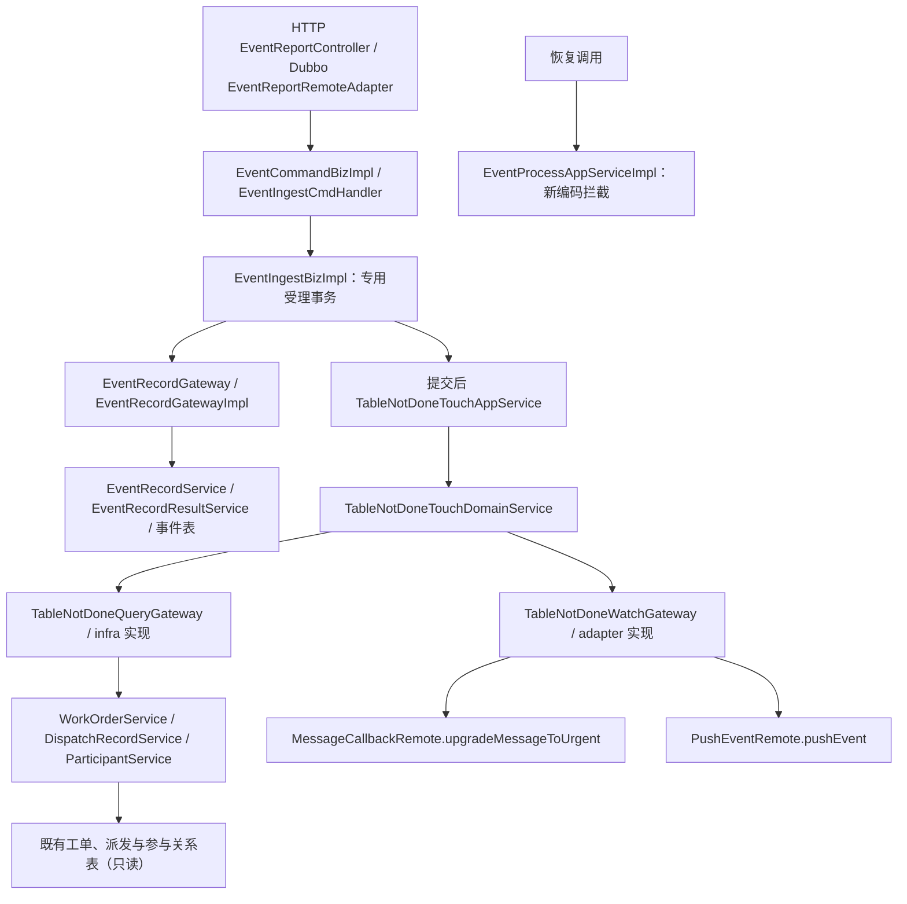

# 未及时收台与擦台事件附加触达 Design

## 设计结论

在现有事件上报入口增加两类未及时事件的专用受理分支：事件成功提交后同步执行附加触达，返回已确认的中性结果 `ACCEPTED`。现有事件唯一约束承担首次受理竞争，不增加触达重试任务或工单状态。
领域服务固定映射目标模板，先筛目标状态，再在同日、同店、同桌、同账单范围内选最新工单；通过只读查询端口和专用手表端口完成触达。
复用当前云手环 API 的紧急升级与推送能力，二次提醒拥有独立业务标识和专用消息类型，不进入普通工单派发、完成回调链路。
代价是同步请求增加查询和一次远程调用耗时；至多一次尝试允许漏提醒，不承诺设备必达。依据为同目录 PRD、用户原始需求及已确认的 `ACCEPTED` 决策。

## 方案全景

### 核心模型与所有权

| 模型 | 最小数据与行为 | 所有者 |
| --- | --- | --- |
| `TableNotDoneEventEntity` | eventId、事件类型、storeCode、pointCode、occurredAt、TableBillId；固定模板映射并构造当日查询条件 | 事件领域；只读已受理事实 |
| `TableBillId` | 桌台账单身份及既有 payload 解析口径；区分缺失、非法与有效编号 | 工单领域值对象 |
| `TableNotDoneWorkOrderQuery` | 门店、桌台、模板、目标状态集合、创建时间左闭右开区间 | 领域查询契约 |
| `WorkOrderRecordEntity` | 只消费 id、workOrderId、templateCode、storeCode、pointCode、pointName、workOrderStatus、createTime、payloadData | 工单领域；本流程无写权限 |
| `TableNotDoneRecipientEntity` | employeeId、employeeName、dispatchRound | 工单派发关系的只读投影 |
| `TableNotDoneTouchDecision` | UPGRADE、REMIND、SKIP 及目标工单；状态分支互斥 | 事件附加触达领域 |
| `TableNotDoneTouchDTO` | 已提交事件的最小事实，由应用转换器显式映射为领域实体 | application 入参边界 |

`domain` 定义 `TableNotDoneQueryGateway` 和 `TableNotDoneWatchGateway`；`infra` 实现只读查询及 PO → Entity 转换，`adapter` 实现 Entity/值对象 → 云手环 DTO 转换。新增代码遵循 `web → application → domain → port`，不使用 application 对 infra 的现存依赖走捷径。Dubbo 既有入站适配器仍调用 application，共享同一受理行为。

### 持久化范围

| 既有对象 | 本次使用 | 写入限制 |
| --- | --- | --- |
| `t_event_record` | `event_type_code + source_event_id` 唯一键；`result_code=ACCEPTED`、固定受理说明和 processed_at | 仅事件受理写入；触达结束后不回写 |
| `t_event_record_result` | 既有事件结果关系存储 | 新事件关联集合为空，不绑定选中的既有工单 |
| `t_work_order_record` | 同店同桌、模板、目标状态、create_time、payload_data；`state=0` | 只读 |
| `t_work_order_dispatch_record` | `state=1`、channel_type=WATCH 的最大 dispatch_round | 只读；不新增派发轮次或触达审计记录 |
| `t_work_order_participant` | 同轮次候选人及广播成员的有效关系 | 只读；不修改处理人或关系有效性 |

当前 Schema 已支持以上数据，无结构性 DDL。事件编码和云手环消息类型的配置数据归人工运维，见 TASK-001、TASK-004。

## 关键设计与权衡

### 受理提交后同步触达，异常捕获边界不包含受理失败

`EventIngestBizImpl#ingest` 在识别两类新事件后，用专用 `TransactionTemplate` 的 `REQUIRES_NEW` 边界包住现有校验、事件草稿及最终受理结果写入；模板返回即表示提交成功。仅这两个编码使用该路径，普通事件事务语义保持原状。新增 `ACCEPTED` 枚举，受理结束即为终态，不先写“待规则处理”。

附加调用置于事务提交之后，并以 `NOT_SUPPORTED` 挂起可能存在的外层事务；不在事件事务中查询工单或调用手表。应用服务捕获整个附加阶段的查询、转换、账单解析、判重和远程异常，最后返回提交时保存的受理结果。不得用覆盖整个 `ingest` 的异常兜底将校验拒绝、事件持久化失败或提交失败伪装成成功。

新增分支早于 `routeAcceptedEvent`；`EventIngestCmdHandler#execute` 保持只对原有两种规则待处理码发布事件，`ACCEPTED` 不发布 `EventIngestedEvent`。在 `EventProcessAppServiceImpl#process` 完成事件定位后、规则评估前按两个事件编码拦截重放或内部直调：返回已有事件结论，不评估规则、不改结果、不再次触达。

### 事件幂等是一次尝试，不是可靠投递

受理使用已存在的 `uk_event_type_source_event(event_type_code, source_event_id)`，不额外套用工单时间窗口守卫。相同事件类型下来源编号跨门店也必须唯一，不能把 storeCode 加入新口径。唯一冲突在事务外按既有查询定位事件，重复调用返回 `IGNORED_DUPLICATE` 和原 eventId；已存事件仍为 `ACCEPTED`，结果查询保持中性成功。PRD 流程图中的重复分支只表达“不重复触达”，不将既有重复响应码改成首次受理码。

仅当前调用中成功完成首次提交的分支可执行附加服务；后续重复、并发请求和规则重放均无触达资格。若首次事件提交后进程退出，或远程调用已处理但响应丢失，不自动补偿、不释放资格重试。新手表引用显式设置 `retries=0`，每次附加服务最多发出一次升级或一次批量提醒调用。

入库唯一竞争失败属于受理阶段；“附加防重失败不影响成功”仅适用于已经提交后的附加阶段，两者必须在异常处理与测试中分开。

### 先筛状态，再按同账单选最新

用户原始要求的“目标状态工单”与领域定义共同约束候选集合为 `WAIT_CLAIM / EXECUTING / COMPLETED`。取消和失效记录先排除；例如 12:05 的取消单不遮挡 12:00 的待认领单。PRD 的“匹配工单不属于目标状态则跳过”作为防御性状态校验，不改变此前置筛选。

查询按工单 `create_time` 落在 `occurredAt.toLocalDate()` 的 00:00 至次日 00:00，左闭右开；不使用 receivedAt、不限制为事件发生时刻之前。日期沿用现有 HTTP/Dubbo 转换后 LocalDateTime 口径，不新增时区换算；调用方继续遵守现有发生时间约定。晚到事件仍查其发生日。

`TableNotDoneQueryGateway#listCandidates` 接收完整条件，infra 在数据库筛选有效记录、门店、桌台、模板、状态和日期并按 `create_time DESC, id DESC` 返回日内候选；领域服务按同账单筛选后取首条。不能先 LIMIT 1 再比较账单，也不设会漏掉旧账单的候选数量截断。相同创建时间以 id 倒序作稳定平局规则。

账单号来自事件及工单持久化业务快照，解析优先级保持现有 `TableBillIdResolveSupport#resolve`：根 tableBillId、根 orderId、detail.tableBillId、detail.orderId；detail 兼容对象及 JSON 字符串。将该语义下沉为 `TableBillId`，现有 application 支撑类保留签名并委托，保持其原调用者行为。新流程区分缺少编号与非法 JSON：事件无可用编号时 SKIP，候选无编号不匹配；无法解析时终止本次附加尝试并记为 PARSE_FAILED，不能因解析错误误选更旧工单。

目标工单以查询得到的状态快照决定动作；本流程不锁工单。并发认领或完成不会导致同一事件改发另一种动作或选择第二张工单。远程系统独立变化与本地查询无法组成原子快照，风险见“验证与风险”。

### 当前有效接收人来自派发事实，不来自完成人

`TableNotDoneQueryGateway#findLatestWatchRecipients` 先在有效 WATCH 派发记录中确定最大 dispatch_round，再查询同工单、同轮次、`state=1 / is_current=1 / relation_status=ACTIVE` 且角色为 `CANDIDATE / BROADCAST_MEMBER` 的参与人。最后由领域模型按 employeeId 去重；空编号不能发出请求。姓名只用于展示，缺失时按现有云手环构造口径使用员工编号。

最新 WATCH 轮次没有有效对象时即为空；不回退更旧轮次，不把 CURRENT_HANDLER、HISTORY_HANDLER、主表 executeUserId 或本次上报 dispatchUserId 作为补发目标。某员工同时具有历史身份和当前有效候选身份时，只依据后者获得提醒资格。已完成工单的候选关系若全部失效，按 REQ-007 不发送。

infra 通过现有派发 repository 的批量列表和参与人条件查询完成读取，并转换为领域投影。不得假定“最新任意渠道轮次”等于“最新手表轮次”；旧数据没有 channel_type 时不可推断为 WATCH。

### 专用手表端口与普通工单生命周期隔离

`TableNotDoneWatchGateway` 定义 `upgradeExistingMessage(workOrderId)` 和 `sendReminder(event, workOrder, recipients)` 两个动作，领域决策只调用其一。adapter 单独引用现有 `MessageCallbackRemote` 与 `PushEventRemote`，不复用会写派发记录的工单执行用例。

当前依赖 `com.haidilao:cloud-bracelet-api:1.2.5.9-SNAPSHOT` 已有 `upgradeMessageToUrgent(List, String)`、`pushEvent(RemoteMessageDto)`，无需升级依赖。升级仅针对既有消息；二次提醒采用事件实例 eventId 作为 businessId，避免原工单号去重吞掉提醒。完整参数映射见“外部边界合同”。

## 设计边界

### 外部边界合同

| 边界 | 方向/触发 | 外部契约/语义所有者 | 输入契约及来源 | 输出/结果 | 失败与运行时语义 |
| --- | --- | --- | --- | --- | --- |
| HTTP/Dubbo 事件上报 | 上游 → 工单系统 | HTTP `POST /api/event-center/events/report`；`EventReportRemote#reportEvent`，Dubbo 1.0.0 | 复用 EventReportRequestQo；新 eventDefineCode；sourceEventId、sourceType、storeCode、pointCode、occurredAt 沿用现有必填校验；payload 保留账单字段 | 首次返回 OpenApiResponse.success，eventId、ACCEPTED、workOrderId 为空、workOrderIds=[]；reasonDesc 只写固定受理说明，processedAt 为受理时间 | 受理前失败沿用现有拒绝/异常合同；提交后触达失败不进入接口异常映射；重复语义见“事件幂等是一次尝试” |
| 事件结果查询 | 上游 → 工单系统 | `POST /api/event-center/events/result/query` | 已受理 eventId | 存储的 ACCEPTED 和空工单集合 | 不暴露触达原因、目标工单、收件人或调用耗时字段 |
| 既有消息升级 | 工单系统 → 云手环 | `MessageCallbackRemote#upgradeMessageToUrgent(List, String)`，Dubbo 1.0.0；List 元素为 String | 目标 workOrderId 单元素集合；来源码取 WorkOrderWatchProperties.messageSourceFromCode，既有默认 HSC_WORK_ORDER | 仅 R 非空且 isSuccess 为 true 才记内部远程受理成功 | 空返回、业务拒绝、超时和异常都结束本次尝试；不改为推送新消息，不调用 callbackMessage |
| 专用二次提醒 | 工单系统 → 云手环 | `PushEventRemote#pushEvent(RemoteMessageDto)`，Dubbo 1.0.0；云手环负责消息路由与展示 | eventType=本次 CLEAR_TABLE_NOT_DONE 或 WIPE_TABLE_NOT_DONE；psCode=事件门店；tableNo=pointCode；businessId=eventId；businessIdDedup=true；employeeList=领域筛出的员工编号与姓名；updateTime=发送时间，格式 yyyy-MM-dd HH:mm:ss；title=“未及时收台复核提醒”或“未及时擦台复核提醒”；msg=桌台展示名加“检测到未及时收台/擦台，请线下复核处理。”；data 仅包含桌台与复核事项 | R 成功仅表示云手环受理，非员工已读或动作完成 | 相同错误分类；专用类型须由人工运维配置为通知类消息，无认领/完工回调和工单状态写操作；不附带普通工单动作 |
| 规则恢复/定时扫描 | 恢复入口 → 工单系统 | 既有失败扫描与统一 process 入口 | eventId 或事件快照 | 新编码在规则评估前结束；已受理记录维持原结果 | 不产生延迟触发计划，不增加消息补偿扫描，不把触达失败写成 PROCESS_FAILED |

桌台展示名采用事件持久化 pointName，缺失时使用 pointCode；提醒文案不得宣称工单已失败、被重开或要求线上再次完成。新消息类型编码的存在属于人工接入前提，不能从 API 类存在推断云手环配置已经就绪。

### 非功能设计

| 主题 | 约束及依据 | 设计措施/责任边界 | 失败、降级与恢复 | 验证观察面 |
| --- | --- | --- | --- | --- |
| 同步可用性 | REQ-002、REQ-009 | 手表新引用 timeout=3000ms、retries=0；批量提醒单次调用；事务外执行 | 超时即结束；上游自身超时仍可能看到超时，不承诺网络层必得 ACCEPTED | 提交前后顺序、RPC 调用次数、接口结果 |
| 一致性 | REQ-008、REQ-010 | 数据库唯一键只允许一个首次提交者；只读工单、关系和派发数据 | 不使用分布式事务；不重试不确定的远程结果 | 并发上报、提交后宕机、超时注入 |
| 查询范围 | REQ-004 | DB 限定同日同店同桌模板状态，使用已有门店/状态索引；账单过滤后选最新 | 不用全库或跨日扫描替代缺失条件；查询异常结束触达 | 午夜边界、同秒排序、不同账单、执行计划 |
| 日志 | 全局 AGENTS 规则 | 结构化记录 eventId、workOrderId、outcome，最多三个业务字段；异常携带堆栈 | QUERY_FAILED、PARSE_FAILED、NO_TARGET、NO_RECIPIENT、REMOTE_REJECTED、REMOTE_UNKNOWN 区分内部结论；不写入事件响应 | 日志字段及故障分类 |
| 兼容 | Java 8、DDD 全局规范 | 新代码使用 JDK8；显式边界转换；业务步骤中文注释依 AGENTS；正常事件保持原路由 | 现有 API 对象名称和方法签名保持兼容，新 application 对象用 DTO 后缀 | 普通事件、延迟事件、账单兼容解析回归 |

## 实施影响

### TASK-001：首次受理得到稳定中性结果，重复和重放不触达

- 对应需求：REQ-001、REQ-002、REQ-008、REQ-009；AC-001、AC-002、AC-007、AC-008。
- 结果：两类事件可受理，提交后同步尝试附加触达；接口及结果查询只表达受理结论。
- 输入与不变量：沿用上报校验及唯一事件身份；只有本次首次成功提交者具备触达资格；触达不进入事件提交事务。
- 失败语义：受理失败不包装成功；附加异常均不能改变已提交结果；重复和规则重放不补偿消息。
- 验证观察面：HTTP/Dubbo 响应、数据库事件结论与空关系、事务提交顺序、触达次数、规则评估与事件发布次数。

### TASK-002：准确选择当日最新同账单目标工单

- 对应需求：REQ-003、REQ-004、REQ-007；AC-003、AC-006。
- 结果：仅匹配固定模板、目标状态和完整业务身份；无目标时结束附加流程。
- 输入与不变量：“先筛状态，再按同账单选最新”的日期、账单与平局规则；工单数据只读。
- 失败语义：无编号或无目标为跳过；非法 JSON、查询失败为附加失败；均回到 TASK-001 的受理结果。
- 验证观察面：查询条件、选中工单、候选顺序、跨日及同日多账单案例、失效和取消单排除。

### TASK-003：待认领工单只升级既有手表消息

- 对应需求：REQ-005、REQ-010；AC-004、AC-008、AC-009。
- 结果：调用云手环紧急升级，不创建消息或工单。
- 输入与不变量：目标状态为 WAIT_CLAIM；动作接收目标工单号，来源码与既有消息一致；不写工单。
- 失败语义：远程拒绝、空结果、超时或异常均结束本次尝试，不转为二次提醒。
- 验证观察面：完整升级参数、零推送、单次调用、工单及派发/参与关系无变化、接口仍为 ACCEPTED。

### TASK-004：执行中或已完成工单的有效派发对象收到专用提醒

- 对应需求：REQ-006、REQ-007、REQ-010；AC-005、AC-006、AC-008、AC-009。
- 结果：向最新 WATCH 轮次的有效候选人和广播成员推送线下复核通知。
- 输入与不变量：“当前有效接收人来自派发事实”及“外部边界合同”的身份、去重、文案和独立 businessId；单次提醒不写工单生命周期。
- 失败语义：无有效对象跳过；远程不确定结果不补发；不回退历史处理人或较旧轮次。
- 验证观察面：完整推送请求、接收人集合、专用类型与事件标识、消息无工单动作、零升级和零工单写操作。

## 验证与风险

TASK-001 需要应用单元测试、HTTP/Dubbo 契约测试以及真实事务/唯一约束集成测试；重点包含提交失败和提交后异常，两者不能只用 mock 数据库区分。普通事件与延迟触发既有测试作为兼容回归。

TASK-002 需要领域边界用例及 repository 查询集成测试；包括午夜、晚到上报、创建时间相同、较新取消单、较新不同账单、detail 兼容形态。执行阶段以同店同桌单日数据验证执行计划；本期不凭未知数据量增加索引。

TASK-003、TASK-004 需要 adapter 协议测试和无写副作用的应用测试。云手环服务端的来源码、专用消息路由、展示效果及无完工回调必须人工联调；本地 API 签名和单元测试不证明设备端实际行为。

同步数据库查询与远程请求均可能增加接口耗时。由于没有跨数据库与手表的事务，工单状态或派发关系可在读取后变化；本合同以读取的快照选择一次动作，不保证在设备收到时仍与最新状态一致。提交后宕机和远程响应丢失允许漏提醒，不能通过后台重试改变本期至多一次尝试语义。

全局 DDD 模块规则优先于旧 spec 中的 biz/service 模块示例；全局日志三字段上限优先于旧 spec 的完整请求日志示例。根 pom 的 Java 1.8 基线为本次构建约束。

## Executing 定位与交付

### 变更职责链路

### TASK-001

- 公共验证入口：现有 `work-order-web/src/main/java/com/haidilao/workorder/web/controller/open/event/EventReportController.java#reportEvent`、`work-order-adapter/src/main/java/com/haidilao/workorder/adapter/remote/inbound/EventReportRemoteAdapter.java#reportEvent`、`work-order-application/src/test/java/com/haidilao/workorder/application/event/command/ingest/EventIngestBizImplTest.java#shouldAcceptPosSourceWhenEventDefineAllowsPos`、`work-order-application/src/test/java/com/haidilao/workorder/application/event/command/ingest/EventIngestBizImplTest.java#shouldMarkDelayedPendingWhenTemplateTriggerOrchestrationReturnsDelayed`；新增 `work-order-application/src/test/java/com/haidilao/workorder/application/event/command/ingest/EventIngestBizImplTest.java#shouldAcceptNotDoneAfterCommitDespiteTouchFailure`、`work-order-application/src/test/java/com/haidilao/workorder/application/event/command/process/EventProcessAppServiceImplTest.java#shouldSkipNotDoneRuleReplay`。
- 影响锚点：现有 `work-order-web/src/main/java/com/haidilao/workorder/web/controller/open/event/EventReportController.java#reportEvent` / `work-order-adapter/src/main/java/com/haidilao/workorder/adapter/remote/inbound/EventReportRemoteAdapter.java#reportEvent` → `work-order-application/src/main/java/com/haidilao/workorder/application/event/command/EventCommandBizImpl.java#ingest` → `work-order-application/src/main/java/com/haidilao/workorder/application/event/executor/command/ingest/EventIngestCmdHandler.java#execute` → `work-order-application/src/main/java/com/haidilao/workorder/application/event/command/ingest/EventIngestBizImpl.java#ingest` → `work-order-infra/src/main/java/com/haidilao/workorder/infra/gatewayimpl/event/EventRecordGatewayImpl.java#save` → `work-order-infra/src/main/java/com/haidilao/workorder/infra/core/repository/event/EventRecordServiceImpl.java#save`；新增 `work-order-application/src/main/java/com/haidilao/workorder/application/event/command/ingest/TableNotDoneTouchAppService.java#touch` → `work-order-domain/src/main/java/com/haidilao/workorder/domain/event/notdone/TableNotDoneTouchDomainService.java#touch`；现有恢复入口 `work-order-application/src/main/java/com/haidilao/workorder/application/event/command/dispatch/EventRuleDispatchBizImpl.java#dispatchToRule` → `work-order-application/src/main/java/com/haidilao/workorder/application/event/command/process/EventProcessAppServiceImpl.java#process`。
- Execution 交付：构建根 `pom.xml`，模块 application/domain/common/web/adapter；Modify `work-order-application/src/main/java/com/haidilao/workorder/application/event/command/ingest/EventIngestBizImpl.java`、`work-order-application/src/main/java/com/haidilao/workorder/application/event/command/process/EventProcessAppServiceImpl.java`、`work-order-domain/src/main/java/com/haidilao/workorder/domain/common/enums/EventResultCodeEnum.java`、`work-order-common/src/main/java/com/haidilao/workorder/common/constant/EventConstants.java`；Add `work-order-application/src/main/java/com/haidilao/workorder/application/event/command/ingest/TableNotDoneTouchAppService.java`、`work-order-application/src/main/java/com/haidilao/workorder/application/event/dto/TableNotDoneTouchDTO.java`、`work-order-application/src/main/java/com/haidilao/workorder/application/event/support/TableNotDoneTouchConverter.java`；Test `work-order-application/src/test/java/com/haidilao/workorder/application/event/command/ingest/EventIngestBizImplTest.java`、`work-order-application/src/test/java/com/haidilao/workorder/application/event/command/process/EventProcessAppServiceImplTest.java`、`work-order-web/src/test/java/com/haidilao/workorder/web/controller/open/event/EventReportControllerTest.java`、`work-order-adapter/src/test/java/com/haidilao/workorder/adapter/remote/inbound/EventReportRemoteAdapterTest.java`、`work-order-application/src/test/java/com/haidilao/workorder/application/event/command/ingest/TableNotDoneAcceptanceIntegrationTest.java`。
- 人工运维产物：人工维护两类事件定义及允许来源、SHOP_TABLE 点位类型、保留账单字段的 payload schema；使用中文名“未及时收台”“未及时擦台”。不创建到建单模板的触发关系。人工核验既有事件唯一索引已部署，并负责配置数据 DML、激活、禁用和回滚。
- 依赖：TASK-002～TASK-004 提供附加服务能力；新编码由领域映射识别，不依赖事件到模板关系表。

### TASK-002

- 公共验证入口：新增 `work-order-domain/src/test/java/com/haidilao/workorder/domain/event/notdone/TableNotDoneTouchDomainServiceTest.java#shouldSelectLatestMatchingTargetStatus`、`work-order-infra/src/test/java/com/haidilao/workorder/infra/gatewayimpl/event/TableNotDoneQueryGatewayImplTest.java#shouldRestrictCandidatesToEventDay`；现有 `work-order-application/src/test/java/com/haidilao/workorder/application/event/command/ingest/EventIngestBizImplTest.java#shouldAcceptPosSourceWhenEventDefineAllowsPos` 为普通受理回归入口。
- 影响锚点：新增 `work-order-application/src/main/java/com/haidilao/workorder/application/event/command/ingest/TableNotDoneTouchAppService.java#touch` → `work-order-domain/src/main/java/com/haidilao/workorder/domain/event/notdone/TableNotDoneTouchDomainService.java#touch` → `work-order-domain/src/main/java/com/haidilao/workorder/domain/event/notdone/model/TableNotDoneEventEntity.java#toQuery`、`work-order-domain/src/main/java/com/haidilao/workorder/domain/workorder/model/valueobject/TableBillId.java#parse` → `work-order-domain/src/main/java/com/haidilao/workorder/domain/event/notdone/gateway/TableNotDoneQueryGateway.java#listCandidates` → `work-order-infra/src/main/java/com/haidilao/workorder/infra/gatewayimpl/event/TableNotDoneQueryGatewayImpl.java#listCandidates` → 新增 `work-order-infra/src/main/java/com/haidilao/workorder/infra/core/repository/workorder/WorkOrderServiceImpl.java#listNotDoneCandidates` → 现有 `work-order-infra/src/main/java/com/haidilao/workorder/infra/core/mapper/workorder/WorkOrderRecordMapper.java#WorkOrderRecordMapper`；兼容委托现有 `work-order-application/src/main/java/com/haidilao/workorder/application/workorder/support/TableBillIdResolveSupport.java#resolve`。
- Execution 交付：构建根 `pom.xml`，模块 domain/infra/application；Add `work-order-domain/src/main/java/com/haidilao/workorder/domain/event/notdone/TableNotDoneTouchDomainService.java`、`work-order-domain/src/main/java/com/haidilao/workorder/domain/event/notdone/model/TableNotDoneEventEntity.java`、`work-order-domain/src/main/java/com/haidilao/workorder/domain/event/notdone/model/TableNotDoneWorkOrderQuery.java`、`work-order-domain/src/main/java/com/haidilao/workorder/domain/event/notdone/model/TableNotDoneTouchDecision.java`、`work-order-domain/src/main/java/com/haidilao/workorder/domain/workorder/model/valueobject/TableBillId.java`、`work-order-domain/src/main/java/com/haidilao/workorder/domain/event/notdone/gateway/TableNotDoneQueryGateway.java`、`work-order-infra/src/main/java/com/haidilao/workorder/infra/gatewayimpl/event/TableNotDoneQueryGatewayImpl.java`、`work-order-infra/src/main/java/com/haidilao/workorder/infra/core/model/criteria/workorder/TableNotDoneSearchCriteria.java`；Modify `work-order-infra/src/main/java/com/haidilao/workorder/infra/core/repository/workorder/WorkOrderService.java`、`work-order-infra/src/main/java/com/haidilao/workorder/infra/core/repository/workorder/WorkOrderServiceImpl.java`、`work-order-application/src/main/java/com/haidilao/workorder/application/workorder/support/TableBillIdResolveSupport.java`；Test `work-order-domain/src/test/java/com/haidilao/workorder/domain/event/notdone/TableNotDoneTouchDomainServiceTest.java`、`work-order-infra/src/test/java/com/haidilao/workorder/infra/gatewayimpl/event/TableNotDoneQueryGatewayImplTest.java`、`work-order-domain/src/test/java/com/haidilao/workorder/domain/workorder/model/valueobject/TableBillIdTest.java`、`work-order-application/src/test/java/com/haidilao/workorder/application/workorder/support/TableBillIdResolveSupportTest.java`。
- 人工运维产物：无。
- 依赖：TASK-001 提供已提交事件；现有 PO 与基础 repository 保持复用。

### TASK-003

- 公共验证入口：新增 `work-order-domain/src/test/java/com/haidilao/workorder/domain/event/notdone/TableNotDoneTouchDomainServiceTest.java#shouldUpgradeOnlyForWaitClaim`、`work-order-adapter/src/test/java/com/haidilao/workorder/adapter/remote/outbound/watch/TableNotDoneWatchGatewayAdapterTest.java#shouldUpgradeExistingMessageWithoutPush`。
- 影响锚点：新增 `work-order-application/src/main/java/com/haidilao/workorder/application/event/command/ingest/TableNotDoneTouchAppService.java#touch` → `work-order-domain/src/main/java/com/haidilao/workorder/domain/event/notdone/TableNotDoneTouchDomainService.java#touch` → `work-order-domain/src/main/java/com/haidilao/workorder/domain/event/notdone/gateway/TableNotDoneWatchGateway.java#upgradeExistingMessage` → `work-order-adapter/src/main/java/com/haidilao/workorder/adapter/remote/outbound/watch/TableNotDoneWatchGatewayAdapter.java#upgradeExistingMessage`；外部边界为当前 cloud-bracelet-api 的 `MessageCallbackRemote#upgradeMessageToUrgent`；现有配置来源 `work-order-adapter/src/main/java/com/haidilao/workorder/adapter/config/WorkOrderWatchProperties.java#getMessageSourceFromCode`。
- Execution 交付：构建根 `pom.xml`，模块 domain/adapter/application；Add `work-order-domain/src/main/java/com/haidilao/workorder/domain/event/notdone/gateway/TableNotDoneWatchGateway.java`、`work-order-adapter/src/main/java/com/haidilao/workorder/adapter/remote/outbound/watch/TableNotDoneWatchGatewayAdapter.java`；Modify `work-order-domain/src/main/java/com/haidilao/workorder/domain/event/notdone/TableNotDoneTouchDomainService.java`；Test `work-order-adapter/src/test/java/com/haidilao/workorder/adapter/remote/outbound/watch/TableNotDoneWatchGatewayAdapterTest.java`、`work-order-domain/src/test/java/com/haidilao/workorder/domain/event/notdone/TableNotDoneTouchDomainServiceTest.java`、`work-order-application/src/test/java/com/haidilao/workorder/application/event/command/ingest/TableNotDoneTouchAppServiceTest.java`。
- 人工运维产物：人工核验云手环原工单消息来源码与现有 work-order.watch.message-source-from-code 配置一致；人工联调升级接口及设备效果。
- 依赖：TASK-001、TASK-002；使用已声明云手环依赖版本。

### TASK-004

- 公共验证入口：新增 `work-order-domain/src/test/java/com/haidilao/workorder/domain/event/notdone/TableNotDoneTouchDomainServiceTest.java#shouldRemindLatestEffectiveWatchRecipients`、`work-order-infra/src/test/java/com/haidilao/workorder/infra/gatewayimpl/event/TableNotDoneQueryGatewayImplTest.java#shouldNotFallbackToHistoricalRecipients`、`work-order-adapter/src/test/java/com/haidilao/workorder/adapter/remote/outbound/watch/TableNotDoneWatchGatewayAdapterTest.java#shouldPushDedicatedReminderWithEventBusinessId`。
- 影响锚点：新增 `work-order-application/src/main/java/com/haidilao/workorder/application/event/command/ingest/TableNotDoneTouchAppService.java#touch` → `work-order-domain/src/main/java/com/haidilao/workorder/domain/event/notdone/TableNotDoneTouchDomainService.java#touch` → `work-order-domain/src/main/java/com/haidilao/workorder/domain/event/notdone/gateway/TableNotDoneQueryGateway.java#findLatestWatchRecipients` → `work-order-infra/src/main/java/com/haidilao/workorder/infra/gatewayimpl/event/TableNotDoneQueryGatewayImpl.java#findLatestWatchRecipients` → 现有 `work-order-infra/src/main/java/com/haidilao/workorder/infra/core/repository/workorder/dispatch/WorkOrderDispatchRecordServiceImpl.java#listByWorkOrderIds`、`work-order-infra/src/main/java/com/haidilao/workorder/infra/core/repository/workorder/participant/WorkOrderParticipantServiceImpl.java#list`；新增 `work-order-domain/src/main/java/com/haidilao/workorder/domain/event/notdone/gateway/TableNotDoneWatchGateway.java#sendReminder` → `work-order-adapter/src/main/java/com/haidilao/workorder/adapter/remote/outbound/watch/TableNotDoneWatchGatewayAdapter.java#sendReminder` → `work-order-adapter/src/main/java/com/haidilao/workorder/adapter/remote/outbound/watch/TableNotDoneMessageConverter.java#toRemoteMessage` → 云手环 `PushEventRemote#pushEvent`。
- Execution 交付：构建根 `pom.xml`，模块 domain/infra/adapter；Add `work-order-domain/src/main/java/com/haidilao/workorder/domain/event/notdone/model/TableNotDoneRecipientEntity.java`、`work-order-adapter/src/main/java/com/haidilao/workorder/adapter/remote/outbound/watch/TableNotDoneMessageConverter.java`；Modify `work-order-domain/src/main/java/com/haidilao/workorder/domain/event/notdone/gateway/TableNotDoneQueryGateway.java`、`work-order-infra/src/main/java/com/haidilao/workorder/infra/gatewayimpl/event/TableNotDoneQueryGatewayImpl.java`、`work-order-domain/src/main/java/com/haidilao/workorder/domain/event/notdone/gateway/TableNotDoneWatchGateway.java`、`work-order-adapter/src/main/java/com/haidilao/workorder/adapter/remote/outbound/watch/TableNotDoneWatchGatewayAdapter.java`、`work-order-domain/src/main/java/com/haidilao/workorder/domain/event/notdone/TableNotDoneTouchDomainService.java`；Test `work-order-infra/src/test/java/com/haidilao/workorder/infra/gatewayimpl/event/TableNotDoneQueryGatewayImplTest.java`、`work-order-adapter/src/test/java/com/haidilao/workorder/adapter/remote/outbound/watch/TableNotDoneMessageConverterTest.java`、`work-order-adapter/src/test/java/com/haidilao/workorder/adapter/remote/outbound/watch/TableNotDoneWatchGatewayAdapterTest.java`、`work-order-domain/src/test/java/com/haidilao/workorder/domain/event/notdone/TableNotDoneTouchDomainServiceTest.java`。
- 人工运维产物：人工在云手环配置 CLEAR_TABLE_NOT_DONE、WIPE_TABLE_NOT_DONE 两个专用通知事件类型、接收员工编号映射及展示；关闭工单认领/完成动作与回调，核验独立 businessId 和 businessIdDedup 的实际行为；配置数据 DML、激活、禁用、回滚及联调由人工运维负责。
- 依赖：TASK-001、TASK-002、TASK-003 的公共端口与适配器；云手环专用通知配置须在新事件激活前就绪。
