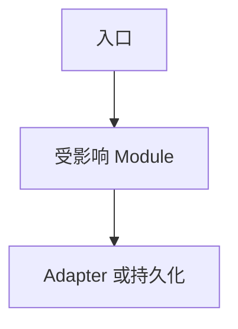

# <主题>Execution Plan

<!-- 完整核心生产 symbol 和行为测试代码必须保留；代码外只写定位、依赖及代码无法表达的约束，不逐段讲解代码，不复制 Design 或增加过程报告。成稿删除填写提示。 -->

<!-- 生产和测试代码块均按项目格式化规则排版；只整理文档内代码，不改写真实实现文件。 -->

## 变更链路



## 实施任务

### TASK-001：<可观察领域结果>

约束：
- <代码无法直接表达的外部合同或兼容限制>

<!-- 必须保持业务约束及明确保留的签名/装配。新增类、方法等单元可等价简化；已有单元只做需求必要修改、本次引入问题的局部修复或用户明确指定的重构。完整 symbol 展示不授权整理旧代码；非阻断结构建议写在现有约束中，不作为必须执行的 TASK。Files 只列本 TASK 所需文件；删除项注明 symbol、依据和调用方调整，不给修改后代码。 -->

<!-- 遵循“非必要、勿新增”：每个 Add、Test、依赖或配置变更都必须有当前行为、合同、验证或构建前置条件；先复用已有能力，不为未来变体、排版偏好或调查过程增加文件或抽象。 -->

构建范围：`<构建根或模块>`

公共验证入口：`<现有/新增；仓库相对测试路径#symbol>`

**Files:**
- Modify: `module/src/main/java/example/Target.java`
- Test: `module/src/test/java/example/TargetTest.java`

修改：

```java
// 每个文件给完整核心 symbol：字段、构造器、注解、公开/受影响方法及必要配置；省略 import。
<完整核心生产 symbol>
```

测试：

```java
// 从公共入口验证结果、状态或异常的完整可执行测试，不以测试意图或调用次数代替断言。
<从公共行为入口固定结果、状态或异常合同>
```

依赖：
- <仅在 TASK 顺序确实受影响时保留>
