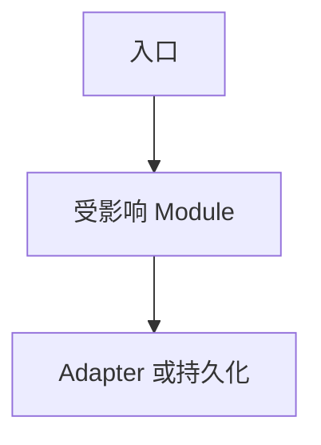

# <主题>Execution Plan

## 变更链路



## 实施任务

### TASK-001：<可观察领域结果>

约束：
- <代码无法直接表达的外部合同或兼容限制>

构建范围：`<构建根或模块>`

公共验证入口：`<现有/新增；仓库相对测试路径#symbol>`

**Files:**
- Modify: `module/src/main/java/example/Target.java`
- Test: `module/src/test/java/example/TargetTest.java`

修改：

```java
// 每个生产文件分别提供完整的新增或修改后核心 symbol。
// 必须包含相关字段、构造器、注解、公开/受影响方法和必要配置；不展示 import。
<完整核心生产 symbol>
```

测试：

```java
// 从公共行为入口开始，给出可直接执行的完整行为测试代码。
// 必须断言结果、状态或异常合同；不能只写测试意图、调用次数或 private 方法测试。
<从公共行为入口固定结果、状态或异常合同>
```

依赖：
- <仅在 TASK 顺序确实受影响时保留>
