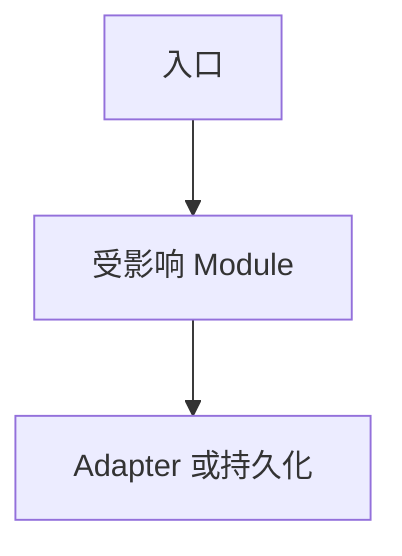

# <主题> Design

## 设计结论

<!-- 用 3–6 行直接说明采用什么方案、解决什么问题、主要边界和关键代价。不要重复 PRD，也不要写待定选择。 -->

## 方案全景

<!-- 按合同维度选择最小且可核查的表达形式；不同维度可以互补，但同一事实只能有一个权威来源。 -->

### 技术流程（按需）

<!-- 存在外部边界，或需要表达外部边界上的事务、异步、状态、并发或失败恢复时必须提供 Mermaid flowchart/sequenceDiagram；仅内部 Maven module/技术分层调用不触发该要求，纯模型/配置变化不要制造图。 -->

### 核心领域模型（按需）

<!-- 领域实体、值对象、聚合、领域事件或上下文关系变化时提供 Mermaid classDiagram 或其他适合形式；不要画 Controller/Service/Repository。 -->

### 持久化实体（按需）

<!-- 涉及持久化实体、Schema、JPA Entity 或实体关系变化时提供 Mermaid erDiagram 或结构化表格；只列本次相关字段和关系。 -->

## 关键设计与权衡

### <可读的设计结论或可独立挑战的问题>

<!-- 先写采用方案，再说明决定性证据、被否决方案、正负后果和重新评估条件。只有真实权衡才保留被否决方案。 -->

## 设计边界

<!-- 只说明系统与外部参与者/系统/服务/消息基础设施/调度器之间的负责与不负责、对外职责、外部运行时语义和兼容性判断。不要把内部 Maven module、技术分层、边界对象或对象转换写成设计边界。 -->

### 非功能设计（按需）

<!-- 只在本次设计受兼容性、安全、并发/一致性、性能/可用性或可观测性/恢复影响时保留；每项写约束及依据、设计措施与责任边界、失败/降级/恢复语义和验证观察面。没有触发主题时删除本小节。 -->

| 主题 | 约束及依据 | 设计措施/责任边界 | 失败、降级与恢复 | 验证观察面 |
| --- | --- | --- | --- | --- |

### 外部边界合同（按需）

| 边界 | 方向/触发 | 外部契约/语义所有者 | 输入契约及来源 | 输出/结果 | 失败与运行时语义 |
| --- | --- | --- | --- | --- | --- |

## 实施影响

### 变更职责链路

### TASK-001：<可观察结果>

- 覆盖需求：REQ-001、AC-001
- 结果：<用户或外部系统可观察的结果>
- 公共验证入口：<稳定的公开行为入口>
- 影响锚点：<真实入口、规则所有者、持久化点或外部边界>
- 验证观察面：<结果、状态、异常、消息或完整边界请求>
- 依赖：（按需）

## 验证与风险

<!-- 只说明技术上需要证明什么、观察面、验证层级和无法验证范围；只有存在明确且重要的技术风险时才补充风险及缓解，不要生成“主要风险与缓解”小节。交付前检查、自审清单、质量门禁、命令和执行结果属于内部流程，不写入 Design。 -->

- Design 风险级别：<低 / 高>
- Design 风险类型：<无 / 公共合同、迁移、所有权、一致性、安全等具体类型>
- 合同来源：<无 / 仓库相对路径，以逗号分隔>

<!-- 高风险指公共 API/RPC/MQ/调度合同、DDL/迁移/历史兼容、职责/所有权/依赖方向、事务/并发/幂等/一致性、状态机、不可逆副作用、安全、跨模块公共行为或部署协作。按真实合同声明，不使用关键词猜测。 -->
