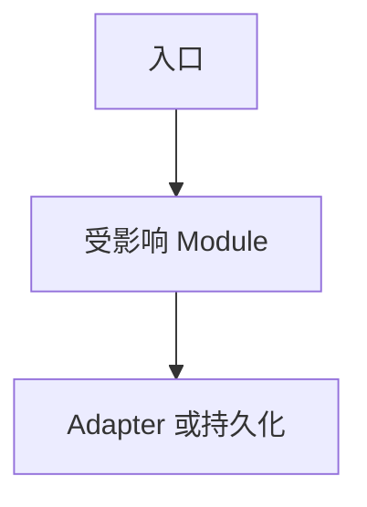

# <主题> Design

<!-- 使用最小充分表达：每个技术事实只写一次；删去不改变决定、边界、不变量、失败语义、所有权、追溯、验证或风险的句子。 -->

## 设计结论

<!-- 用 3–6 行直接说明采用什么方案、解决什么问题、主要边界和关键代价；不复述 PRD，也不预告后文章节。 -->

## 方案全景

<!-- 按合同维度选择最小且可核查的表达形式；同一语义只选择图、表或文字中的一种解释载体，其他章节只保留 ID、Symbol、路径或标题引用。没有关系变化时用一句话说明并删除下列可选小节。 -->

### 技术流程（按需）

<!-- 存在外部边界，或需要表达外部边界上的事务、异步、状态、并发或失败恢复时提供 Mermaid flowchart/sequenceDiagram；图替代同义流程叙述，只保留本次受影响节点。若下方变更职责链路足以表达同一事实，不再创建第二张图。 -->

### 核心领域模型（按需）

<!-- 领域实体、值对象、聚合、领域事件或上下文关系变化时提供 Mermaid classDiagram 或其他适合形式；只保留相关类型和关系，不画 Controller/Service/Repository。 -->

### 持久化实体（按需）

<!-- 涉及持久化实体、Schema、JPA Entity 或实体关系变化时提供 Mermaid erDiagram 或结构化表格；只列本次变化所需字段和关系。 -->

## 关键设计与权衡

### <可读的设计结论或可独立挑战的问题>

<!-- 每项优先用三行：采用方案；决定性依据；代价与重新评估条件。涉及版本、状态机、幂等、Schema 或恢复协议时，按 SKILL.md 的“Design 合同门禁”交代当前承载、目标语义和修改或迁移方式；模型或边界已表达时引用，不重复。只有真实权衡才增加被否决方案，不写通用最佳实践。 -->

## 设计边界

<!-- 只说明系统与外部参与者/系统/服务/消息基础设施/调度器之间的负责与不负责、对外职责、外部运行时语义和兼容性判断。优先使用下表，不再写同义段落。 -->

### 非功能设计（按需）

<!-- 只在本次设计受兼容性、安全、并发/一致性、性能/可用性或可观测性/恢复影响时保留；每项写约束及依据、设计措施与责任边界、失败/降级/恢复语义和验证观察面。没有触发主题时删除本小节。 -->

| 主题 | 约束及依据 | 设计措施/责任边界 | 失败、降级与恢复 | 验证观察面 |
| --- | --- | --- | --- | --- |

### 外部边界合同（按需）

| 边界 | 方向/触发 | 外部契约/语义所有者 | 输入契约及来源 | 输出/结果 | 失败与运行时语义 |
| --- | --- | --- | --- | --- | --- |

## 实施影响

### 变更职责链路

<!-- 只保留一份权威链路。面向人工评审说明受影响职责及协作关系；方案全景已有同义图时引用其标题，否则使用下图。具体文件定位写入 Executing交付的影响锚点。 -->

### TASK-001：<可观察结果>

<!-- 合并共享同一结果、信任边界、失败语义和验证入口的 REQ/AC；任一维度需独立实现或验证时拆分。每个字段优先一行。 -->

- 对应需求：REQ-001、AC-001
- 结果：<用户或外部系统可观察的结果>
- 输入与不变量：<必填/可选输入、首个信任边界及成立条件>
- 失败语义：<合同错误、查询未命中、外部故障等可区分结果>
- 验证观察面：<结果、状态、异常、消息或完整边界请求>

## 验证与风险

<!-- 按 TASK ID 汇总验证层级和无法验证范围，不重复 TASK 的结果、入口或观察面；只有存在明确且重要的技术风险时才补充风险及缓解。交付前检查、自审清单、质量门禁、命令和执行结果属于内部流程，不写入 Design。 -->

<!-- Execution 验收只列不依赖真实数据库、外部服务或部署环境的单元/行为测试。需要真实事务、唯一约束、repository 集成测试、SQL 执行计划或外部联调时，使用下列人工条目并保留未验证范围；不作为 Executing交付的入口、文件或依赖。无外部验证时删除该条目。 -->

- 人工外部验证：<TASK ID、验证事项及本地测试不能证明的范围>；不作为 Plan/Execution 门禁。

## Executing 交接

<!-- 本节只供 pretty-executing 定位和交接，按相同 TASK ID 对应“实施影响”，不重复设计语义。Add/Modify/DDL 必须覆盖前文选定的变更；声明“DDL 无”须与字段复用和历史兼容方案一致，已有查询入口不代表对账编排已实现。 -->

### TASK-001

- 公共验证入口：<现有/新增；仓库相对路径#symbol>
- 影响锚点：<按链路顺序列出现有/新增的仓库相对路径#symbol>
- Execution 交接：<构建根或模块；Add/Modify/Test/DDL 仓库相对路径，或无>
- 人工运维产物：<配置数据 DML，或无>
- 依赖：（按需）
