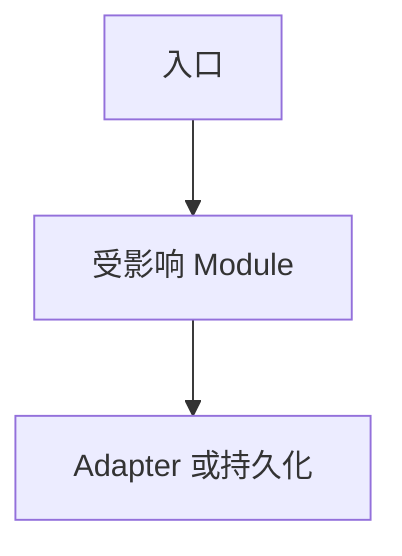

# <主题> Implementation Plan

## 变更链路



## 实施任务

### TASK-001：<可观察领域结果>

约束：
- <代码无法直接表达的外部合同或兼容限制>

**Files:**
- Modify: `module/src/main/java/example/Target.java`
- Test: `module/src/test/java/example/TargetTest.java`

修改：

```java
<完整核心生产 symbol>
```

测试：

```java
<从公共行为入口固定结果、状态或异常合同>
```

依赖：
- <仅在 TASK 顺序确实受影响时保留>
