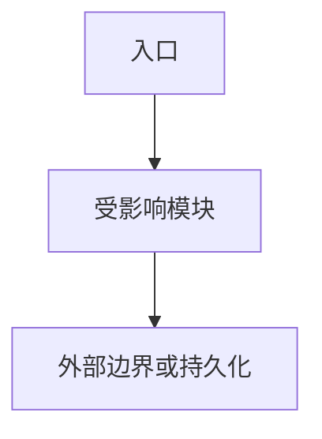

# <主题> Implementation Plan

## 变更链路



<仅在调用关系、交互顺序或状态迁移值得可视化时保留本节；简单任务可以省略。按需使用 flowchart、sequenceDiagram 或 stateDiagram-v2。>

## 实施任务

### TASK-001：<领域结果或独立风险>

约束：
- <只有存在不可改变的边界时才填写。>

**Files:**
- Modify: `module/src/main/java/...`
- Test: `module/src/test/java/...`

修改：

```java
<展示受影响的完整生产 symbol。>
```

测试：

```java
<展示公共行为入口、真实输入、必要边界替身和业务结果断言。>
```

依赖：
- <仅在依赖关系确实影响任务顺序时填写。>

### TASK-002：<另一个独立领域结果>

**Files:**
- Modify: `db/migration/...sql`

修改：

```sql
<完整 DDL 或其他声明性变更内容。>
```
