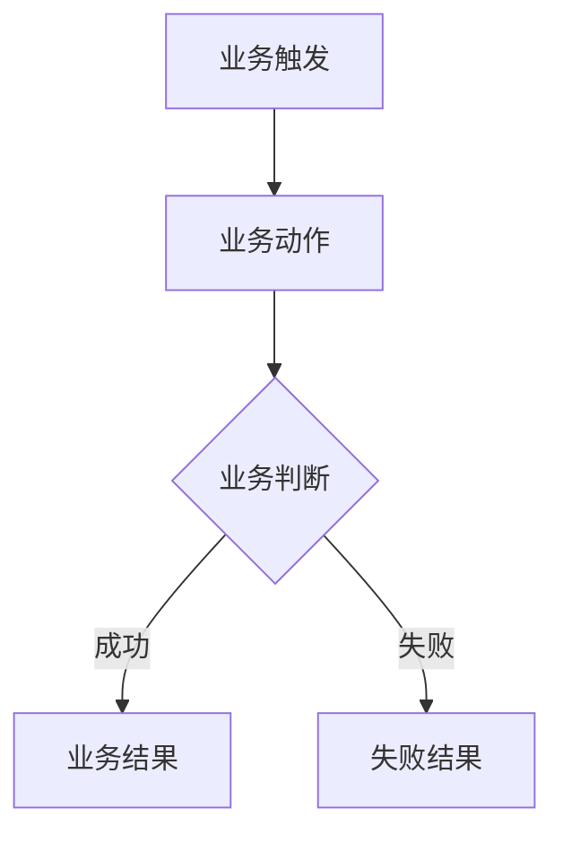

# <主题> PRD

<!-- 使用最小充分表达：每个业务事实只设一个权威落点；用户与场景保留独立阅读所需的业务结果概述，验收场景保留独立验证所需的具体条件、行为和结果。删去不改变业务决策、外部结果、边界或可验证性的句子。 -->

## 背景与问题

<直接写当前问题、受影响用户和现有可观察行为；不写方案、调查过程或历史叙述>

## 目标与非目标

**目标**

- <每项一行，只写可观察结果>

**非目标**

- <每项一行，只写本次明确排除的结果或边界>

## 用户与场景

<!-- 本节用自然语言写清角色或业务主体、背景、触发行为和可观察结果；禁止出现或链接引用需求编号、验收编号，含标题、正文、列表、表格和括号附注。读者无需跳转即可理解，不展开完整规则或验收细节。 -->

<简单需求只保留能解释触发与结果的场景；复杂需求仅为不同角色、触点或分支保留 3–6 个业务故事块>

- <简单需求：用户在什么场景下需要什么结果>

<复杂需求保留下列结构并复制必要的故事块；简单需求删除本段>

### <业务故事名称>

作为<真实角色>，我希望<业务目标>，以便<业务价值>。（仅在存在真实角色时保留本行）

在<具体业务背景>下，当<触发行为>时，<端到端可观察结果>。

## 核心用例流程（可选）

<!-- 仅复杂业务使用；只表达业务角色、业务动作、业务分支和业务结果，不表达技术实现。 -->

## 需求

### REQ-001：<需求名称>

<用最短完整句表达一个外部行为或业务规则；不重复背景、场景或验收示例>

## 验收标准

<!-- 标题和 Given/When/Then 必须使用实际业务语义，不得以“满足 REQ-001 的条件”“执行 REQ-001”“结果符合 REQ-001”等编号引用替代描述。需要追踪时，在场景描述之外单独写“关联需求：REQ-001”；读者无需查阅关联需求即可执行验收。 -->

### AC-001：<用业务语言描述验收结果>

- Given <具体业务前置条件>，When <实际触发行为>，Then <可观察、可验证的业务结果>。（同一结果的不同场景可增加条目；保留验收所需业务语义，不用 REQ 编号代替）

## Design 交接

<!-- 本节按触发保留，遵循“有则必记、无则不查”。这里只记录为确认当前行为已经读取的公共入口/测试定位，不指定未来实现。未读取时删除本节；只读取其中一项时，另一列写“未获取”。 -->

- 定位状态：`已核验`

| REQ/AC | 当前公共行为入口 | 当前公共验证入口 |
| --- | --- | --- |
| REQ-001 / AC-001 | `module/src/main/java/example/Entry.java#handle` | `module/src/test/java/example/EntryTest.java#returnsResult` |
