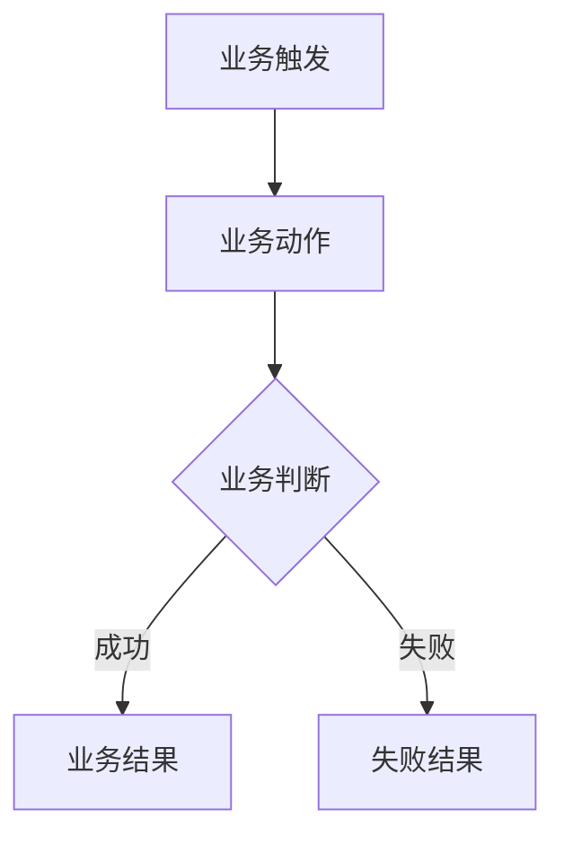

# <主题> PRD

<!-- 背景交代问题，场景概述触发与结果，REQ 定义规则，AC 给具体验收示例；不在四处复制同一段业务规则。删掉一句后不影响业务决定、边界或验收判断，就删除。成稿移除填写提示和未触发的可选章节。 -->

<!-- 遵循“非必要、勿新增”：先复用已有章节、术语和领域上下文；只有当前需求语义或领域建模门禁无法由现有承载表达时才新增故事、图、表或文件，并在已有章节说明其当前用途。不为未来变体、排版偏好或调查过程新增产物。 -->

## 背景与问题

<一段说明受影响用户、当前问题和可观察行为>

## 目标与非目标

**目标**

- <每项一行，只写可观察结果>

**非目标**

- <每项一行，只写本次明确排除的结果或边界>

## 用户与场景

<!-- 本节用自然语言写清角色或业务主体、背景、触发行为和可观察结果；禁止出现或链接引用需求编号、验收编号，含标题、正文、列表、表格和括号附注。读者无需跳转即可理解，不展开完整规则或验收细节。 -->

<!-- 简单需求用下方短列表；只有不同角色、触发或结果需要独立理解时才拆场景，不设故事数量下限。不在场景展开规则与验收细节。 -->

- <角色在何种背景下触发什么行为，得到什么结果>

<!-- 复杂场景可用下方结构替换短列表；同一场景只保留一种写法。 -->

### <业务故事名称>

<业务主体>在<具体背景>下，<触发行为>后得到<可观察结果>。

## 核心用例流程（可选）

<!-- 仅在图更容易说明复杂业务分支时保留；只画业务角色、动作、判断和结果，不画技术实现，不附逐节点文字复述。 -->

## 需求

### REQ-001：<需求名称>

<一个完整句定义独立业务规则及必要边界；多条件用短列表或表格，选一种表达>

## 验收标准

<!-- 标题和 Given/When/Then 必须使用实际业务语义，不得以“满足 REQ-001 的条件”“执行 REQ-001”“结果符合 REQ-001”等编号引用替代描述。需要追踪时，在场景描述之外单独写“关联需求：REQ-001”；读者无需查阅关联需求即可执行验收。 -->

### AC-001：<用业务语言描述验收结果>

- Given <具体业务条件>，When <实际动作>，Then <可验证结果>。

<!-- 同一结果的不同输入在本 AC 下增加条目；不复制 REQ 全部规则，也不用编号代替条件或结果。 -->

## Design 交接

<!-- 本节按触发保留，遵循“有则必记、无则不查”。这里只记录为确认当前行为已经读取的公共入口/测试定位，不指定未来实现。未读取时删除本节；只读取其中一项时，另一列写“未获取”。 -->

- 定位状态：`已核验`

| REQ/AC | 当前公共行为入口 | 当前公共验证入口 |
| --- | --- | --- |
| REQ-001 / AC-001 | `module/src/main/java/example/Entry.java#handle` | `module/src/test/java/example/EntryTest.java#returnsResult` |
