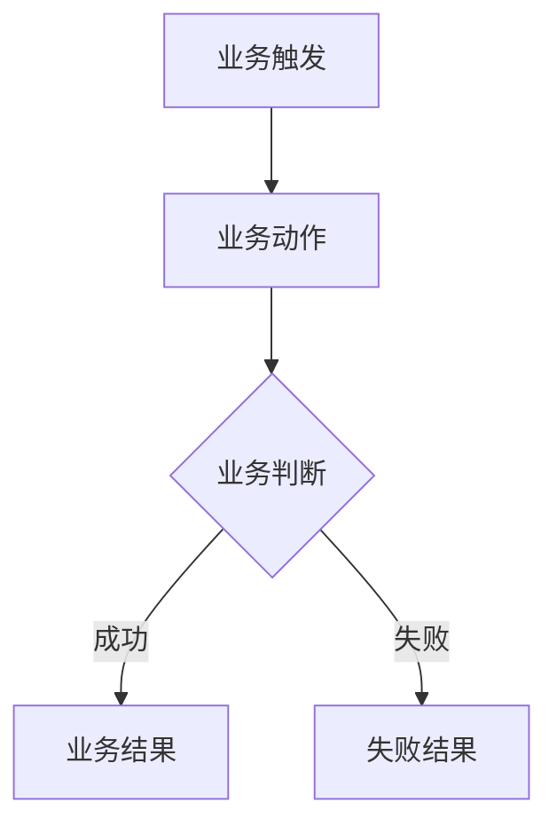

# <主题> PRD

## 背景与问题

<当前问题、受影响用户和仓库中的现有行为>

## 目标与非目标

**目标**

- <目标>

**非目标**

- <明确不做什么>

## 用户与场景

<简单需求保留下一行；复杂需求删除下一行并使用 3–6 个业务故事块>

- <简单需求：用户在什么场景下需要什么结果>

<复杂需求保留下列结构并复制必要的故事块；简单需求删除本段>

### <业务故事名称>

作为<真实角色>，我希望<业务目标>，以便<业务价值>。（仅在存在真实角色时保留本行）

在<具体业务背景>下，当<触发行为>时，<端到端可观察结果>。

## 核心用例流程（可选）

<!-- 仅复杂业务使用；只表达业务角色、业务动作、业务分支和业务结果，不表达技术实现。 -->

## 需求

### REQ-001：<需求名称>

<外部可观察行为或业务规则>

## 验收标准

### AC-001：<验收结果>

- Given <前置条件>，When <行为>，Then <可验证结果>。
