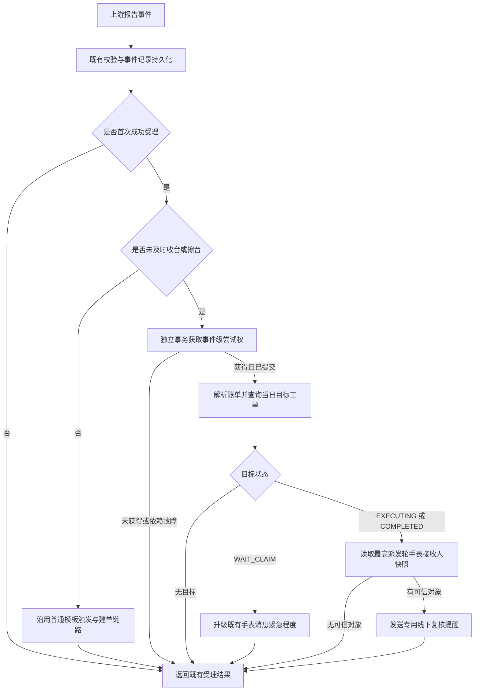

# 未及时收台与擦台事件附加触达 Design

## 设计结论

采用“事件正常受理、特殊事件前置分流、附加触达至多一次”的方案。`CLEAR_TABLE_NOT_DONE` 固定关联 `TemplateConstants.TemplateCode.CLEAR_TABLE`，`WIPE_TABLE_NOT_DONE` 固定关联 `TemplateConstants.TemplateCode.WIPE_TABLE`。两类事件首次成功受理并形成事件记录后，不进入模板触发、普通规则、建单、派发和普通触达链路，而是在本次同步请求内消费一次不可释放的附加触达尝试权。

目标工单只从事件 `occurredAt` 所属自然日内、同门店、同点位、同桌台账单、同固定模板且状态为 `WAIT_CLAIM`、`EXECUTING` 或 `COMPLETED` 的有效工单中选择。候选按 `create_time DESC, id DESC` 稳定排序，应用层复用 `TableBillIdResolveSupport` 完成账单精确比对，只取第一条完整匹配记录。`CANCELED`、跨日、账单不一致以及失效记录均不得入选。

`WAIT_CLAIM` 目标只调用云手表现有消息紧急升级接口；`EXECUTING` 和 `COMPLETED` 目标只向最高派发轮次中被云手表服务聚合接受、并由本系统固化的员工请求快照发送专用复核提醒。现有派发目标、工单状态、处理人和业务内容均不修改。最高轮没有可信手表快照时接收人为空，不从更早轮次、当前处理人、历史候选人或临时人员推断。

并发防重使用独立的事件附加触达尝试表，以 `event_id` 唯一插入作为尝试权获取结果。插入在远程副作用前独立提交；成功、合法跳过、依赖失败、超时或远程结果未知都视为尝试权已经使用，不释放、不补偿、不自动重试。附加流程的任何结果只通过内部状态和日志观察，不改变事件成功受理结果，也不进入上游响应。

本次需要 Java、行为测试及结构性 DDL 文件；DDL 只进入代码库，质量门禁不连接数据库。两类事件定义及其启停属于人工运维配置数据 DML，且不得建立普通模板关系。`CONTEXT.md` 与 ADR 已覆盖本设计的领域语言和长期决策，无需修改。

## 方案全景

### 运行流程

同步边界固定在现有事件报告请求内。事件主记录成功受理是前置事实，尝试权提交是远程副作用的前置事实；目标查询、紧急升级和二次提醒均不得参与事件主记录事务。特殊分支完成、跳过或失败后直接返回原事件结果，不等待异步任务、MQ 或调度补偿。

### 职责与依赖

内部职责链遵守 `web -> application -> domain`，持久化端口由 `infra` 实现，云手表端口由 `adapter` 实现：

- `EventReportController`、`EventCommandBizImpl` 和既有 Qo/DTO/VO 转换保持对外契约不变。
- `EventIngestBizImpl` 在首次成功受理后、`TemplateTriggerOrchestrateAppService` 之前识别两类特殊事件；普通事件继续走原编排。
- 新增应用服务承接尝试权获取、目标匹配和状态分支，只依赖领域查询端口、领域持久化端口与外部触达端口，不直接依赖 repository、mapper 或远程 SDK。
- 领域层拥有事件类型映射、尝试权、目标匹配条件、最高轮可信快照和触达命令的合同；不依赖 `infra` 或 `adapter` 实现。
- `infra` 提供尝试权原子插入、目标工单有序候选查询、最高派发轮及手表接收人快照读取与持久化。
- `adapter` 扩展紧急升级能力，并为专用二次提醒组装真实 `RemoteMessageDto` 后调用 `PushEventRemote`。

### 数据事实

新增 `t_event_additional_touch_attempt`，以 `event_id` 作为业务唯一键。必要字段包括尝试记录标识、事件标识、事件类型、领取状态、领取时间、结果编码、目标工单标识、结束时间以及审计字段。领取状态在插入成功时即固定为已领取；结果字段允许为空，因为进程退出或结果未知不能让尝试权重新可用。表和全部字段均带业务注释。

新增 `t_work_order_watch_recipient_snapshot`，一条记录表示某工单某派发轮次的一次云手表请求被远端聚合接受后，本系统固化的完整请求收件人集合。必要字段包括快照标识、工单标识、派发轮次、渠道请求标识、规范化员工快照 JSON、远端接受时间以及审计字段。业务唯一键固定为 `work_order_id + dispatch_round + channel_request_id`；快照标识是独立生成的记录主键，渠道请求标识为空或无法稳定归属时不创建可信快照。建立按工单和轮次读取的组合索引。员工快照保留 `employeeCode`、`employeeName`，只有原请求真实携带岗位信息时才保留 `jobCode`、`jobName`，不得从派发岗位反推员工岗位。

目标工单查询在 `t_work_order_record` 上增加专用组合索引，覆盖有效状态、门店、点位、模板、工单状态、创建时间和主键。查询使用发生日零点到次日零点的左闭右开范围，并按创建时间、主键倒序返回候选；账单仍从既有 payload 快照解析，不增加冗余账单列。

### 人工配置合同

人工运维配置两条 `t_event_define` 数据：来源类型固定为 `AI,SYSTEM`，点位类型固定为 `SHOP_TABLE`，payload schema 保留 `tableBillId`、兼容字段 `orderId` 以及可能承载两者的 `detail`；事件定义在代码和结构性 DDL 已具备后再人工启用。两类事件在 `t_event_define_template_relation` 中必须没有有效关系，防止配置误操作绕过代码分流进入普通模板链路。人工验收需核对编码唯一、来源与 schema 一致、点位类型正确、启用状态符合投产步骤以及普通模板关系为空。

## 关键设计与权衡

### 特殊分流与兼容结果

两类特殊事件继续沿用现有事件类型、来源、门店、点位、payload schema 和唯一键校验。只有结果为 `ACCEPTED_READY_FOR_RULE` 且确实由当前请求首次形成事件记录时才能进入附加用例；`IGNORED_DUPLICATE`、拒绝结果和其他结果直接返回。特殊事件保持 `workOrderId`、`workOrderIds` 为空，不写入事件与目标工单关系。

仅在 `EventIngestBizImpl` 跳过 `TemplateTriggerOrchestrateAppService` 不足以构成长期保护。普通规则的显式重放入口和统一事件处理入口也必须共享同一特殊事件类型策略，对两类事件执行无副作用跳过，避免人工重放或未来恢复任务重新建单。普通事件及既有 `CLEAR_TABLE`、`WIPE_TABLE` 事件不命中该策略，保持原行为。

### 目标工单选择

首个信任边界位于应用层附加触达服务。事件的门店、点位、发生时间、账单和类型映射先完成规范化；任一必要值缺失或账单解析失败均形成合法的“无目标”结果，不扩大匹配范围。发生日使用应用当前业务时区 `Asia/Shanghai` 计算自然日边界，避免按受理时间或数据库日期函数造成跨日偏差。

领域查询端口接收门店、点位、唯一目标模板、三个允许状态、日始和次日始。`infra` 只按结构化字段、有效记录和时间范围缩小候选并保证稳定倒序；应用层对事件和每个候选复用 `TableBillIdResolveSupport`，按排序顺序选出第一条账单完全相等的记录。相同创建时间通过主键倒序消除并列歧义，其他候选不再触达。

选择过程只读目标工单，不加业务锁，也不写主表、状态日志、参与关系或事件工单关系。查询时目标状态是选择条件；选择后到远程调用之间即使工单状态并发变化，本次仍按已选快照执行附加提醒，因为附加动作不改变工单且尝试权不能恢复。该竞态通过事件标识、目标工单标识和所选状态日志观察，不以二次读取触发另一种动作。

### 至多一次与事务边界

尝试权必须在解析、查询和远程调用之前获取。领域端口执行单行唯一插入并使用独立本地事务提交；唯一键冲突只表示尝试权已被使用，不抛出需要重试的业务错误。数据库不可用、事务超时或提交结果不确定时，附加流程按失败结束且不执行远程动作，事件受理结果保持不变。

获得尝试权后不删除记录、不把领取状态改回可用，也不因无目标、无接收人、远程拒绝、异常、超时或返回结果未知而释放。结果编码和结束时间只是尽力写入的内部观察字段；结果回写失败不能重新开放尝试权。该设计选择避免重复打扰，代价是单次故障可能丢失提醒，与 ADR 的至多一次决策一致。

两个云手表调用均只允许一次应用调用，并使用零 RPC 重试配置，禁止复用普通工单执行域的重试策略。未取得远端逐员工回执，因此远端聚合成功只表示该次请求被服务接受，不能宣称每名员工设备均已收到；快照只记录请求接受事实，不写入逐员工 `ACKED` 或 `SENT` 状态。

### 手表接收人快照

现有 `t_work_order_dispatch_record` 的 `dispatch_target_type` 和 `dispatch_target_code` 表达派发目标，岗位派发时不等于实际员工；`selected_employee_*`、`delivery_snapshot_json` 也没有在当前普通手表发送链路中形成可证明的完整接收人事实。因此本设计不覆盖这些字段，也不把岗位记录改写为人员记录。普通事件的原派发记录仍由既有派发域拥有，新增快照表只拥有“远端接受的员工请求集合”这一审计事实。

普通手表请求的 `dispatchRound` 从既有 `DispatchResult` 透传到执行命令。`WatchDeviceDeliveryGatewayAdapter` 以实际发送的规范化 `employeeList` 形成领域收件人快照，并随聚合接受结果返回；`WorkOrderExecuteDomainServiceImpl` 只在远端返回成功且 `channel_request_id` 可稳定归属时通过独立领域端口固化新快照。该端口只能新增快照记录，不得更新或覆盖 `t_work_order_dispatch_record` 的 `dispatch_target_type`、`dispatch_target_code`、`selected_employee_*`、`dispatch_status`、`delivery_status` 或其他原派发字段。快照持久化失败不反向改变普通手表发送结果，但该轮因此没有可信快照，未来未及时事件必须跳过二次提醒。

读取接收人时，先从既有派发记录确定最高 `dispatch_round`，再只读取该轮的手表接受快照。最高轮无快照、快照损坏或员工集合为空时返回空，不查询更早轮次。最高轮存在多条聚合接受快照时，按接受时间和主键稳定排序，并按 `employeeCode` 合并去重；所有员工都必须来自这些真实请求，不能从当前处理人或关系表补齐。上线前存量工单通常没有新快照，因此可能不发送二次提醒，这是为可信对象边界接受的兼容代价。

### 两种外部动作

待接单分支扩展 `WatchMessageRemoteGateway`，以单个目标工单号和 `WorkOrderWatchProperties.messageSourceFromCode` 调用 `MessageCallbackRemote.upgradeMessageToUrgent`。远端返回为空、失败或抛出异常均视为本次动作失败；不得创建新手表任务替代，也不得调用普通 `ExecuteWorkOrderCommand`。

执行中和已完成分支使用独立的专用提醒领域端口。适配器调用 `PushEventRemote.pushEvent`，边界请求固定为：

| 字段 | 合同 |
| --- | --- |
| `eventType` | 沿用当前手表工单消息类型 `WOKR_ORDER` |
| `psCode` | 目标工单门店编码 |
| `tableNo` | 目标工单点位编码 |
| `businessId` | 目标工单标识 |
| `businessIdDedup` | `false`，避免被原工单首次消息去重 |
| `title` | 收台或擦台未及时复核提醒 |
| `msg` | 明确对应作业未及时并要求员工线下复核 |
| `employeeList` | 最高派发轮可信快照中的规范化员工集合 |

聚合返回对象成功才表示请求被远端接受；失败、空返回、异常或超时均不重试。两种动作都不得写目标工单，不向上游暴露外部请求或结果。

### 代码质量约束

Java 实现以仓库 `JDK 1.8` 为基线，不使用更高版本语法或标准库。新增业务代码默认不增加流程翻译式注释，不写编号注释或临时待办注释；仅在命名和类型无法表达至多一次、事务顺序或外部限制时解释原因。新增日志不得打印 payload、完整员工集合或复杂实体，单条日志最多保留三个关键业务字段，优先使用事件标识、目标工单标识和结果编码。

## 设计边界

### 上游事件报告方

公共入口仍为 `POST /api/event-center/events/report`，请求和 `EventReportResponseVO` 不新增字段。合法特殊事件无论附加动作成功、跳过或失败，都只返回既有事件受理结果；目标工单标识、目标状态、动作类型、员工、远端结果和失败原因均不得进入 `workOrderId`、`workOrderIds`、`reasonDesc` 或其他响应字段。非法事件请求继续由既有校验和异常合同处理，不因本需求改为成功。

### 工单数据库

本系统拥有事件记录、附加触达尝试权、工单主记录、派发记录和手表接收人快照。事件记录唯一键继续负责首次受理，尝试表唯一键负责附加副作用资格，两者职责不可合并。目标工单和既有派发目标为只读事实；新接收人快照是普通手表请求被聚合接受后的不可变审计事实，不代表逐员工设备回执。

结构性 DDL 仅作为代码库文件交付，数据库变更、迁移、发布和数据库验证不属于本流程。事件定义配置数据、启用、禁用和配置回滚由人工运维承担，Execution 不生成也不执行配置数据 DML。

### 云手表服务

待接单动作使用依赖版本 `cloud-bracelet-api:1.2.5.9-SNAPSHOT` 中的 `MessageCallbackRemote.upgradeMessageToUrgent`；专用提醒使用同一依赖中的 `PushEventRemote.pushEvent`。本系统只把远端聚合成功当作请求被接受，不扩展为逐员工投递成功承诺。调用超时或结果不确定时不查询补偿、不自动重试，事件受理和目标工单保持不变。

### 消息与调度基础设施

特殊事件不发布用于普通规则、建单或普通触达的 MQ 消息，不进入失败事件扫描任务、延迟模板恢复或其他重放调度。现有消息和调度基础设施只继续服务普通事件。本需求不新增补偿任务，也不授权人工通过重复上报触发补发。

## 实施影响

### 变更职责链路

`EventReportController -> EventCommandBizImpl -> EventIngestCmdHandler -> EventIngestBizImpl` 保持公共入口；首次成功受理后由特殊事件类型策略在 `TemplateTriggerOrchestrateAppService` 之前分流到附加触达应用服务。该服务依次通过领域端口获取尝试权、查询目标工单、读取最高轮手表接收人，并按状态调用云手表紧急升级或专用提醒端口。`infra` 只实现数据库端口，`adapter` 只实现远程端口；显式规则重放和统一事件处理入口复用相同策略阻断特殊事件进入普通链路。

### TASK-001：特殊事件首次受理后只进入附加触达分支

- 覆盖需求：REQ-001、REQ-002、REQ-010、REQ-012、AC-001、AC-002、AC-018、AC-019
- 结果：两类未及时事件首次成功受理后同步进入专用附加触达用例且不触发普通规则、建单、派发或普通触达；特殊事件响应不包含目标与触达信息，其他事件保持原行为。
- 输入与不变量：公共入口先完成既有 Qo、DTO、领域命令校验并持久化事件；只有当前请求形成的 `ACCEPTED_READY_FOR_RULE` 记录且事件类型为两个固定编码时分流，固定映射分别为 `CLEAR_TABLE` 和 `WIPE_TABLE`，事件工单关系始终为空。
- 失败语义：非法请求继续返回既有拒绝或异常结果；重复事件返回 `IGNORED_DUPLICATE` 且不进入附加用例；特殊分流内部异常被隔离并返回原成功受理结果；合法普通事件不受特殊分流影响。
- 公共验证入口：`POST /api/event-center/events/report` 以及既有事件结果查询入口。
- 影响锚点：`EventReportController`、`EventCommandBizImpl`、`EventIngestCmdHandler`、`EventIngestBizImpl`、`TemplateTriggerOrchestrateAppService`、`EventRuleDispatchBizImpl`、`EventProcessAppServiceImpl`、`EventReportResponseVO`。
- 验证观察面：事件结果码与响应字段、事件记录及事件工单关系、普通模板编排与建单入口调用次数、普通事件回归结果。
- Execution 交付：特殊事件类型策略、首次受理后的应用分流与普通规则入口保护 Java，实现相应应用单元测试、入口契约测试和普通事件回归测试。
- 人工运维产物：两条事件定义配置数据 DML；固定 `source_type=AI,SYSTEM`、`point_type=SHOP_TABLE`、payload schema 保留账单兼容字段，人工控制启用状态，并验证不存在有效模板关系。

### TASK-002：精确且稳定地选择唯一目标工单

- 覆盖需求：REQ-003、REQ-004、REQ-007、REQ-009、AC-003、AC-004、AC-005、AC-010、AC-012、AC-015、AC-016
- 结果：系统只从事件发生日内同门店、同点位、同账单、同固定模板和三个目标状态的有效工单中选择创建时间与主键倒序的第一条；无目标时静默结束。
- 输入与不变量：事件类型、门店、点位、发生时间和账单是匹配必需值；发生日按 `Asia/Shanghai` 计算左闭右开时间范围；候选状态仅为 `WAIT_CLAIM`、`EXECUTING`、`COMPLETED`，账单比较复用 `TableBillIdResolveSupport` 并采用精确相等。
- 失败语义：入口级非法时间由既有校验拒绝；事件或候选账单缺失、解析失败以及合法查询未命中均返回无目标且不触达；数据库查询异常或超时终止剩余附加动作并保持事件成功受理，不回退到较旧、跨日、取消或账单不一致工单。
- 公共验证入口：`POST /api/event-center/events/report`，通过持久化候选和云手表边界调用观察最终选择。
- 影响锚点：`TableBillIdResolveSupport`、`WorkOrderRecordEntity`、`WorkOrderActiveQuery`、`WorkOrderRecordGateway.listByQuery`、`WorkOrderRecordGatewayImpl`、`WorkOrderServiceImpl.listByParam`、`t_work_order_record`。
- 验证观察面：选中的唯一工单标识、候选稳定顺序、无目标结果、云手表边界是否未调用、事件结果与目标工单持久化快照是否不变。
- Execution 交付：专用领域查询对象与查询端口、infra 查询实现、账单过滤与稳定选择 Java，行为测试，以及只写入代码库的工单组合查询索引结构性 DDL 文件。
- 人工运维产物：无。

### TASK-003：并发与重复处理最多消费一次附加触达尝试权

- 覆盖需求：REQ-008、REQ-009、AC-013、AC-014、AC-016
- 结果：同一已受理事件最多有一个处理者在尝试权提交后继续查询和触达；重复上报、并发上报、人工重放和进程恢复都不能再次执行附加动作。
- 输入与不变量：尝试权键固定为已持久化事件的 `event_id`；领取发生在任何匹配或远程副作用之前，使用独立本地事务和数据库唯一键原子提交，后续任何结果均不释放该记录。
- 失败语义：唯一键冲突表示已消费并静默跳过；事件标识为空属于合同错误且不调用端口；数据库不可用、提交异常、超时或提交结果不确定时停止附加流程且不执行远程动作；领取后进程退出仍视为已消费。
- 公共验证入口：`POST /api/event-center/events/report`，并通过相同事件身份的串行、并发报告及公开规则重放入口验证。
- 影响锚点：`EventIngestBizImpl`、附加触达应用服务、新增事件尝试权领域端口及 infra 实现、`t_event_record.uk_event_type_source_event`、`t_event_additional_touch_attempt`。
- 验证观察面：事件记录数量、尝试权唯一记录、目标查询与两个云手表边界的调用次数、重复响应、依赖故障后的事件结果。
- Execution 交付：尝试权领域模型、领域端口、独立事务的 infra 原子领取与尽力结果记录 Java，串行及并发行为测试，以及只写入代码库且包含表/字段注释和唯一键的结构性 DDL 文件。
- 人工运维产物：无。

### TASK-004：待接单目标只升级既有手表消息紧急程度

- 覆盖需求：REQ-005、REQ-009、REQ-011、AC-006、AC-017
- 结果：唯一目标为 `WAIT_CLAIM` 时，只对该工单已有云手表消息执行一次紧急升级，不创建新消息或新工单，不修改工单及派发关系。
- 输入与不变量：调用前必须已提交事件尝试权并选出唯一待接单目标；远程请求只含该工单标识列表和 `WorkOrderWatchProperties.messageSourceFromCode`，默认来源编码为 `HSC_WORK_ORDER`；应用与 RPC 均不得重试。
- 失败语义：工单标识或来源编码无效属于边界合同错误并终止动作；远端空返回、失败、异常、超时或结果不确定均记录为本次已消费失败，不改事件结果和目标工单，也不改发专用二次提醒兜底。
- 公共验证入口：`POST /api/event-center/events/report`，以云手表紧急升级完整边界请求和持久化不变性作为观察依据。
- 影响锚点：`WatchMessageRemoteGateway`、`WatchMessageRemoteGatewayAdapter`、`WorkOrderWatchProperties.messageSourceFromCode`、`MessageCallbackRemote.upgradeMessageToUrgent`。
- 验证观察面：紧急升级远程调用次数与完整参数、普通手表推送及建单入口未调用、事件响应、目标工单和派发记录前后状态。
- Execution 交付：领域远程端口扩展、adapter 紧急升级实现、零重试 RPC 配置及行为测试；无结构性 DDL。
- 人工运维产物：无。

### TASK-005：执行中或已完成目标只提醒最高派发轮可信员工

- 覆盖需求：REQ-006、REQ-007、REQ-009、REQ-011、AC-007、AC-008、AC-009、AC-011、AC-017
- 结果：唯一目标为 `EXECUTING` 或 `COMPLETED` 时，系统向最高派发轮中被云手表服务聚合接受并固化的员工集合发送一次专用线下复核提醒；无可信对象时不发送，工单状态和处理关系保持不变。
- 输入与不变量：普通手表发送链路只有在 `PushEventRemote` 返回聚合成功后才固化实际请求的规范化员工集合和派发轮次；读取时先确定最高派发轮，再只合并该轮快照并按 `employeeCode` 去重；专用提醒使用固定 `RemoteMessageDto` 字段合同且应用与 RPC 均不得重试。
- 失败语义：最高轮不存在可信快照、快照为空或损坏属于合法无对象并静默跳过；快照查询故障终止剩余动作；远端失败、空返回、异常、超时或结果不确定均消耗本次尝试且不重试；聚合成功不能解释为每个员工设备逐一成功。
- 公共验证入口：`POST /api/event-center/events/report`，并通过普通事件报告入口先形成可读的手表接受快照，再观察专用提醒边界。
- 影响锚点：`DispatchResult`、`ExecuteWorkOrderCommand`、`WorkOrderExecuteDomainServiceImpl`、`WatchDeviceDeliveryGatewayAdapter`、`WorkOrderDispatchRecordService.findLatestByWorkOrderId`、`PushEventRemote.pushEvent`、新增手表收件人快照领域端口与 infra 实现、专用提醒领域端口与 adapter、`t_work_order_watch_recipient_snapshot`。
- 验证观察面：普通手表接受快照的派发轮次与员工字段、最高轮选择、专用 `RemoteMessageDto` 完整请求、远程调用次数、无对象分支、事件响应和目标工单持久化不变性。
- Execution 交付：派发轮次透传、聚合接受快照固化与读取、专用提醒领域端口和 adapter Java，消息字段映射及状态组合行为测试，以及只写入代码库且包含表/字段注释、业务唯一键和查询索引的结构性 DDL 文件。
- 人工运维产物：无。

## 验证与风险

### 行为验证矩阵

| 维度 | 组合 | 必须观察的结果 |
| --- | --- | --- |
| 事件类型 | 两类特殊事件、`CLEAR_TABLE`、`WIPE_TABLE`、其他普通事件 | 特殊事件固定映射且不建单；其他事件保持普通链路 |
| 受理身份 | 首次、串行重复、并发重复、显式重放 | 仅首次且唯一尝试权持有者可继续；其余无远程副作用 |
| 匹配维度 | 同日/跨日、同店/异店、同点位/异点位、同账单/异账单、账单缺失或损坏 | 只有全部维度成立者入选，缺失和解析失败不降级 |
| 目标状态 | `WAIT_CLAIM`、`EXECUTING`、`COMPLETED`、`CANCELED` | 分别执行紧急升级、专用提醒、专用提醒、无动作 |
| 唯一选择 | 一条、多条不同创建时间、多条相同创建时间 | 只选 `create_time DESC, id DESC` 的第一条完整账单匹配工单 |
| 接收人 | 最高轮有一人、多人、多个接受快照、空或损坏、仅早期轮有快照 | 只合并最高轮真实请求员工并去重；无最高轮可信对象时不发送 |
| 依赖结果 | 查询成功/失败、领取成功/冲突/不确定、远端成功/失败/空返回/异常/超时、快照写入成功/失败 | 仅合同允许的动作发生，失败和不确定结果不重试且不改变事件受理；普通事件远端成功但快照写入失败时仍保持原建单与触达结果，且不产生可信快照 |
| 上游兼容 | 动作成功、无目标、无对象、依赖失败 | 响应始终不包含目标工单、动作、员工或附加失败信息 |

测试以稳定公共入口和真实端口边界为主：入口契约测试验证 HTTP 响应；应用测试验证规则入口、目标选择和副作用次数；infra 测试验证唯一插入、有序查询与最高轮读取；adapter 测试捕获紧急升级参数和完整 `RemoteMessageDto`。普通事件公开入口必须分别覆盖远端成功且快照成功、远端成功但快照失败、远端失败或结果未知三组场景，断言原响应和工单处理结果保持既有语义、远程调用不增加、原派发记录逐字段不变，并且只有聚合成功且快照落库成功的场景产生可信快照。并发测试必须使用能真实触发唯一键竞争的持久化边界，不能只用顺序 mock 证明并发。DDL 仅验证文件结构、注释、键和索引定义，不连接或修改数据库。

### 可观测性

内部结果编码至少区分已领取、重复跳过、无目标、无接收人、查询失败、紧急升级接受/失败、二次提醒接受/失败和结果不确定。日志不改变上游合同，也不打印 payload、收件人列表或完整复杂实体。事件标识贯穿附加用例；涉及目标后使用目标工单标识，结果日志使用结果编码，单条日志最多保留三个关键业务字段。

### 主要风险与控制

- **远端已处理但本地只得到超时或不确定结果**：尝试权保持已消费，禁止重试；可能漏记成功，但不会重复打扰员工。
- **普通手表请求成功但快照持久化失败**：普通派发结果不回滚，最高轮被视为没有可信对象，后续二次提醒跳过。
- **存量工单没有新快照**：不从派发岗位、参与关系或历史处理人推断，接受上线初期部分二次提醒缺失。
- **工单选择后状态并发变化**：按选择时状态执行单一动作，不二次分流；所有动作不修改目标工单，事件尝试权仍只消费一次。
- **事件定义误绑普通模板**：代码入口仍有特殊类型保护，人工启用前必须核对有效模板关系为空。
- **组合查询扫描过大**：infra 先用结构化字段和半开日期范围收窄并使用专用索引，应用只对有序候选解析账单 JSON。
- **远端只提供聚合返回**：测试和日志只陈述请求被服务接受，不把结果扩大为逐员工设备送达证明。

进入 Apply 前需由用户 Review 并批准本 Design。批准后，Apply 使用 `$pretty-executing`；如只需查看非权威执行预览，使用 `$pretty-executing Dry Run` 生成 `execution-preview.md`。
