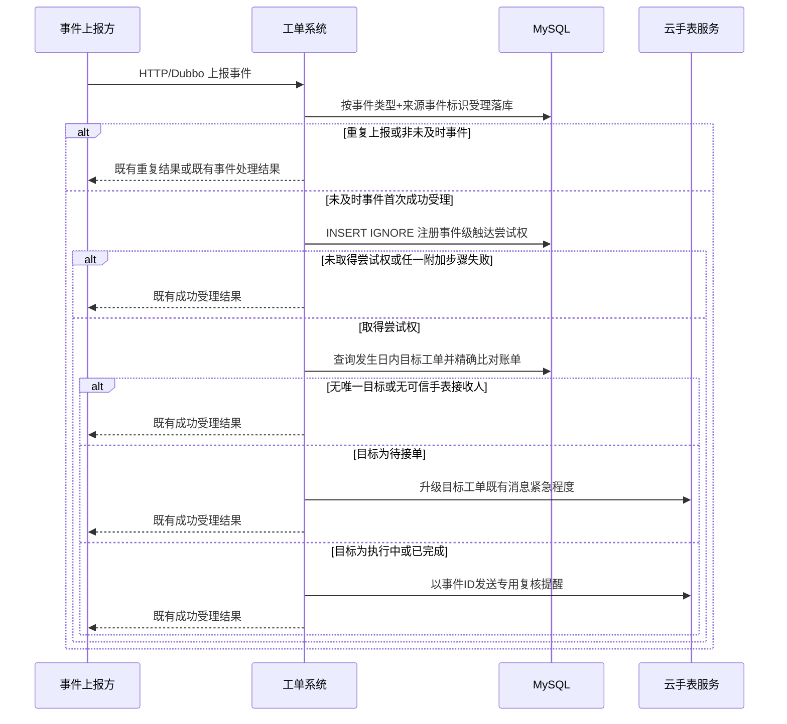
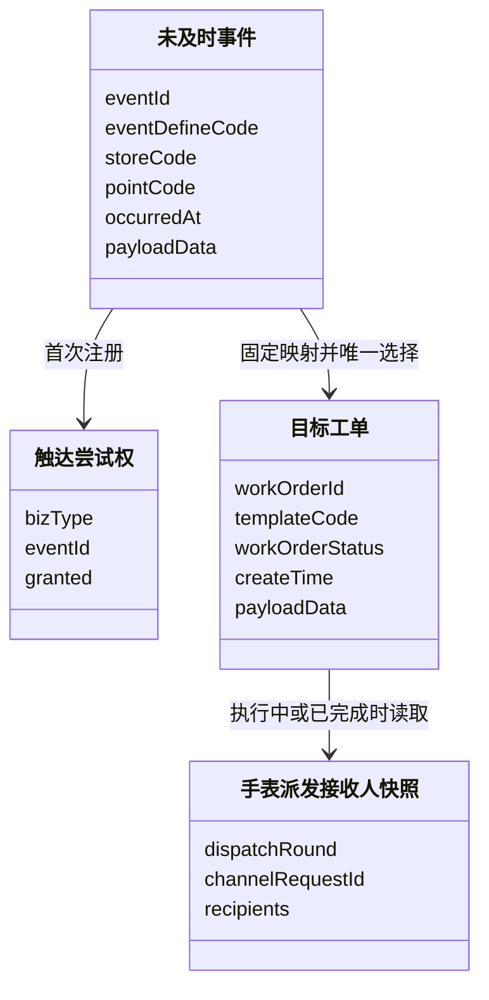
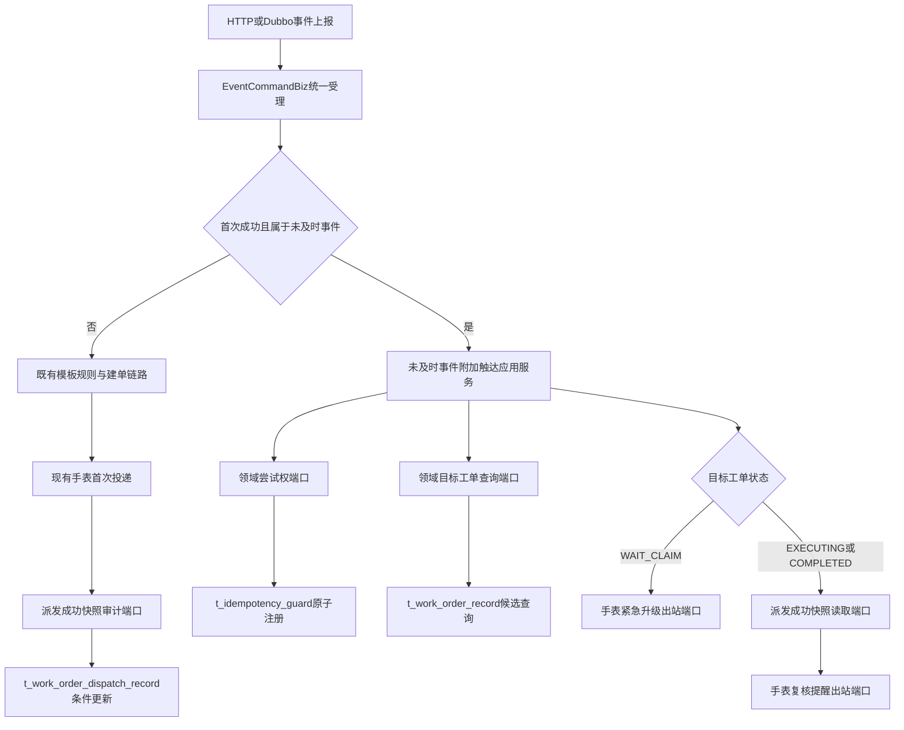

# 未及时收台与擦台事件附加触达 Design

## 设计结论

`CLEAR_TABLE_NOT_DONE` 与 `WIPE_TABLE_NOT_DONE` 继续复用现有 HTTP/Dubbo 事件上报合同和首次受理唯一键，但在事件首次成功落库后、模板规则编排前进入专属同步附加触达，并由规则重放入口再次做防御性拦截；两类事件不匹配规则、不生成工单，也不在响应中返回目标工单或触达信息。
目标工单采用固定事件到模板映射，在事件发生日的半开时间区间内按门店、桌台、模板、允许状态检索，应用层复用既有桌台账单解析口径精确比对，并以 `create_time DESC, id DESC` 唯一选中最新记录。
待接单目标只升级既有手表消息；执行中或已完成目标只向最近一次成功手表派发轮次的不可变接收人快照发送专用复核提醒，缺少可信快照时静默跳过。
事件标识通过数据库唯一键换取一次且不释放的附加触达尝试权；任何查询、解析、审计或远程失败均停止剩余动作、禁止补偿重试，并保持原事件受理结果和目标工单不变。

## 方案全景

### 技术流程

首次普通工单向手表投递成功后，现有建单编排在同一调用线程内将该次 `dispatchRound`、远程请求标识、发送时间和实际提交的员工集合写入派发记录；该审计写入是尽力而为的旁路，不反向改变原建单和投递结果。未及时事件只读取这些成功投递快照，不读取当前处理人、参与者关系、岗位候选池或事件携带的临时接收人。

### 核心领域模型

| 领域合同 | 固定语义 |
| --- | --- |
| 事件映射 | `CLEAR_TABLE_NOT_DONE -> CLEAR_TABLE`；`WIPE_TABLE_NOT_DONE -> WIPE_TABLE`，不允许配置覆盖 |
| 发生日 | 使用已经在入口解析为 `LocalDateTime` 的 `occurredAt`，区间为该日期 `00:00:00`（含）到下一日期 `00:00:00`（不含），不使用上报时间或受理时间 |
| 候选状态 | 仅 `WAIT_CLAIM`、`EXECUTING`、`COMPLETED`；`CANCELED` 和未知状态不可入选 |
| 唯一性 | 先按结构条件查询，再逐条解析候选 `payloadData`；账单完全相等的第一条即为唯一目标，排序固定为 `create_time DESC, id DESC` |
| 事件级尝试权 | `bizType=EVENT_NOT_DONE_ADDITIONAL_TOUCH`、`guardKey=eventId`；唯一键插入成功才授权，授权一经写入永不释放 |
| 有效手表对象 | 目标工单活动派发记录的最高轮次中一条 `channel_type=WATCH`、`delivery_status=SENT` 且有可解析非空接收人快照的规范记录；该最高轮次没有这样的记录就视为无对象，不回退更早轮次 |

### 持久化实体

| 存储 | 本次使用/变更 | 约束 |
| --- | --- | --- |
| `t_event_record` | 复用事件记录及 `(event_type_code, source_event_id)` 唯一键 | 专属事件保持既有成功受理结果，`workOrderIds` 为空，不新增事件结果字段 |
| `t_idempotency_guard` | 复用 `(biz_type, guard_key)` 唯一键，新业务类型按 `eventId` 原子 `INSERT IGNORE` | 不复用现有窗口 claim/commit/release 语义；后续失败也不删除、不释放 |
| `t_work_order_record` | 读取有效工单的门店、桌台、模板、状态、创建时间和 payload | 新增联合索引 `(state, store_code, point_code, template_code, work_order_status, create_time, id)`；查询必须 `state=0`、发生日半开区间、倒序稳定排序 |
| `t_work_order_dispatch_record` | 复用现有 `channel_type`、`channel_request_id`、`delivery_status`、`sent_time`、`delivery_snapshot_json` | 每轮只选择 `state=1, id DESC` 的一条规范记录；快照仅在为空或与新快照完全一致时条件更新，不修改派发对象、选中员工、决策快照等原始派发事实 |
| `t_event_define` | 以两阶段迁移登记两类 `SHOP_TABLE` 事件 | 准备阶段幂等写入但保持禁用，代码全量部署验证后才启用；payload 白名单必须包含 `tableBillId`、`orderId`、`detail` |
| `t_event_define_template_relation` | 清除两类专属事件的活动模板绑定 | 数据配置不能把专属事件重新导向常规模板；代码分流和规则重放拦截仍是最终保护 |

接收人快照固定为 `{"schemaVersion":1,"recipients":[{"employeeId":"U001","employeeName":"张三","employeeStaffNo":"10001"}]}`。快照来源不是 `DispatchResult.assigneeUsers`：手表 adapter 必须在最终 `RemoteMessageDto.employeeList` 形成后，以其中的 `employeeCode/employeeName` 顺序构造 `DeliveryResult.acceptedAssigneeUsers`，工号仅可按 employeeCode 从本次已规范化输入映射补齐，并且只有远程返回 `R.isSuccess=true` 才回传；执行域把这份不可变领域快照原样传入 `ExecuteResult.acceptedAssigneeUsers`，应用层只审计该字段。姓名、工号缺失时写 JSON `null`，员工标识缺失的条目不写入。快照形成后不覆盖为不同内容；未部署本能力前的历史工单不回填，也不从其他字段推断，因而没有可信快照时不发送二次提醒。

## 关键设计与权衡

### 在首次受理点专属分流，并对重放入口双重封堵

主分流放在 `EventIngestBizImpl.ingest` 已获得 `ACCEPTED_READY_FOR_RULE` 且该事件记录完成提交之后、`TemplateTriggerOrchestrateAppService.orchestrate` 之前。专属事件以局部 `try/catch` 同步调用附加触达应用服务，无论其成功、跳过或抛出异常都直接 `finish`，异常不得进入事件受理入口的失败映射；结果保留现有 `eventId/resultCode/reasonDesc/processedAt`，并保持 `workOrderId=null`、`workOrderIds=[]`。重复键分支沿用 `IGNORED_DUPLICATE` 且不进入附加服务；其他事件继续调用原模板编排器。

`EventRuleDispatchBizImpl.dispatchToRule` 和 `EventRuleDispatchAsyncExecutor.dispatch` 在进入 `EventProcessAppService` 前共享同一事件类型判定，读取到两类专属事件就直接结束且不写失败结果；`EventRuleDeliveryRetryJob.retryRuleDelivery` 作为现有作业入口也只能经过该拦截。这样线程池任务、失败任务扫描、人工重放或后续新增重放入口无法越过主分流进入普通处理。仅依赖数据库不配置模板关系无法覆盖这些重放路径；仅在规则层返回“不建单”又会把不属于规则域的触达职责混入普通处理链路，因此不采用。

`EventProcessAppServiceImpl.process` 在解析出事件记录后、规则评估前使用同一分类器提供最终失败关闭：若上游拦截被绕过，直接返回该事件已有的受理结果、原因、处理时间和空工单集合，不调用结果持久化、规则域、建单、派发或执行域。异步 executor 的前置拦截仍然必须保留，避免它把这一非终态受理返回误判为异步处理失败。

### 尝试权先于业务解析，选择至多一次而非至少一次

事件首次成功记录必须先完成自己的数据库提交，再调用专属应用服务；该入口不得把事件受理写入、尝试权注册和远程调用包在同一个可回滚事务中。专属应用服务首先调用独立领域端口 `tryRegister(eventId)`，infra 通过独立 `REQUIRES_NEW` 事务复用 `IdempotencyGuardMapper.insertIgnore`，只有该事务已提交且受影响行数为 1 才返回授权，不修改既有 `IdempotencyGuardGateway.initIfAbsent` 的 void 合同和窗口幂等行为。两个提交边界必须由独立 Spring 代理组件或显式 `TransactionTemplate` 建立，禁止依赖同类自调用上的事务注解。未取得授权立即结束；数据库异常按未授权处理并结束。取得授权后才解析事件字段、查询工单和调用外部服务，任何后续缺失、异常、失败或超时都消费本次尝试权，禁止 release、定时补偿、人工重放和客户端重试。

该语义在远程请求已被接受但调用方超时的场景仍能保证本系统不再次触达，代价是提醒可能丢失。业务优先级是避免员工被重复提醒，且现有云手表接口没有可供本系统确认最终状态的可靠回执，因此不采用租约释放或失败重试。专用二次提醒同时使用当前事件 `eventId` 作为 `businessId` 且设置 `businessIdDedup=true`，作为下游重复保护；它不能替代本地并发守卫。

### 专用目标查询保持账单解析兼容且保证稳定唯一

新增不可变领域查询对象和专用读取端口，字段固定为 `storeCode`、`pointCode`、单一 `templateCode`、三种状态、`createTimeBegin`、`createTimeEndExclusive`。infra 只返回 `state=0` 且满足结构条件的候选，按 `create_time DESC, id DESC` 排序；应用服务使用现有 `TableBillIdResolveSupport` 同时兼容根节点 `tableBillId/orderId` 与对象或字符串形态 `detail.tableBillId/detail.orderId`，取第一个与事件账单完全相等的候选。

账单不下推为单一 JSON SQL 条件，是因为历史 payload 存在四种字段位置/形态，数据库表达会与既有解析器形成两套语义。候选集已被门店、桌台、单模板、三状态和单日索引收窄；若事件或候选账单缺失、JSON 解析失败，则该记录不匹配，全部不匹配时静默结束。目标状态以这次唯一候选查询返回的持久化快照为决策时点，查询后立即执行对应触达，不持有数据库锁跨越远程调用；并发状态变更不触发第二次查询、改分支或补偿。日期边界、等时刻 `id` 决胜、取消状态、跨日记录及查询后并发状态变化均由行为测试固定。

### 手表成功投递快照是二次提醒接收人的唯一事实源

现有 `DispatchResult` 持有派发轮次和候选员工，`ExecuteResult` 持有 `triggered/channelType/channelRequestId`。为关闭候选员工与实际手表请求之间的证据缺口，`DeliveryResult` 和 `ExecuteResult` 增加不可变 `acceptedAssigneeUsers`，仅手表 adapter 在归一化请求员工且远程成功后填充，执行域原样复制；其他触达 adapter 返回空集合。`EventProcessAppServiceImpl` 仅在 `triggered=true`、`channelType=WATCH` 且该快照非空时，调用独立派发投递审计端口，将实际被接受的员工集合固化到该轮 `id` 最大的活动派发记录；条件更新保证不同快照不能覆盖原事实。审计调用必须在应用服务内使用局部 `try/catch` 隔离，失败只记录含 `workOrderId`、`dispatchRound`、失败原因的摘要日志，不得冒泡到 `EventProcessAppServiceImpl` 外层异常处理，也不改变原事件、工单或手表投递结果。

二次提醒读取端口先确定该工单活动派发记录的最高 `dispatchRound`，再只读取该轮 `id` 最大的活动记录并验证 `WATCH/SENT/schema v1/非空员工`；最高轮次缺少可解析快照、快照损坏或读取异常时直接跳过，绝不向更早轮次回退。当前参与人可能在完工后转为历史，派发候选人未必实际发送到手表，远程或事件临时接收人也不属于目标工单的派发事实，因此这些来源均禁止兜底。

### 云手表边界使用专用端口并固定完整请求合同

新增专属领域出站端口，由 adapter 中一个专用实现承接 `MessageCallbackRemote` 与 `PushEventRemote`，两个 Dubbo 引用均使用现有 `version=1.0.0`、`check=false` 并显式 `retries=0`。`work-order-adapter` 的 `cloud-bracelet-api` 从可漂移的 `1.2.5.9-SNAPSHOT` 固定为发布版 `1.2.5.9`；仓库本地发布版二进制 SHA-256 为 `53fd98e69c2db0b4ab3d537bf3a5605aac4e7c588280a477f0eb3012fb5ee8e8`，Execution 编译前必须解析到该发布坐标并校验二进制签名。已用该二进制确认 `MessageCallbackRemote.upgradeMessageToUrgent` 接受字符串列表与字符串并返回 `R`、`PushEventRemote.pushEvent` 接受 `RemoteMessageDto` 并返回 `R`，以及请求 DTO 的 `setEventType/setPsCode/setTitle/setMsg/setTableNo/setBusinessId/setData/setUpdateTime/setEmployeeList/setBusinessIdDedup/setExtraData`、员工和详情字段 setter 均存在。

待接单分支调用 `upgradeMessageToUrgent(Collections.singletonList(workOrderId), messageSourceFromCode)`；`messageSourceFromCode` 复用 `work-order.watch.message-source-from-code`，空值仍回退 `HSC_WORK_ORDER`。返回对象为空、`isSuccess=false`、异常或超时均视为本次触达失败并终止，不改变工单。

执行中/已完成分支调用 `PushEventRemote.pushEvent(RemoteMessageDto)`，请求必须完全满足下表，禁止附带 payload、桌台账单、凭证或额外员工信息：

| 字段 | `CLEAR_TABLE_NOT_DONE` | `WIPE_TABLE_NOT_DONE` | 公共规则 |
| --- | --- | --- | --- |
| `eventType` | `CLEAR_TABLE_NOT_DONE` | `WIPE_TABLE_NOT_DONE` | 使用当前未及时事件编码 |
| `title` | `未及时收台复核提醒` | `未及时擦台复核提醒` | 固定文案 |
| `msg` | `{pointCode}桌台未及时收台，请员工线下复核处理` | `{pointCode}桌台未及时擦台，请员工线下复核处理` | 不使用工单状态拼文案 |
| 标识 | 相同 | 相同 | `psCode=storeCode`、`tableNo=pointCode`、`businessId=eventId`、`businessIdDedup=true` |
| 时间 | 相同 | 相同 | `updateTime` 使用附加触达请求构造时的应用本地时间，按现有 `yyyy-MM-dd HH:mm:ss` 格式生成 |
| 员工 | 相同 | 相同 | `employeeCode=employeeId`；`employeeName` 缺失时回退 employeeId；`jobCode/jobName=null` |
| `data[0]` | 相同 | 相同 | `fieldName=tableNo`、`fieldValue=pointCode`、`fieldDesc=桌号`、`fieldSort=1`、`fieldExplain=桌台号` |
| `data[1]` | 相同 | 相同 | `fieldName=reviewAction`、`fieldValue=请员工线下复核处理`、`fieldDesc=复核要求`、`fieldSort=2`、`fieldExplain=未及时事件处理要求` |
| 空字段 | 相同 | 相同 | `areaNo/tableName/areaName/extraData` 不赋业务值 |

### 配置分准备与激活两阶段发布

Execution 必须生成三个独立、可审计的版本化 SQL 文件：`sql/prepare_not_done_event_additional_touch_20260825.sql`、`sql/activate_not_done_event_additional_touch_20260825.sql` 和 `sql/rollback_not_done_event_additional_touch_20260825.sql`，不修改 `sql/work_order_mysql.sql` 充当线上迁移。准备迁移以 upsert 写入两类事件定义，固定合同如下：

| 字段 | `CLEAR_TABLE_NOT_DONE` | `WIPE_TABLE_NOT_DONE` | 更新规则 |
| --- | --- | --- | --- |
| `event_name` | `未及时收台` | `未及时擦台` | 名称与说明均表达既有工作的复核信号 |
| `event_desc` | `收台工作未及时完成的复核事件` | `擦台工作未及时完成的复核事件` | 不表达新建清台任务 |
| `source_type` | 相同 | 相同 | 固定 `AI,MANUAL,MEMBER,OPEN_PLATFORM,POS,SYSTEM,WATCH` |
| `payload_schema_json` | 相同 | 相同 | 固定 `[{"fieldCode":"tableBillId"},{"fieldCode":"orderId"},{"fieldCode":"detail"}]` |
| `point_type` | `SHOP_TABLE` | `SHOP_TABLE` | 不允许空值或工作点位类型 |
| 控制字段 | 相同 | 相同 | 新增时 `enable_status=0,idempotent_min=15,state=1,version=1`，审计人为 `SYSTEM` |

准备迁移重复执行时可以修正上述合同字段和审计时间，但不得把已是 `enable_status=1` 的记录改回禁用；upsert 的更新表达式必须保留已启用值，确保激活后重跑为无害操作。它还必须用 `UPDATE t_event_define_template_relation SET state=0, update_by='SYSTEM', update_time=NOW(), version=version+1 WHERE state=1 AND event_define_code IN ('CLEAR_TABLE_NOT_DONE','WIPE_TABLE_NOT_DONE')` 逻辑失效活动模板关系，并在确认 `information_schema.statistics` 不存在同名索引后执行 `ALTER TABLE t_work_order_record ADD INDEX idx_work_order_not_done_target (state, store_code, point_code, template_code, work_order_status, create_time, id)`；每个 DML/DDL 的表、字段和迁移说明都使用真实业务注释。

激活迁移只对 `state=1` 且合同字段与准备迁移完全一致的两条记录执行 `enable_status=1`，更新审计字段并递增版本；任一记录缺失、活动模板关系仍存在、索引缺失或代码验证未通过时整次激活失败，不允许部分启用。激活迁移本身重复执行保持启用，不改变其他事件定义。

发布顺序固定为：先执行准备迁移和索引，再全量部署所有代码节点，随后验证专属分流、三层重放拦截、手表投递快照和两个 Dubbo 引用，最后由运维执行独立激活迁移把两类定义更新为 `enable_status=1`。不得在应用启动时自动执行配置 DML。回滚脚本只把两类活动定义原子更新为 `enable_status=0` 并维护审计字段/版本，不删除事件定义、联合索引、事件历史、尝试权或已写入派发快照；执行回滚脚本止流后才能回滚代码，禁止回放。

## 设计边界

工单系统继续负责校验、持久化和返回事件受理结果，并在首次受理后的同步调用窗口内尽力完成一次附加触达；上报方不感知目标工单、触达分支、接收人、远程结果或失败原因，也不获得重试附加触达的能力。HTTP `POST /api/event-center/events/report`、Dubbo `EventReportRemote.reportEvent`、`EventReportRequestQo`、`EventReportResponseVO` 均不增加字段、不改变校验与错误映射；特殊事件成功、跳过或触达失败时均返回既有成功受理合同。

云手表服务负责接收紧急升级或专用推送请求及其自身投递；工单系统只把同步 `R.isSuccess` 视为接口接受，不承诺员工设备最终展示，也不跨系统补偿。MySQL 负责事件受理唯一性、触达尝试权原子唯一性、目标候选排序和派发快照持久化；两者之间没有分布式事务。

本设计不创建、重开、取消、完成或更新目标工单，不改变状态、当前处理人、参与关系、派发决策和业务 payload。首次普通手表投递新增的成功快照属于派发审计事实，不是新的接收人关系；上线前历史工单没有该事实时保持无触达，不做推测性回填。

### 非功能设计

| 主题 | 约束及依据 | 设计措施/责任边界 | 失败、降级与恢复 | 验证观察面 |
| --- | --- | --- | --- | --- |
| 兼容性 | 两个公开入口和响应已被上游使用 | 不改 Qo/Vo/DTO 公共字段；特殊事件仍用现有结果码和空工单集合 | 附加失败不映射为 HTTP/Dubbo 失败 | 完整响应 JSON、Dubbo 返回对象、普通事件回归 |
| 并发与一致性 | 同一事件可能并发上报、重放、进程崩溃或远程超时 | 事件受理先提交；尝试权以独立新事务提交后才允许副作用；受理和触达唯一键分别拦截；Dubbo 禁用提供者重试 | 任何失败均消费尝试权，不补偿；目标工单只读 | 并发数据库集成测试、提交/回滚故障注入、远程调用次数、守卫行数 |
| 性能 | payload 兼容形态阻止账单条件完全下推 | 联合索引先将候选收窄到单店单桌单模板单日三状态，再在应用内顺序解析 | 查询失败直接跳过，不降级全表或跨日查询 | 查询条件、稳定排序、执行计划及候选数量日志 |
| 可观测性 | 上游不可看到附加结果，但运维需要定位 | 每阶段只记录 `eventId`、动作/状态、一个关键关联标识；复杂实体不整对象打印，日志字段不超过三个业务字段 | 失败日志不包含 payload、账单或完整员工列表 | 分流、守卫命中、无目标、无快照、远程失败、审计失败日志 |
| 发布恢复 | 事件定义启用后会产生不可逆外部提醒 | 准备、代码、验证、激活四步发布；激活为唯一流量开关 | 先禁用定义止血，历史和守卫保留，禁止回放 | 配置查询、关系表核验、索引、节点版本、手表引用健康度 |

### 外部边界合同

| 边界 | 方向/触发 | 外部契约/语义所有者 | 输入契约及来源 | 输出/结果 | 失败与运行时语义 |
| --- | --- | --- | --- | --- | --- |
| 开放事件 HTTP | 上游同步调用 | `EventReportHttpApi` | 现有 `EventReportRequestQo`；新增的只是可接受事件编码与配置 | 现有 `OpenApiResponse` 包裹 `EventReportResponseVO`，无附加字段 | 入站校验失败仍按现有错误；受理成功后的附加失败不外泄 |
| 开放事件 Dubbo | 上游同步调用 | `EventReportRemote` v1.0.0 | 与 HTTP 共用 Qo | 与 HTTP 共用响应 VO | 同上，不新增提供方重试语义 |
| 手表消息紧急升级 | 首次专属事件命中待接单目标 | `MessageCallbackRemote` v1.0.0 | 单一目标 `workOrderId` 列表与消息来源编码 | 仅 `R.isSuccess=true` 视为接受 | `retries=0`；空/失败/异常/超时终止且不补偿 |
| 手表专用复核提醒 | 首次专属事件命中执行中/已完成目标与可信快照 | `PushEventRemote` v1.0.0 | 上表固定 `RemoteMessageDto` | 仅 `R.isSuccess=true` 视为接受 | `retries=0`；空/失败/异常/超时终止且不补偿 |
| 数据库迁移 | 发布前准备、发布后激活、回滚止血 | MySQL 变更流程与运维 | 事件定义、模板关系、联合索引 | 配置启停和查询能力 | 迁移幂等；索引失败不得激活；回滚先禁用事件 |

## 实施影响

### 变更职责链路

职责落点遵守 `web/adapter 入站 -> application 编排 -> domain 规则与端口 -> infra 持久化适配或 adapter 外部系统适配`。本需求无新 Qo/Vo 和跨层公开 DTO；新增领域查询、尝试权、接收人快照及手表触达命令使用不可变值对象或 `*Entity`，持久化继续落现有 `*PO`，转换在网关边界显式完成。所有 application/domain 核心方法按校验、授权、解析、查询、决策、远程调用、结果收口添加并维护中文分步注释，Java 实现保持 JDK 8 语法。

### TASK-001：两类未及时事件成功受理且不进入规则建单

- 覆盖需求：REQ-001、REQ-002、REQ-010、REQ-012、AC-001、AC-002、AC-018、AC-019
- 结果：两类新增事件仅在首次成功受理后同步进入专属附加触达，响应沿用既有成功字段且无工单标识；普通事件及现有收台、擦台事件继续走原规则、建单和触达链路。
- 公共验证入口：HTTP `POST /api/event-center/events/report`；Dubbo `EventReportRemote.reportEvent(EventReportRequestQo)`。
- 影响锚点：`EventConstants.EventDefineCode`、`EventIngestBizImpl.ingest`、`TemplateTriggerOrchestrateAppService.orchestrate`、`EventRuleDispatchBizImpl.dispatchToRule`、`EventRuleDispatchAsyncExecutor.dispatch`、`EventProcessAppServiceImpl.process`、准备/激活/回滚迁移。
- 验证观察面：首次与重复上报的完整响应、事件记录结果、规则编排调用次数、工单新增数、重放路径调用次数、普通事件回归结果。
- 依赖：准备迁移已写入但禁用事件定义；所有节点部署并验证后执行激活迁移。

### TASK-002：只选择发生日内全部维度一致的最新唯一工单

- 覆盖需求：REQ-003、REQ-004、REQ-007、REQ-009、AC-003、AC-004、AC-005、AC-010、AC-012、AC-015、AC-016
- 结果：系统只在同门店、同桌台、同账单、固定模板、允许状态和事件发生日内选择 `create_time/id` 最新的一张工单；无目标、字段缺失、解析或查询失败时不触达。
- 公共验证入口：通过两个公开事件上报入口提交具备不同候选数据组合的未及时事件。
- 影响锚点：专用目标工单领域查询端口、`WorkOrderRecordGateway`/`WorkOrderServiceImpl` 持久化查询、`TableBillIdResolveSupport.resolve`、`t_work_order_record` 联合索引。
- 验证观察面：候选查询参数和顺序、最终远程调用使用的唯一工单、跨日/错维度/取消状态排除、同创建时间 `id` 决胜、无调用的静默结果。
- 依赖：事件 payload schema 保留账单字段；索引在事件激活前创建成功。

### TASK-003：待接单目标仅升级既有手表消息紧急程度

- 覆盖需求：REQ-005、REQ-009、REQ-011、AC-006、AC-017
- 结果：唯一目标为 `WAIT_CLAIM` 时仅对该 `workOrderId` 调用手表紧急升级，不创建新工单或新手表任务，不修改目标工单；远程失败仍返回事件成功受理。
- 公共验证入口：通过公开事件上报入口提交可命中待接单目标的未及时事件。
- 影响锚点：专属手表触达领域端口、`MessageCallbackRemote.upgradeMessageToUrgent` adapter、`WorkOrderWatchProperties.messageSourceFromCode`。
- 验证观察面：完整紧急升级请求、远程调用一次、工单及派发记录前后差异、事件响应、异常/超时下无重试。
- 依赖：云手表 v1.0.0 服务提供紧急升级接口，Dubbo 提供者重试关闭。

### TASK-004：执行中和已完成目标只提醒最近有效手表接收人

- 覆盖需求：REQ-006、REQ-007、REQ-009、REQ-011、AC-007、AC-008、AC-009、AC-011、AC-017
- 结果：`EXECUTING` 或 `COMPLETED` 目标只向活动派发记录最高轮次中已成功手表投递的实际接收人快照发送一次固定复核提醒；最高轮次没有可信快照时不回退、不触达，更早轮次、当前/历史关系推断对象和临时对象均不触达，工单状态保持不变。
- 公共验证入口：先经现有公开事件入口形成并成功手表派发工单，再通过公开入口上报可命中该工单的未及时事件。
- 影响锚点：`EventProcessAppServiceImpl` 的 dispatch/execute 结果衔接、`DispatchResult`、`ExecuteResult`、派发投递审计读写端口、`WorkOrderDispatchRecordServiceImpl`、`PushEventRemote.pushEvent` adapter。
- 验证观察面：adapter 归一化后的 `DeliveryResult.acceptedAssigneeUsers`、`ExecuteResult` 原样传递、规范派发记录的条件更新、最高轮次接收人集合、完整 `RemoteMessageDto`、员工去重顺序、无快照或最高轮次缺快照时零调用、执行前后工单状态和处理人。
- 依赖：只有代码上线后被手表成功接受并写入 schema v1 快照的派发可成为接收人事实；历史记录不回填。

### TASK-005：重复、并发与任一附加失败最多消耗一次触达尝试

- 覆盖需求：REQ-008、REQ-009、AC-013、AC-014、AC-015、AC-016、AC-017
- 结果：同一 `eventId` 仅一个执行者取得尝试权，重复上报、规则重放和并发处理均不产生第二次紧急升级或复核提醒；守卫、解析、查询、审计或远程失败均被隔离在已成功受理事件之外。
- 公共验证入口：对 HTTP/Dubbo 公开入口并发提交相同来源事件，并通过 `EventRuleDeliveryRetryJob.retryRuleDelivery`（XXL-Job handler `eventRuleDeliveryRetryJob`）和异步派发入口重复处理同一事件。
- 影响锚点：`t_event_record.uk_event_type_source_event`、专用尝试权领域端口、`IdempotencyGuardMapper.insertIgnore`、`t_idempotency_guard.uk_guard_biz_type_key`、`EventRuleDispatchBizImpl.dispatchToRule`、`EventRuleDispatchAsyncExecutor.dispatch`、`EventProcessAppServiceImpl.process`、`EventRuleDeliveryRetryJob.retryRuleDelivery`。
- 验证观察面：并发响应、单一事件记录、独立提交的单一守卫记录、两个手表边界各自调用次数、失败注入后的事件结果和工单零变更、`EventRuleDispatchBizImpl`/`EventRuleDispatchAsyncExecutor`/`EventProcessAppServiceImpl`/XXL-Job 重放零触达。
- 依赖：数据库唯一约束有效，触达尝试记录不被清理或失效化。

## 验证与风险

验证以公开 HTTP/Dubbo 事件上报为主行为入口，并在应用层测试替换领域端口、在 infra 集成测试使用真实 MySQL 语义、在 adapter 合同测试捕获完整远程请求。行为矩阵至少覆盖两种专属事件与普通事件、首次/重复/并发/两条重放路径、四种工单状态、无目标、跨日和六类错维度、创建时间并列、四种账单位置/形态、无/旧/最新派发轮次、最高轮次无快照、员工重复与空字段，以及守卫/查询/解析/审计/两个远程边界的空返回、失败、异常和超时。数据库验证必须证明事件受理先提交、`REQUIRES_NEW` 守卫在外层回滚和进程崩溃前已独立持久化、两个唯一键、半开日期边界、`create_time DESC,id DESC`、联合索引命中和派发快照条件更新；adapter/执行域测试必须证明只有实际组装进成功手表请求的归一化员工进入 `acceptedAssigneeUsers` 并原样到达审计端口。回归验证必须证明审计异常不会进入 `EventProcessAppServiceImpl` 外层失败处理、目标工单所有业务字段不变、专属响应不泄露附加信息、其他事件建单与触达次数不变。

无法在仓库自动化测试中证明员工设备最终展示或生产运维实际执行顺序，因此以云手表接口接受结果、迁移审计记录、节点版本与激活开关作为边界观察面。迁移演练必须在真实 MySQL 依次执行准备两次、激活两次、再次误执行准备、回滚两次，逐步核验最终启停状态、两条定义完整字段、三字段 payload 快照、活动模板关系为空及联合索引仅一份；上线验收先用禁用定义核验 DDL/索引和代码节点，再用受控事件验证两条远程合同。出现重复触达、普通事件误拦截、查询性能退化或错误改单时立即执行回滚脚本禁用两类定义止血。

- Design 风险级别：高
- Design 风险类型：公共 HTTP/RPC 行为兼容、数据库迁移与历史兼容、跨模块职责与依赖方向、并发幂等与一致性、工单状态保持、云手表不可逆副作用、部署协作
- 合同来源：CONTEXT.md, docs/adr/0001-not-done-additional-touch-at-most-once.md, pom.xml, work-order-adapter/pom.xml, work-order-api/src/main/java/com/haidilao/workorder/api/open/event/constant/OpenEventApiConstants.java, work-order-api/src/main/java/com/haidilao/workorder/api/open/event/remote/EventReportHttpApi.java, work-order-api/src/main/java/com/haidilao/workorder/api/open/event/remote/EventReportRemote.java, work-order-api/src/main/java/com/haidilao/workorder/api/open/event/request/EventReportRequestQo.java, work-order-api/src/main/java/com/haidilao/workorder/api/open/event/response/EventReportResponseVO.java, work-order-web/src/main/java/com/haidilao/workorder/web/controller/open/event/EventReportController.java, work-order-web/src/main/java/com/haidilao/workorder/web/job/event/EventRuleDeliveryRetryJob.java, work-order-adapter/src/main/java/com/haidilao/workorder/adapter/remote/inbound/EventReportRemoteAdapter.java, work-order-adapter/src/main/java/com/haidilao/workorder/adapter/async/outbound/EventRuleDispatchAsyncGatewayAdapter.java, work-order-adapter/src/main/java/com/haidilao/workorder/adapter/config/WorkOrderWatchProperties.java, work-order-adapter/src/main/java/com/haidilao/workorder/adapter/remote/outbound/executer/message/AbstractCloudBraceletMessageDataStrategy.java, work-order-application/src/main/java/com/haidilao/workorder/application/event/command/ingest/EventIngestBizImpl.java, work-order-application/src/main/java/com/haidilao/workorder/application/event/command/ingest/EventRuleDispatchAsyncExecutor.java, work-order-application/src/main/java/com/haidilao/workorder/application/event/command/dispatch/EventRuleDispatchBizImpl.java, work-order-application/src/main/java/com/haidilao/workorder/application/event/command/process/EventProcessAppServiceImpl.java, work-order-application/src/main/java/com/haidilao/workorder/application/event/executor/command/ingest/EventIngestCmdHandler.java, work-order-application/src/main/java/com/haidilao/workorder/application/workorder/generate/trigger/TemplateTriggerOrchestrateAppService.java, work-order-application/src/main/java/com/haidilao/workorder/application/workorder/support/TableBillIdResolveSupport.java, work-order-common/src/main/java/com/haidilao/workorder/common/constant/EventConstants.java, work-order-common/src/main/java/com/haidilao/workorder/common/constant/TemplateConstants.java, work-order-domain/src/main/java/com/haidilao/workorder/domain/common/enums/WorkOrderStatusEnum.java, work-order-domain/src/main/java/com/haidilao/workorder/domain/event/core/service/impl/EventPayloadSchemaDomainServiceImpl.java, work-order-domain/src/main/java/com/haidilao/workorder/domain/workorder/gateway/IdempotencyGuardGateway.java, work-order-domain/src/main/java/com/haidilao/workorder/domain/workorder/gateway/WorkOrderRecordGateway.java, work-order-domain/src/main/java/com/haidilao/workorder/domain/workorder/dispatch/gateway/WorkOrderDispatchGateway.java, work-order-domain/src/main/java/com/haidilao/workorder/domain/workorder/dispatch/model/valueobject/DispatchResult.java, work-order-domain/src/main/java/com/haidilao/workorder/domain/workorder/execute/WorkOrderExecuteDomainServiceImpl.java, work-order-domain/src/main/java/com/haidilao/workorder/domain/workorder/rule/execution/ExecuteResult.java, work-order-domain/src/main/java/com/haidilao/workorder/domain/workorder/rule/execution/gateway/DeliveryResult.java, work-order-domain/src/main/java/com/haidilao/workorder/domain/workorder/rule/execution/gateway/DeviceDeliveryGateway.java, work-order-infra/src/main/java/com/haidilao/workorder/infra/core/repository/idempotency/IdempotencyGuardServiceImpl.java, work-order-infra/src/main/java/com/haidilao/workorder/infra/core/repository/event/EventWorkOrderRelationServiceImpl.java, work-order-infra/src/main/java/com/haidilao/workorder/infra/core/repository/workorder/WorkOrderServiceImpl.java, work-order-infra/src/main/java/com/haidilao/workorder/infra/core/repository/workorder/dispatch/WorkOrderDispatchRecordService.java, work-order-infra/src/main/java/com/haidilao/workorder/infra/core/repository/workorder/dispatch/WorkOrderDispatchRecordServiceImpl.java, work-order-infra/src/main/java/com/haidilao/workorder/infra/gatewayimpl/workorder/dispatch/WorkOrderDispatchGatewayImpl.java, work-order-infra/src/main/resources/com/haidilao/workorder/infra/core/mapper/idempotency/IdempotencyGuardMapper.xml, work-order-adapter/src/main/java/com/haidilao/workorder/adapter/remote/outbound/watch/WatchMessageRemoteGatewayAdapter.java, work-order-adapter/src/main/java/com/haidilao/workorder/adapter/remote/outbound/executer/WatchDeviceDeliveryGatewayAdapter.java, sql/work_order_mysql.sql, sql/create_t_idempotency_guard_20260526.sql
