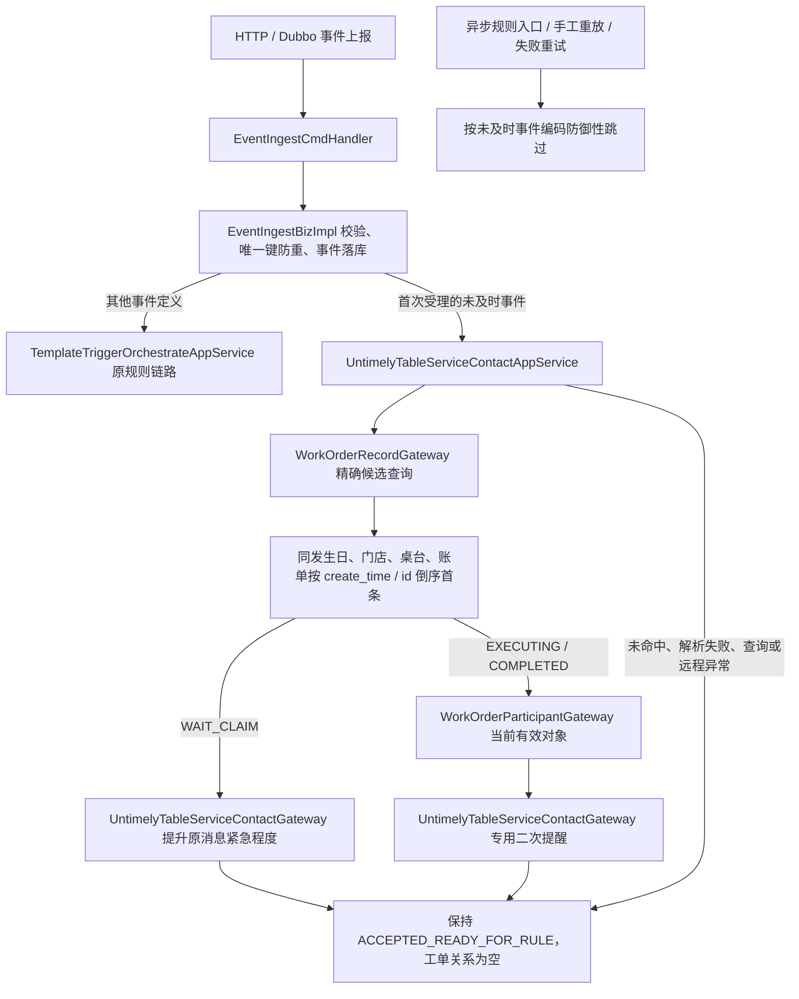

# 未及时收台擦台事件附加触达 Implementation Plan

## 变更链路



## 实施任务

### TASK-001：固化两类未及时事件的目标作业与提醒语义

约束：
- `CLEAR_TABLE_NOT_DONE` 只能映射到 `CLEAR_TABLE`，`WIPE_TABLE_NOT_DONE` 只能映射到 `WIPE_TABLE`；映射、标题和提醒正文是领域固定语义，不开放为模板关系或运行时配置。
- 专用提醒只携带事件、目标工单、门店、桌台和收件人所需数据，不复用常规工单执行命令，不暴露云手表 SDK 类型到领域层。
- 新增 Java 类型与方法保持 JDK 8 兼容；领域实体使用 `*Entity` 命名。

**Files:**
- Modify: `work-order-common/src/main/java/com/haidilao/workorder/common/constant/EventConstants.java`
- Create: `work-order-domain/src/main/java/com/haidilao/workorder/domain/event/model/valueobject/UntimelyTableServiceDefinition.java`
- Create: `work-order-domain/src/main/java/com/haidilao/workorder/domain/event/model/entity/UntimelyTableServiceRecipientEntity.java`
- Create: `work-order-domain/src/main/java/com/haidilao/workorder/domain/event/model/entity/UntimelyTableServiceReminderEntity.java`
- Create: `work-order-domain/src/main/java/com/haidilao/workorder/domain/event/gateway/UntimelyTableServiceContactGateway.java`
- Test: `work-order-domain/src/test/java/com/haidilao/workorder/domain/event/model/valueobject/UntimelyTableServiceDefinitionTest.java`

修改：

```java
public final class EventDefineCode {
    public static final String CLEAR_REQ = "CLEAR_REQ";
    public static final String CLEAR_TABLE = "CLEAR_TABLE";
    public static final String WIPE_TABLE = "WIPE_TABLE";
    public static final String SWEEP_TABLE = "SWEEP_TABLE";
    public static final String CLEAR_TABLE_NOT_DONE = "CLEAR_TABLE_NOT_DONE";
    public static final String WIPE_TABLE_NOT_DONE = "WIPE_TABLE_NOT_DONE";

    private EventDefineCode() {
    }
}

@Getter
public enum UntimelyTableServiceDefinition {
    CLEAR_TABLE_NOT_DONE(
        EventConstants.EventDefineCode.CLEAR_TABLE_NOT_DONE,
        TemplateConstants.TemplateCode.CLEAR_TABLE,
        "收台未及时提醒",
        "检测到收台未及时，请线下复核收台处理"),
    WIPE_TABLE_NOT_DONE(
        EventConstants.EventDefineCode.WIPE_TABLE_NOT_DONE,
        TemplateConstants.TemplateCode.WIPE_TABLE,
        "擦台未及时提醒",
        "检测到擦台未及时，请线下复核擦台处理");

    private final String eventDefineCode;
    private final String targetTemplateCode;
    private final String reminderTitle;
    private final String reminderMessage;

    UntimelyTableServiceDefinition(String eventDefineCode,
                                   String targetTemplateCode,
                                   String reminderTitle,
                                   String reminderMessage) {
        this.eventDefineCode = eventDefineCode;
        this.targetTemplateCode = targetTemplateCode;
        this.reminderTitle = reminderTitle;
        this.reminderMessage = reminderMessage;
    }

    public static Optional<UntimelyTableServiceDefinition> find(String eventDefineCode) {
        return Arrays.stream(values())
            .filter(item -> item.eventDefineCode.equals(eventDefineCode))
            .findFirst();
    }

    public static boolean supports(String eventDefineCode) {
        return find(eventDefineCode).isPresent();
    }
}

@Value
@Builder
public class UntimelyTableServiceRecipientEntity {
    String employeeId;
    String employeeName;
}

@Value
@Builder
public class UntimelyTableServiceReminderEntity {
    String eventId;
    String targetEventType;
    String storeCode;
    String tableNo;
    String workOrderId;
    String title;
    String message;
    List<UntimelyTableServiceRecipientEntity> recipients;
}

public interface UntimelyTableServiceContactGateway {
    void upgradeMessageToUrgent(String workOrderId);

    void pushReminder(UntimelyTableServiceReminderEntity reminder);
}
```

测试：

```java
@Test
void shouldMapUntimelyEventsToFixedTargetDefinitions() {
    assertThat(UntimelyTableServiceDefinition.find("CLEAR_TABLE_NOT_DONE"))
        .hasValueSatisfying(item -> assertThat(item.getTargetTemplateCode()).isEqualTo("CLEAR_TABLE"));
    assertThat(UntimelyTableServiceDefinition.find("WIPE_TABLE_NOT_DONE"))
        .hasValueSatisfying(item -> assertThat(item.getTargetTemplateCode()).isEqualTo("WIPE_TABLE"));
}

@Test
void shouldKeepOtherEventOutsideUntimelyBranch() {
    assertThat(UntimelyTableServiceDefinition.supports("CLEAR_TABLE")).isFalse();
    assertThat(UntimelyTableServiceDefinition.find("UNKNOWN_EVENT")).isEmpty();
}
```

### TASK-002：按发生日和结构化字段稳定查询目标工单候选集

约束：
- 查询条件固定为有效工单 `state = 0`、同门店、同桌台、固定模板、`WAIT_CLAIM / EXECUTING / COMPLETED`，时间窗口使用事件发生地本地日的左闭右开区间 `[dayStart, nextDayStart)`。
- 数据库只负责结构化列过滤与 `create_time DESC, id DESC` 稳定排序；账单仍在应用层用既有 JSON 解析口径逐条精确比较，不能对 JSON 做模糊匹配，也不能先截断为单条记录。
- 新增组合索引只改变访问路径，不新增表或字段；发布前用生产等量数据执行 `EXPLAIN`，确认命中索引且日内候选扫描量可控。
- 同步把组合索引写入 `sql/work_order_mysql.sql` 的工单主表基线定义；仓库当前不存在测试 `schema.sql` 镜像，不创建脱离现有测试设施的重复 schema 文件。
- 新建独立且启用的测试类验证查询，不能把覆盖补进当前带类级 `@Disabled` 的 `WorkOrderServiceImplTest`。

**Files:**
- Create: `work-order-domain/src/main/java/com/haidilao/workorder/domain/workorder/model/valueobject/UntimelyTableServiceCandidateQuery.java`
- Modify: `work-order-domain/src/main/java/com/haidilao/workorder/domain/workorder/gateway/WorkOrderRecordGateway.java`
- Create: `work-order-infra/src/main/java/com/haidilao/workorder/infra/core/model/criteria/workorder/UntimelyTableServiceCandidateSearchCriteria.java`
- Modify: `work-order-infra/src/main/java/com/haidilao/workorder/infra/core/repository/workorder/WorkOrderService.java`
- Modify: `work-order-infra/src/main/java/com/haidilao/workorder/infra/core/repository/workorder/WorkOrderServiceImpl.java`
- Modify: `work-order-infra/src/main/java/com/haidilao/workorder/infra/gatewayimpl/workorder/WorkOrderRecordGatewayImpl.java`
- Modify: `sql/work_order_mysql.sql`
- Create: `sql/alter_t_work_order_record_add_untimely_match_index_20260824.sql`
- Test: `work-order-infra/src/test/java/com/haidilao/workorder/infra/core/repository/workorder/WorkOrderServiceUntimelyCandidateTest.java`
- Test: `work-order-infra/src/test/java/com/haidilao/workorder/infra/gatewayimpl/workorder/WorkOrderRecordGatewayImplTest.java`

修改：

```java
@Value
@Builder
public class UntimelyTableServiceCandidateQuery {
    String storeCode;
    String pointCode;
    String templateCode;
    List<String> statuses;
    LocalDateTime createTimeBegin;
    LocalDateTime createTimeEnd;
}

public interface WorkOrderRecordGateway {
    List<WorkOrderRecordEntity> listUntimelyTableServiceCandidates(
        UntimelyTableServiceCandidateQuery query);
}

@Value
@Builder
public class UntimelyTableServiceCandidateSearchCriteria {
    String storeCode;
    String pointCode;
    String templateCode;
    List<String> statuses;
    LocalDateTime createTimeBegin;
    LocalDateTime createTimeEnd;
}

public interface WorkOrderService {
    List<WorkOrderRecordPO> listUntimelyTableServiceCandidates(
        UntimelyTableServiceCandidateSearchCriteria criteria);
}

public List<WorkOrderRecordPO> listUntimelyTableServiceCandidates(
        UntimelyTableServiceCandidateSearchCriteria criteria) {
    LambdaQueryWrapper<WorkOrderRecordPO> wrapper = new LambdaQueryWrapper<WorkOrderRecordPO>()
        .eq(WorkOrderRecordPO::getState, 0)
        .eq(WorkOrderRecordPO::getStoreCode, criteria.getStoreCode())
        .eq(WorkOrderRecordPO::getPointCode, criteria.getPointCode())
        .eq(WorkOrderRecordPO::getTemplateCode, criteria.getTemplateCode())
        .in(WorkOrderRecordPO::getWorkOrderStatus, criteria.getStatuses())
        .ge(WorkOrderRecordPO::getCreateTime, criteria.getCreateTimeBegin())
        .lt(WorkOrderRecordPO::getCreateTime, criteria.getCreateTimeEnd())
        .orderByDesc(WorkOrderRecordPO::getCreateTime)
        .orderByDesc(WorkOrderRecordPO::getId);
    return workOrderRecordMapper.selectList(wrapper);
}

@Override
public List<WorkOrderRecordEntity> listUntimelyTableServiceCandidates(
        UntimelyTableServiceCandidateQuery query) {
    UntimelyTableServiceCandidateSearchCriteria criteria =
        UntimelyTableServiceCandidateSearchCriteria.builder()
            .storeCode(query.getStoreCode())
            .pointCode(query.getPointCode())
            .templateCode(query.getTemplateCode())
            .statuses(query.getStatuses())
            .createTimeBegin(query.getCreateTimeBegin())
            .createTimeEnd(query.getCreateTimeEnd())
            .build();
    return workOrderService.listUntimelyTableServiceCandidates(criteria).stream()
        .map(workOrderAdminGatewayConvertor::toAdminEntity)
        .collect(Collectors.toList());
}
```

```sql
ALTER TABLE `t_work_order_record`
  ADD INDEX `idx_work_order_record_untimely_match`
  (`state`, `store_code`, `point_code`, `template_code`, `create_time`, `id`, `work_order_status`);
```

测试：

```java
@Test
void shouldPreservePersistenceOrderWhenConvertingCandidates() {
    when(workOrderService.listUntimelyTableServiceCandidates(any()))
        .thenReturn(Arrays.asList(po(2L, "WO-NEW"), po(1L, "WO-OLD")));

    List<WorkOrderRecordEntity> result = gateway.listUntimelyTableServiceCandidates(query());

    assertThat(result).extracting(WorkOrderRecordEntity::getWorkOrderId)
        .containsExactly("WO-NEW", "WO-OLD");
}
```

数据库验证：

- 类型：INDEX / QUERY_PLAN
- 目标引擎：生产同版本 MySQL
- 期望：组合索引存在，日内候选查询的 `EXPLAIN` 使用 `idx_work_order_record_untimely_match`

```sql
SHOW INDEX FROM `t_work_order_record`
WHERE `Key_name` = 'idx_work_order_record_untimely_match';

EXPLAIN SELECT `id`
FROM `t_work_order_record`
WHERE `state` = 0
  AND `store_code` = 'S001'
  AND `point_code` = 'T008'
  AND `template_code` = 'CLEAR_TABLE'
  AND `work_order_status` IN ('WAIT_CLAIM', 'EXECUTING', 'COMPLETED')
  AND `create_time` >= '2026-08-24 00:00:00'
  AND `create_time` < '2026-08-25 00:00:00'
ORDER BY `create_time` DESC, `id` DESC;
```

依赖：
- 依赖 TASK-001 提供固定目标模板编码。

### TASK-003：通过领域端口完成一次紧急提升或专用二次提醒

约束：
- `WAIT_CLAIM` 只调用一次 `MessageCallbackRemote.upgradeMessageToUrgent`，参数为单个目标工单号列表与现有 `messageSourceFromCode`；不得新增消息或修改工单。
- `EXECUTING / COMPLETED` 只调用一次 `PushEventRemote.pushEvent` 批量发送；`eventType` 为目标作业编码，`psCode` 为目标工单门店，`tableNo` 为事件点位，`businessId` 为目标工单号，`businessIdDedup` 必须为 `false`。
- 新建专用适配器并复用 `WorkOrderWatchProperties.messageSourceFromCode`，不改变现有消息完成与常规首次派发适配器；两个 Dubbo 引用显式设置 `retries = 0`，避免客户端透明重试破坏一次尝试语义。
- 云手表返回空或返回失败时由适配器转换为统一系统异常，RPC 抛出的异常直接传播到应用层隔离；适配器不落触达记录、不发起应用级重试。
- 远程日志最多输出事件 ID、工单号、动作三个关键字段，禁止打印完整提醒对象或员工列表。

**Files:**
- Create: `work-order-adapter/src/main/java/com/haidilao/workorder/adapter/remote/outbound/watch/UntimelyTableServiceContactGatewayAdapter.java`
- Test: `work-order-adapter/src/test/java/com/haidilao/workorder/adapter/outbound/remote/watch/UntimelyTableServiceContactGatewayAdapterTest.java`

修改：

```java
private static final DateTimeFormatter WATCH_TIME_FORMATTER =
    DateTimeFormatter.ofPattern("yyyy-MM-dd HH:mm:ss");

private final WorkOrderWatchProperties workOrderWatchProperties;

@DubboReference(version = "1.0.0", check = false, retries = 0)
private MessageCallbackRemote messageCallbackRemote;

@DubboReference(version = "1.0.0", check = false, retries = 0)
private PushEventRemote pushEventRemote;

@Override
public void upgradeMessageToUrgent(String workOrderId) {
    if (!StringUtils.hasText(workOrderId)) {
        throw new BusinessException(ErrorCode.SYSTEM_ERROR, "目标工单号为空");
    }
    R<?> result = messageCallbackRemote.upgradeMessageToUrgent(
        Collections.singletonList(workOrderId),
        resolveSourceFromCode());
    ensureRemoteAccepted(result, "云手表消息紧急程度提升失败");
}

@Override
public void pushReminder(UntimelyTableServiceReminderEntity reminder) {
    if (reminder == null || CollectionUtils.isEmpty(reminder.getRecipients())) {
        throw new BusinessException(ErrorCode.SYSTEM_ERROR, "未及时作业提醒缺少收件人");
    }
    RemoteMessageDto message = new RemoteMessageDto();
    message.setEventType(reminder.getTargetEventType());
    message.setPsCode(reminder.getStoreCode());
    message.setTableNo(reminder.getTableNo());
    message.setBusinessId(reminder.getWorkOrderId());
    message.setBusinessIdDedup(false);
    message.setTitle(reminder.getTitle());
    message.setMsg(reminder.getMessage());
    message.setUpdateTime(LocalDateTime.now().format(WATCH_TIME_FORMATTER));
    message.setEmployeeList(reminder.getRecipients().stream()
        .map(this::toPushEventEmployee)
        .collect(Collectors.toList()));
    ensureRemoteAccepted(pushEventRemote.pushEvent(message), "云手表未及时作业提醒失败");
}

private PushEventEmployeeDto toPushEventEmployee(UntimelyTableServiceRecipientEntity recipient) {
    PushEventEmployeeDto employee = new PushEventEmployeeDto();
    employee.setEmployeeCode(recipient.getEmployeeId());
    employee.setEmployeeName(StringUtils.hasText(recipient.getEmployeeName())
        ? recipient.getEmployeeName()
        : recipient.getEmployeeId());
    return employee;
}

private void ensureRemoteAccepted(R<?> result, String failureMessage) {
    if (result == null || !result.isSuccess()) {
        throw new BusinessException(ErrorCode.SYSTEM_ERROR, failureMessage);
    }
}

private String resolveSourceFromCode() {
    String sourceFromCode = workOrderWatchProperties.getMessageSourceFromCode();
    return StringUtils.hasText(sourceFromCode) ? sourceFromCode : "HSC_WORK_ORDER";
}
```

测试：

```java
@Test
void shouldUpgradeExistingMessageWithConfiguredSource() {
    when(messageCallbackRemote.upgradeMessageToUrgent(
        Collections.singletonList("WO-001"), "WATCH"))
        .thenReturn(R.success());

    adapter.upgradeMessageToUrgent("WO-001");

    verify(messageCallbackRemote).upgradeMessageToUrgent(
        Collections.singletonList("WO-001"), "WATCH");
    verifyNoInteractions(pushEventRemote);
}

@Test
void shouldPushReminderWithoutBusinessIdDedup() {
    when(pushEventRemote.pushEvent(any())).thenReturn(R.success());

    adapter.pushReminder(reminder());

    ArgumentCaptor<RemoteMessageDto> captor = ArgumentCaptor.forClass(RemoteMessageDto.class);
    verify(pushEventRemote).pushEvent(captor.capture());
    assertThat(captor.getValue().getEventType()).isEqualTo("WIPE_TABLE");
    assertThat(captor.getValue().getPsCode()).isEqualTo("S001");
    assertThat(captor.getValue().getTableNo()).isEqualTo("T008");
    assertThat(captor.getValue().getBusinessId()).isEqualTo("WO-001");
    assertThat(captor.getValue().isBusinessIdDedup()).isFalse();
    assertThat(captor.getValue().getTitle()).isEqualTo("擦台未及时提醒");
    assertThat(captor.getValue().getMsg()).contains("请线下复核擦台处理");
    assertThat(captor.getValue().getUpdateTime()).isNotBlank();
    assertThat(captor.getValue().getEmployeeList()).extracting(PushEventEmployeeDto::getEmployeeCode)
        .containsExactly("E001", "E002");
}

@Test
void shouldExposeRemoteRejectionAsExceptionWithoutRetry() {
    when(pushEventRemote.pushEvent(any())).thenReturn(R.fail("REMOTE_REJECTED"));

    assertThatThrownBy(() -> adapter.pushReminder(reminder()))
        .isInstanceOf(BusinessException.class);
    verify(pushEventRemote, times(1)).pushEvent(any());
}

@Test
void shouldDisableDubboTransparentRetryForBothContactCalls() {
    Field callbackField = ReflectionUtils.findField(
        UntimelyTableServiceContactGatewayAdapter.class, "messageCallbackRemote");
    Field pushField = ReflectionUtils.findField(
        UntimelyTableServiceContactGatewayAdapter.class, "pushEventRemote");

    assertThat(callbackField.getAnnotation(DubboReference.class).retries()).isZero();
    assertThat(pushField.getAnnotation(DubboReference.class).retries()).isZero();
}
```

依赖：
- 依赖 TASK-001 的领域提醒与收件人实体。

### TASK-004：首次成功受理后精确匹配并按目标状态附加触达

约束：
- 用例只接受由已成功保存事件显式转换出的 `UntimelyTableServiceContactDTO`；事件账单或发生时间缺失、账单解析失败、无精确候选、无有效收件人都直接结束，不回退到宽松匹配。
- 账单解析必须复用 `TableBillIdResolveSupport` 的 `tableBillId` 优先、`orderId` 兼容和 `detail` 嵌套口径；候选按持久化顺序遍历，在首个账单完全相等时停止。
- `EXECUTING` 只查询 `CURRENT_HANDLER`，`COMPLETED` 只查询 `HISTORY_HANDLER`；复用 `listCurrentByWorkOrderIdsAndRoles` 保证记录有效、当前关系且关系状态为 `ACTIVE`，排除转出、失效和退出对象。
- 整个附加流程捕获查询、解析和远程异常，只记录阶段性结果；不得保存目标工单、参与关系、事件工单关系或 `PROCESS_FAILED`，也不得把失败抛给上游。

**Files:**
- Create: `work-order-application/src/main/java/com/haidilao/workorder/application/event/command/contact/dto/UntimelyTableServiceContactDTO.java`
- Create: `work-order-application/src/main/java/com/haidilao/workorder/application/event/command/contact/UntimelyTableServiceContactAppService.java`
- Test: `work-order-application/src/test/java/com/haidilao/workorder/application/event/command/contact/UntimelyTableServiceContactAppServiceTest.java`
- Test: `work-order-infra/src/test/java/com/haidilao/workorder/infra/gatewayimpl/workorder/WorkOrderParticipantGatewayImplTest.java`

修改：

```java
@Value
@Builder
public class UntimelyTableServiceContactDTO {
    String eventId;
    String eventDefineCode;
    String storeCode;
    String pointCode;
    LocalDateTime occurredAt;
    String payloadData;
}

public void contactAfterAccepted(UntimelyTableServiceContactDTO acceptedEvent) {
    if (acceptedEvent == null) {
        return;
    }
    UntimelyTableServiceDefinition.find(acceptedEvent.getEventDefineCode())
        .ifPresent(definition -> contactSafely(acceptedEvent, definition));
}

private void contactSafely(UntimelyTableServiceContactDTO event,
                           UntimelyTableServiceDefinition definition) {
    try {
        Optional<WorkOrderRecordEntity> target = findTarget(event, definition);
        target.ifPresent(workOrder -> contactTarget(event, definition, workOrder));
        if (!target.isPresent()) {
            log.info("untimely.table.service.no_match eventId={} eventType={}",
                event.getEventId(), event.getEventDefineCode());
        }
    } catch (Exception ex) {
        log.error("untimely.table.service.contact_failed eventId={} eventType={}",
            event.getEventId(), event.getEventDefineCode(), ex);
    }
}

private Optional<WorkOrderRecordEntity> findTarget(
        UntimelyTableServiceContactDTO event,
        UntimelyTableServiceDefinition definition) {
    String eventBillId = tableBillIdResolveSupport.resolve(event.getPayloadData());
    if (!StringUtils.hasText(eventBillId) || event.getOccurredAt() == null) {
        return Optional.empty();
    }
    LocalDateTime dayStart = event.getOccurredAt().toLocalDate().atStartOfDay();
    UntimelyTableServiceCandidateQuery query = UntimelyTableServiceCandidateQuery.builder()
        .storeCode(event.getStoreCode())
        .pointCode(event.getPointCode())
        .templateCode(definition.getTargetTemplateCode())
        .statuses(Arrays.asList(
            WorkOrderStatusEnum.WAIT_CLAIM.getCode(),
            WorkOrderStatusEnum.EXECUTING.getCode(),
            WorkOrderStatusEnum.COMPLETED.getCode()))
        .createTimeBegin(dayStart)
        .createTimeEnd(dayStart.plusDays(1))
        .build();
    return workOrderRecordGateway.listUntimelyTableServiceCandidates(query).stream()
        .filter(candidate -> eventBillId.equals(
            tableBillIdResolveSupport.resolve(candidate.getPayloadData())))
        .findFirst();
}

private void contactTarget(UntimelyTableServiceContactDTO event,
                           UntimelyTableServiceDefinition definition,
                           WorkOrderRecordEntity target) {
    if (WorkOrderStatusEnum.WAIT_CLAIM.getCode().equals(target.getWorkOrderStatus())) {
        executeContact(event, target, "UPGRADE_URGENT",
            () -> untimelyTableServiceContactGateway.upgradeMessageToUrgent(target.getWorkOrderId()));
        return;
    }
    List<String> roles = resolveReminderRoles(target.getWorkOrderStatus());
    List<WorkOrderParticipantRelationEntity> participants =
        workOrderParticipantGateway.listCurrentByWorkOrderIdsAndRoles(
            Collections.singletonList(target.getWorkOrderId()), roles);
    sendReminder(event, definition, target, participants);
}

private List<String> resolveReminderRoles(String status) {
    if (WorkOrderStatusEnum.EXECUTING.getCode().equals(status)) {
        return Collections.singletonList(WorkOrderParticipantConstants.ParticipantRole.CURRENT_HANDLER);
    }
    if (WorkOrderStatusEnum.COMPLETED.getCode().equals(status)) {
        return Collections.singletonList(WorkOrderParticipantConstants.ParticipantRole.HISTORY_HANDLER);
    }
    return Collections.emptyList();
}

private void sendReminder(UntimelyTableServiceContactDTO event,
                          UntimelyTableServiceDefinition definition,
                          WorkOrderRecordEntity target,
                          List<WorkOrderParticipantRelationEntity> participants) {
    List<UntimelyTableServiceRecipientEntity> recipients = toRecipients(participants);
    if (recipients.isEmpty()) {
        log.info("untimely.table.service.no_recipient eventId={} workOrderId={}",
            event.getEventId(), target.getWorkOrderId());
        return;
    }
    UntimelyTableServiceReminderEntity reminder = UntimelyTableServiceReminderEntity.builder()
        .eventId(event.getEventId())
        .targetEventType(definition.getTargetTemplateCode())
        .storeCode(target.getStoreCode())
        .tableNo(event.getPointCode())
        .workOrderId(target.getWorkOrderId())
        .title(definition.getReminderTitle())
        .message(definition.getReminderMessage())
        .recipients(recipients)
        .build();
    executeContact(event, target, "PUSH_REMINDER",
        () -> untimelyTableServiceContactGateway.pushReminder(reminder));
}

private List<UntimelyTableServiceRecipientEntity> toRecipients(
        List<WorkOrderParticipantRelationEntity> participants) {
    if (CollectionUtils.isEmpty(participants)) {
        return Collections.emptyList();
    }
    Map<String, UntimelyTableServiceRecipientEntity> recipientMap = new LinkedHashMap<>();
    for (WorkOrderParticipantRelationEntity participant : participants) {
        if (participant != null && StringUtils.hasText(participant.getEmployeeId())) {
            String employeeId = participant.getEmployeeId();
            recipientMap.putIfAbsent(employeeId, UntimelyTableServiceRecipientEntity.builder()
                .employeeId(employeeId)
                .employeeName(participant.getEmployeeName())
                .build());
        }
    }
    return new ArrayList<>(recipientMap.values());
}

private void executeContact(UntimelyTableServiceContactDTO event,
                            WorkOrderRecordEntity target,
                            String action,
                            Runnable contactCommand) {
    try {
        contactCommand.run();
        log.info("untimely.table.service.contact_accepted eventId={} workOrderId={} action={}",
            event.getEventId(), target.getWorkOrderId(), action);
    } catch (Exception ex) {
        log.error("untimely.table.service.remote_failed eventId={} workOrderId={} action={}",
            event.getEventId(), target.getWorkOrderId(), action, ex);
    }
}
```

测试：

```java
@Test
void shouldSelectFirstExactBillFromStableOrderedCandidates() {
    when(workOrderRecordGateway.listUntimelyTableServiceCandidates(any()))
        .thenReturn(Arrays.asList(
            workOrder("WO-NEW-WRONG", "EXECUTING", "{\"tableBillId\":\"B002\"}"),
            workOrder("WO-NEW-MATCH", "WAIT_CLAIM", "{\"detail\":\"{\\\"orderId\\\":\\\"B001\\\"}\"}"),
            workOrder("WO-OLD-MATCH", "WAIT_CLAIM", "{\"tableBillId\":\"B001\"}")));

    service.contactAfterAccepted(event("CLEAR_TABLE_NOT_DONE", "{\"tableBillId\":\"B001\"}"));

    verify(untimelyTableServiceContactGateway).upgradeMessageToUrgent("WO-NEW-MATCH");
    verify(untimelyTableServiceContactGateway, never()).upgradeMessageToUrgent("WO-OLD-MATCH");
}

@Test
void shouldUseCurrentHandlerForExecutingAndHistoryHandlerForCompleted() {
    exerciseReminderStatus("EXECUTING", WorkOrderParticipantConstants.ParticipantRole.CURRENT_HANDLER);
    exerciseReminderStatus("COMPLETED", WorkOrderParticipantConstants.ParticipantRole.HISTORY_HANDLER);

    verify(untimelyTableServiceContactGateway, times(2))
        .pushReminder(reminderCaptor.capture());
    assertThat(reminderCaptor.getAllValues())
        .allSatisfy(reminder -> assertThat(reminder.getRecipients())
            .extracting(UntimelyTableServiceRecipientEntity::getEmployeeId)
            .containsExactly("E001"));
}

@Test
void shouldNotFallbackWhenBillOrOccurredAtIsMissing() {
    service.contactAfterAccepted(eventWithoutBill());
    service.contactAfterAccepted(eventWithoutOccurredAt());

    verifyNoInteractions(workOrderRecordGateway, workOrderParticipantGateway,
        untimelyTableServiceContactGateway);
}

@Test
void shouldNotPushReminderWhenNoCurrentParticipantExists() {
    when(workOrderRecordGateway.listUntimelyTableServiceCandidates(any()))
        .thenReturn(Collections.singletonList(executingTarget()));
    when(workOrderParticipantGateway.listCurrentByWorkOrderIdsAndRoles(anyList(), anyList()))
        .thenReturn(Collections.emptyList());

    service.contactAfterAccepted(validEvent());

    verify(untimelyTableServiceContactGateway, never()).pushReminder(any());
}

@Test
void shouldKeepAcceptedFlowWhenQueryOrRemoteCallFails() {
    when(workOrderRecordGateway.listUntimelyTableServiceCandidates(any()))
        .thenThrow(new IllegalStateException("query failed"));

    assertThatCode(() -> service.contactAfterAccepted(validEvent())).doesNotThrowAnyException();

    reset(workOrderRecordGateway);
    when(workOrderRecordGateway.listUntimelyTableServiceCandidates(any()))
        .thenReturn(Collections.singletonList(waitClaimTarget()));
    doThrow(new IllegalStateException("remote failed"))
        .when(untimelyTableServiceContactGateway).upgradeMessageToUrgent("WO-001");
    assertThatCode(() -> service.contactAfterAccepted(validEvent())).doesNotThrowAnyException();
    verify(untimelyTableServiceContactGateway, times(1)).upgradeMessageToUrgent("WO-001");
}

@Test
void shouldLoadOnlyActiveCurrentParticipantsForReminderRole() {
    gateway.listCurrentByWorkOrderIdsAndRoles(
        Collections.singletonList("WO-001"),
        Collections.singletonList(WorkOrderParticipantConstants.ParticipantRole.HISTORY_HANDLER));

    ArgumentCaptor<WorkOrderParticipantSearchCriteria> captor =
        ArgumentCaptor.forClass(WorkOrderParticipantSearchCriteria.class);
    verify(workOrderParticipantService).list(captor.capture());
    assertThat(captor.getValue().getWorkOrderIds()).containsExactly("WO-001");
    assertThat(captor.getValue().getParticipantRoles())
        .containsExactly(WorkOrderParticipantConstants.ParticipantRole.HISTORY_HANDLER);
    assertThat(captor.getValue().getState()).isEqualTo(1);
    assertThat(captor.getValue().getIsCurrent()).isEqualTo(1);
    assertThat(captor.getValue().getRelationStatus())
        .isEqualTo(WorkOrderParticipantConstants.RelationStatus.ACTIVE);
}
```

依赖：
- 依赖 TASK-001 的固定映射，TASK-002 的有序候选查询，TASK-003 的云手表端口能力。

### TASK-005：在首次受理入口隔离未及时桌台服务事件并封堵重放旁路

约束：
- 未及时桌台服务事件分支必须发生在事件唯一键插入及成功受理状态保存之后、模板触发编排之前；只有唯一键竞争的胜者执行一次附加触达，重复请求即使首次远程失败也不得再次调用。
- 未及时桌台服务事件继续返回 `ACCEPTED_READY_FOR_RULE`、`事件上报成功`、空 `workOrderIds`，不得写事件工单关系；既有 `CLEAR_TABLE`、`WIPE_TABLE` 与其他事件保持原即时或延迟规则行为。
- 未及时桌台服务事件不发布 `EventIngestedEvent`，异步执行器、提交拒绝回调、手工派发及失败重试入口均按事件编码跳过，且不得回写 `PROCESS_FAILED`。
- `EventProcessAppServiceImpl.process` 在 `resolveEventRecord` 得到完整 `EventRecordEntity` 后、调用任何规则或写结果前增加同一类型守卫，并直接复用现有 `buildResultDTO` 返回已保存的受理结果，确保只传事件 ID 的直接调用也不能绕过隔离；其他事件处理主体不改顺序。
- `EventRuleDispatchAsyncExecutor.dispatch` 的原规则处理主体仅无行为变化地下沉为 `dispatchRuleProcessingEvent`；未及时桌台服务事件在调用该主体和失败记录器之前返回。
- 将 `EventIngestCmdHandler.execute` 的完成日志收敛为 `traceId / eventId / resultCode`，将异步异常日志收敛为 `eventId / eventType / durationMs`，确保每条日志最多三个字段。

**Files:**
- Modify: `work-order-application/src/main/java/com/haidilao/workorder/application/event/command/ingest/EventIngestBizImpl.java`
- Modify: `work-order-application/src/main/java/com/haidilao/workorder/application/event/executor/command/ingest/EventIngestCmdHandler.java`
- Modify: `work-order-application/src/main/java/com/haidilao/workorder/application/event/command/ingest/EventRuleDispatchAsyncExecutor.java`
- Modify: `work-order-application/src/main/java/com/haidilao/workorder/application/event/command/dispatch/EventRuleDispatchBizImpl.java`
- Modify: `work-order-application/src/main/java/com/haidilao/workorder/application/event/command/process/EventProcessAppServiceImpl.java`
- Modify: `work-order-application/src/test/java/com/haidilao/workorder/application/event/command/ingest/EventIngestBizImplTest.java`
- Create: `work-order-application/src/test/java/com/haidilao/workorder/application/event/executor/command/ingest/EventIngestCmdHandlerTest.java`
- Create: `work-order-application/src/test/java/com/haidilao/workorder/application/event/command/ingest/EventRuleDispatchAsyncExecutorTest.java`
- Create: `work-order-application/src/test/java/com/haidilao/workorder/application/event/command/dispatch/EventRuleDispatchBizImplTest.java`
- Modify: `work-order-application/src/test/java/com/haidilao/workorder/application/event/command/process/EventProcessAppServiceImplTest.java`

修改：

```java
private EventRecordEntity routeAcceptedEvent(EventRecordEntity accepted) {
    if (UntimelyTableServiceDefinition.supports(accepted.getEventDefineCode())) {
        untimelyTableServiceContactAppService.contactAfterAccepted(toContactDTO(accepted));
        return accepted;
    }
    TemplateTriggerOrchestrateResult result = templateTriggerOrchestrateAppService.orchestrate(accepted);
    if (result == null || !result.isDelayed()) {
        return accepted;
    }
    return markResult(
        accepted,
        EventResultCodeEnum.ACCEPTED_DELAYED_TRIGGER_PENDING.getCode(),
        result.getReasonDesc(),
        Collections.emptyList());
}

private UntimelyTableServiceContactDTO toContactDTO(EventRecordEntity event) {
    return UntimelyTableServiceContactDTO.builder()
        .eventId(event.getEventId())
        .eventDefineCode(event.getEventDefineCode())
        .storeCode(event.getStoreCode())
        .pointCode(event.getPointCode())
        .occurredAt(event.getOccurredAt())
        .payloadData(event.getPayloadData())
        .build();
}

private boolean shouldPublishIngestedEvent(EventReportResult result,
                                           String eventTypeCode) {
    if (UntimelyTableServiceDefinition.supports(eventTypeCode)) {
        return false;
    }
    return result != null
        && (EventResultCodeEnum.ACCEPTED_READY_FOR_RULE.getCode().equals(result.getResultCode())
        || EventResultCodeEnum.ACCEPTED_DELAYED_TRIGGER_PENDING.getCode().equals(result.getResultCode()));
}

private void logCommandFinished(String traceId, EventReportResult result) {
    log.info("event.ingest.command.finish traceId={} eventId={} resultCode={}",
        traceId,
        result.getEventId(),
        result.getResultCode());
}

public void dispatch(EventRecordEntity entity) {
    if (entity != null
        && UntimelyTableServiceDefinition.supports(entity.getEventDefineCode())) {
        log.info("event.rule.dispatch.async.skip eventId={} eventType={}",
            entity.getEventId(), entity.getEventDefineCode());
        return;
    }
    dispatchRuleProcessingEvent(entity);
}

public void onSubmitRejected(EventRecordEntity entity, String rejectReason) {
    if (entity != null
        && UntimelyTableServiceDefinition.supports(entity.getEventDefineCode())) {
        log.info("event.rule.dispatch.reject.skip eventId={} eventType={}",
            entity.getEventId(), entity.getEventDefineCode());
        return;
    }
    persistFailedResultSafely(entity, new IllegalStateException(
        rejectReason == null ? "异步提交失败" : rejectReason));
}

private boolean shouldSkipRuleDispatch(EventRecordEntity event) {
    return event != null
        && UntimelyTableServiceDefinition.supports(event.getEventDefineCode());
}

private boolean isUntimelyTableServiceEvent(EventRecordEntity event) {
    return event != null
        && UntimelyTableServiceDefinition.supports(event.getEventDefineCode());
}
```

测试：

```java
@Test
void shouldContactOnlyFirstAcceptedUntimelyEventAndKeepEmptyWorkOrderResult() {
    EventReportResult first = service.ingest(untimelyCommand("SOURCE-001"));
    EventReportResult duplicate = service.ingest(untimelyCommand("SOURCE-001"));

    assertThat(first.getResultCode()).isEqualTo("ACCEPTED_READY_FOR_RULE");
    assertThat(first.getReasonDesc()).isEqualTo("事件上报成功");
    assertThat(first.getWorkOrderIds()).isEmpty();
    assertThat(duplicate.getResultCode()).isEqualTo("IGNORED_DUPLICATE");
    verify(untimelyTableServiceContactGateway, times(1)).upgradeMessageToUrgent("WO-001");
    verifyNoInteractions(templateTriggerOrchestrateAppService, eventRuleDispatchAsyncGateway);
}

@Test
void shouldKeepClearTableEventOnOriginalRulePath() {
    EventReportResult result = service.ingest(eventCommand("CLEAR_TABLE"));

    assertThat(result.getResultCode()).isEqualTo("ACCEPTED_READY_FOR_RULE");
    verify(templateTriggerOrchestrateAppService).orchestrate(any());
    verifyNoInteractions(untimelyTableServiceContactGateway);
}

@Test
void shouldNotRetryContactWhenDuplicateFollowsFirstRemoteFailure() {
    doThrow(new IllegalStateException("remote failed"))
        .when(untimelyTableServiceContactGateway).upgradeMessageToUrgent("WO-001");

    EventReportResult first = service.ingest(untimelyCommand("SOURCE-FAILED"));
    EventReportResult duplicate = service.ingest(untimelyCommand("SOURCE-FAILED"));

    assertThat(first.getResultCode()).isEqualTo("ACCEPTED_READY_FOR_RULE");
    assertThat(duplicate.getResultCode()).isEqualTo("IGNORED_DUPLICATE");
    verify(untimelyTableServiceContactGateway, times(1))
        .upgradeMessageToUrgent("WO-001");
}

@Test
void shouldNotPublishDomainEventForAcceptedUntimelyEvent() {
    when(eventIngestBiz.ingest(any())).thenReturn(acceptedResult());

    handler.execute(command("WIPE_TABLE_NOT_DONE"));

    verifyNoInteractions(applicationEventPublisher);
}

@Test
void shouldStillPublishDomainEventForAcceptedRuleEvent() {
    when(eventIngestBiz.ingest(any())).thenReturn(acceptedResult());

    handler.execute(command("CLEAR_TABLE"));

    verify(applicationEventPublisher).publishEvent(any(EventIngestedEvent.class));
}

@Test
void shouldSkipUntimelyEventAtEveryRuleReplayEntry() {
    EventRecordEntity event = untimelyAcceptedEvent();

    asyncExecutor.dispatch(event);
    asyncExecutor.onSubmitRejected(event, "queue full");
    ruleDispatchBiz.dispatchToRule(event.getEventId());

    verifyNoInteractions(eventProcessAppService, eventProcessResultRecorderBiz);
}

@Test
void shouldBypassDirectRuleProcessCallForUntimelyEvent() {
    EventProcessResultDTO result = processAppService.process(untimelyProcessCommand());

    assertThat(result.getResultCode()).isEqualTo("ACCEPTED_READY_FOR_RULE");
    assertThat(result.getWorkOrderIds()).isEmpty();
    verifyNoInteractions(workOrderGenerateRuleDomainService, workOrderGenerateDomainService,
        workOrderDispatchDomainService, workOrderExecuteDomainService,
        eventProcessResultRecorderBiz);
}
```

依赖：
- 依赖 TASK-004 提供失败隔离的附加触达用例。

### TASK-006：以幂等数据脚本开放新事件定义并锁定外部响应契约

约束：
- 发布前确认有效的 `CLEAR_TABLE`、`WIPE_TABLE` 事件定义各一条；新定义分别继承对应基础事件的来源白名单和幂等窗口，固定 `point_type = SHOP_TABLE`、`process_mode = IMMEDIATE`，载荷 schema 必须保留 `tableBillId`、`orderId`、`detail`。
- 脚本重复执行不能覆盖已存在的新定义；不得向 `t_event_define_template_relation` 写关系，否则会重新引入常规模板建单语义。
- 部署顺序为组合索引、应用代码、新事件定义；回滚时先通过既有事件定义管理能力停用两类新事件，再回滚应用，避免旧应用接收未知类型。
- HTTP、Dubbo 报告及事件结果查询继续使用现有 DTO/VO，不新增目标工单、收件人、紧急程度或远程错误字段；未及时桌台服务事件的单值工单号为空且工单号列表为空。

**Files:**
- Create: `sql/insert_t_event_define_untimely_table_service_events_20260824.sql`
- Create: `work-order-web/src/test/java/com/haidilao/workorder/web/converter/event/EventRequestConvertorTest.java`
- Create: `work-order-adapter/src/test/java/com/haidilao/workorder/adapter/remote/inbound/EventReportRemoteAdapterTest.java`

修改：

```sql
INSERT INTO `t_event_define` (
  `event_type_code`, `event_name`, `event_desc`, `source_type`, `payload_schema_json`,
  `point_type`, `process_mode`, `process_delay_minutes`, `enable_status`, `idempotent_min`,
  `create_time`, `create_by`, `update_time`, `update_by`, `state`, `version`
)
SELECT
  'CLEAR_TABLE_NOT_DONE', '未及时收台', '收台作业未及时完成后的附加触达事件', source_define.`source_type`,
  '[{"fieldCode":"tableBillId"},{"fieldCode":"orderId"},{"fieldCode":"detail"}]',
  'SHOP_TABLE', 'IMMEDIATE', NULL, 1, source_define.`idempotent_min`,
  NOW(), 'SYSTEM', NOW(), 'SYSTEM', 1, 1
FROM `t_event_define` source_define
WHERE source_define.`event_type_code` = 'CLEAR_TABLE'
  AND source_define.`state` = 1
  AND NOT EXISTS (
    SELECT 1 FROM `t_event_define` target_define
    WHERE target_define.`event_type_code` = 'CLEAR_TABLE_NOT_DONE'
  );

INSERT INTO `t_event_define` (
  `event_type_code`, `event_name`, `event_desc`, `source_type`, `payload_schema_json`,
  `point_type`, `process_mode`, `process_delay_minutes`, `enable_status`, `idempotent_min`,
  `create_time`, `create_by`, `update_time`, `update_by`, `state`, `version`
)
SELECT
  'WIPE_TABLE_NOT_DONE', '未及时擦台', '擦台作业未及时完成后的附加触达事件', source_define.`source_type`,
  '[{"fieldCode":"tableBillId"},{"fieldCode":"orderId"},{"fieldCode":"detail"}]',
  'SHOP_TABLE', 'IMMEDIATE', NULL, 1, source_define.`idempotent_min`,
  NOW(), 'SYSTEM', NOW(), 'SYSTEM', 1, 1
FROM `t_event_define` source_define
WHERE source_define.`event_type_code` = 'WIPE_TABLE'
  AND source_define.`state` = 1
  AND NOT EXISTS (
    SELECT 1 FROM `t_event_define` target_define
    WHERE target_define.`event_type_code` = 'WIPE_TABLE_NOT_DONE'
  );
```

数据库验证：

- 类型：DML / QUERY
- 目标引擎：生产同版本 MySQL
- 期望：两类事件定义各存在一条有效记录，且不存在事件模板关系

```sql
SELECT `event_type_code`, `source_type`, `payload_schema_json`, `point_type`,
       `process_mode`, `process_delay_minutes`, `enable_status`, `state`
FROM `t_event_define`
WHERE `event_type_code` IN ('CLEAR_TABLE_NOT_DONE', 'WIPE_TABLE_NOT_DONE')
ORDER BY `event_type_code`;

SELECT COUNT(*) AS forbidden_template_relation_count
FROM `t_event_define_template_relation`
WHERE `event_define_code` IN ('CLEAR_TABLE_NOT_DONE', 'WIPE_TABLE_NOT_DONE');
```

测试：

```java
@Test
void shouldKeepUntimelyReportWorkOrderFieldsEmptyInHttpConversion() {
    EventReportResponseVO response = convertor.toReportVO(acceptedUntimelyResultDTO());

    assertThat(response.getResultCode()).isEqualTo("ACCEPTED_READY_FOR_RULE");
    assertThat(response.getWorkOrderId()).isNull();
    assertThat(response.getWorkOrderIds()).isEmpty();
}

@Test
void shouldKeepUntimelyResultQueryWorkOrderFieldsEmpty() {
    EventResultVo response = convertor.toResultVO(acceptedUntimelyRecordDTO());

    assertThat(response.getResultCode()).isEqualTo("ACCEPTED_READY_FOR_RULE");
    assertThat(response.getWorkOrderId()).isNull();
    assertThat(response.getWorkOrderIds()).isEmpty();
}

@Test
void shouldKeepUntimelyReportWorkOrderFieldsEmptyInDubboResponse() {
    when(validator.validate(any(EventReportRequestQo.class))).thenReturn(Collections.emptySet());
    when(eventCommandBiz.ingest(any())).thenReturn(acceptedUntimelyResultDTO());

    OpenApiResponse<EventReportResponseVO> response = adapter.reportEvent(untimelyRequest());

    assertThat(response.getData().getResultCode()).isEqualTo("ACCEPTED_READY_FOR_RULE");
    assertThat(response.getData().getWorkOrderId()).isNull();
    assertThat(response.getData().getWorkOrderIds()).isEmpty();
}
```

依赖：
- 依赖 TASK-002 的索引先行发布与 TASK-005 的未及时桌台服务事件入口隔离。
