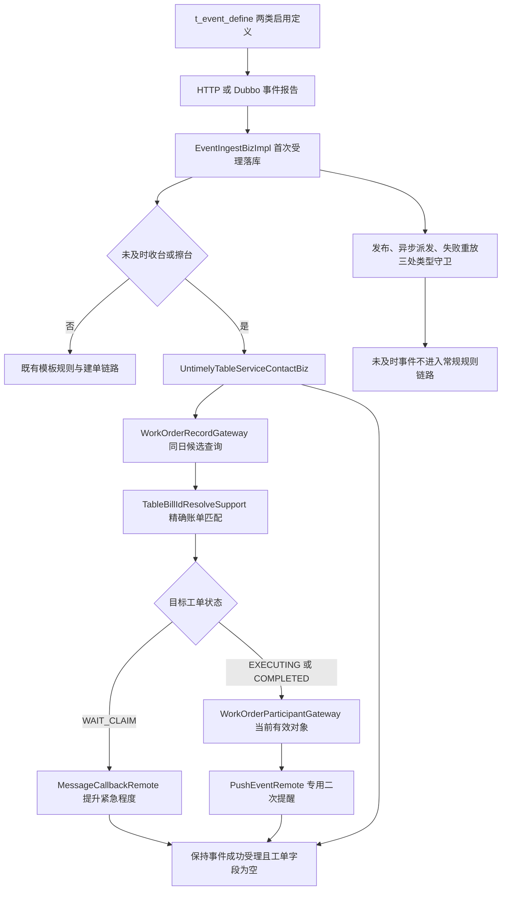

# 未及时收台擦台事件附加触达 Implementation Plan

## 变更链路



## 实施任务

通用 Java 约束：本 Plan 中所有新增生产类、接口、枚举和值对象，以及所有新增测试类，都必须在类型声明前添加说明业务职责或验证职责的中文类级 JavaDoc；实现时同步保留各业务步骤前的中文分步注释。

### TASK-001：建立未及时事件固定规则与可稳定排序的目标工单候选查询

约束：
- 两类未及时事件与目标模板的关系是系统固定规则，不读取模板关系表，也不允许运行时配置改变映射。
- 候选查询只在有效工单中按门店、桌台、目标模板、`WAIT_CLAIM/EXECUTING/COMPLETED` 和发生日半开区间过滤；数据库必须按 `create_time DESC, id DESC` 返回，应用层再按该顺序做账单精确匹配。
- 目标数据库为 MySQL 8.0；索引列顺序保持等值前缀后接时间与主键排序列，状态列用于索引条件过滤，避免状态 `IN` 破坏全局倒序。

**Files:**
- Modify: `work-order-common/src/main/java/com/haidilao/workorder/common/constant/EventConstants.java`
- Create: `work-order-domain/src/main/java/com/haidilao/workorder/domain/event/model/valueobject/UntimelyTableServiceDefinition.java`
- Create: `work-order-domain/src/main/java/com/haidilao/workorder/domain/workorder/model/valueobject/UntimelyTableServiceCandidateQuery.java`
- Modify: `work-order-domain/src/main/java/com/haidilao/workorder/domain/workorder/gateway/WorkOrderRecordGateway.java`
- Create: `work-order-infra/src/main/java/com/haidilao/workorder/infra/core/model/criteria/workorder/UntimelyTableServiceCandidateSearchCriteria.java`
- Modify: `work-order-infra/src/main/java/com/haidilao/workorder/infra/core/repository/workorder/WorkOrderService.java`
- Modify: `work-order-infra/src/main/java/com/haidilao/workorder/infra/core/repository/workorder/WorkOrderServiceImpl.java`
- Modify: `work-order-infra/src/main/java/com/haidilao/workorder/infra/gatewayimpl/workorder/WorkOrderRecordGatewayImpl.java`
- Modify: `sql/work_order_mysql.sql`
- Create: `sql/alter_t_work_order_record_add_untimely_match_index_20260824.sql`
- Test: `work-order-domain/src/test/java/com/haidilao/workorder/domain/event/model/valueobject/UntimelyTableServiceDefinitionTest.java`
- Test: `work-order-infra/src/test/java/com/haidilao/workorder/infra/core/repository/workorder/WorkOrderServiceUntimelyCandidateTest.java`
- Test: `work-order-infra/src/test/java/com/haidilao/workorder/infra/gatewayimpl/workorder/WorkOrderRecordGatewayImplTest.java`

修改：

```java
/**
 * 事件定义相关常量。
 */
public final class EventConstants {
    private EventConstants() {
    }

    public static final class EventDefineCode {
        public static final String CLEAR_REQ = "CLEAR_REQ";
        public static final String CLEAR_TABLE = "CLEAR_TABLE";
        public static final String WIPE_TABLE = "WIPE_TABLE";
        public static final String SWEEP_TABLE = "SWEEP_TABLE";
        public static final String CLEAR_TABLE_NOT_DONE = "CLEAR_TABLE_NOT_DONE";
        public static final String WIPE_TABLE_NOT_DONE = "WIPE_TABLE_NOT_DONE";

        private EventDefineCode() {
        }
    }
}

/**
 * 未及时桌台服务事件的固定目标作业、候选状态与提醒语义。
 */
@Getter
public enum UntimelyTableServiceDefinition {
    CLEAR_TABLE_NOT_DONE(
        EventConstants.EventDefineCode.CLEAR_TABLE_NOT_DONE,
        TemplateConstants.TemplateCode.CLEAR_TABLE,
        "收台未及时提醒",
        "检测到收台未及时，请线下复核收台处理"),
    WIPE_TABLE_NOT_DONE(
        EventConstants.EventDefineCode.WIPE_TABLE_NOT_DONE,
        TemplateConstants.TemplateCode.WIPE_TABLE,
        "擦台未及时提醒",
        "检测到擦台未及时，请线下复核擦台处理");

    private static final List<String> TARGET_STATUSES = Collections.unmodifiableList(Arrays.asList(
        WorkOrderStatusEnum.WAIT_CLAIM.getCode(),
        WorkOrderStatusEnum.EXECUTING.getCode(),
        WorkOrderStatusEnum.COMPLETED.getCode()));

    private final String eventDefineCode;
    private final String targetTemplateCode;
    private final String reminderTitle;
    private final String reminderMessage;

    UntimelyTableServiceDefinition(String eventDefineCode,
                                   String targetTemplateCode,
                                   String reminderTitle,
                                   String reminderMessage) {
        this.eventDefineCode = eventDefineCode;
        this.targetTemplateCode = targetTemplateCode;
        this.reminderTitle = reminderTitle;
        this.reminderMessage = reminderMessage;
    }

    public static Optional<UntimelyTableServiceDefinition> find(String eventDefineCode) {
        // 只识别已批准的精确事件编码，防止相似编码误入附加触达链路。
        return Arrays.stream(values())
            .filter(definition -> definition.eventDefineCode.equals(eventDefineCode))
            .findFirst();
    }

    public static boolean supports(String eventDefineCode) {
        // 复用唯一映射入口，保证受理、发布和重放守卫采用同一类型口径。
        return find(eventDefineCode).isPresent();
    }

    public List<String> targetStatuses() {
        // 返回不可变目标状态集合，禁止调用方扩大候选工单生命周期范围。
        return TARGET_STATUSES;
    }

    public boolean requiresUrgentUpgrade(String workOrderStatus) {
        // 待认领工单只提升已有消息紧急程度，不创建二次提醒。
        return WorkOrderStatusEnum.WAIT_CLAIM.getCode().equals(workOrderStatus);
    }

    public List<String> recipientRolesFor(String workOrderStatus) {
        // 执行中触达当前处理人，已完成触达仍有效的历史处理人。
        if (WorkOrderStatusEnum.EXECUTING.getCode().equals(workOrderStatus)) {
            return Collections.singletonList(WorkOrderParticipantConstants.ParticipantRole.CURRENT_HANDLER);
        }
        if (WorkOrderStatusEnum.COMPLETED.getCode().equals(workOrderStatus)) {
            return Collections.singletonList(WorkOrderParticipantConstants.ParticipantRole.HISTORY_HANDLER);
        }
        return Collections.emptyList();
    }
}

/**
 * 未及时桌台服务目标工单的领域查询条件。
 */
@Value
@Builder
public class UntimelyTableServiceCandidateQuery {
    String storeCode;
    String pointCode;
    String templateCode;
    List<String> statuses;
    LocalDateTime createTimeBegin;
    LocalDateTime createTimeEnd;
}

/**
 * 未及时桌台服务目标工单的持久化查询条件。
 */
@Value
@Builder
public class UntimelyTableServiceCandidateSearchCriteria {
    String storeCode;
    String pointCode;
    String templateCode;
    List<String> statuses;
    LocalDateTime createTimeBegin;
    LocalDateTime createTimeEnd;
}

public interface WorkOrderRecordGateway {
    List<WorkOrderRecordEntity> listUntimelyTableServiceCandidates(
        UntimelyTableServiceCandidateQuery query);
}

public interface WorkOrderService {
    List<WorkOrderRecordPO> listUntimelyTableServiceCandidates(
        UntimelyTableServiceCandidateSearchCriteria criteria);
}

public List<WorkOrderRecordPO> listUntimelyTableServiceCandidates(
        UntimelyTableServiceCandidateSearchCriteria criteria) {
    // 用结构化列和发生日范围收窄候选集，账单 JSON 留给应用层按既有口径解析。
    LambdaQueryWrapper<WorkOrderRecordPO> wrapper = new LambdaQueryWrapper<WorkOrderRecordPO>()
        .eq(WorkOrderRecordPO::getState, 0)
        .eq(WorkOrderRecordPO::getStoreCode, criteria.getStoreCode())
        .eq(WorkOrderRecordPO::getPointCode, criteria.getPointCode())
        .eq(WorkOrderRecordPO::getTemplateCode, criteria.getTemplateCode())
        .in(WorkOrderRecordPO::getWorkOrderStatus, criteria.getStatuses())
        .ge(WorkOrderRecordPO::getCreateTime, criteria.getCreateTimeBegin())
        .lt(WorkOrderRecordPO::getCreateTime, criteria.getCreateTimeEnd())
        .orderByDesc(WorkOrderRecordPO::getCreateTime)
        .orderByDesc(WorkOrderRecordPO::getId);
    // 直接返回数据库稳定倒序，应用层遇到首个同账单候选即可停止扫描。
    return workOrderRecordMapper.selectList(wrapper);
}

@Override
public List<WorkOrderRecordEntity> listUntimelyTableServiceCandidates(
        UntimelyTableServiceCandidateQuery query) {
    // 显式完成领域查询到持久化条件的边界转换，避免领域对象泄漏到基础设施层。
    UntimelyTableServiceCandidateSearchCriteria criteria =
        UntimelyTableServiceCandidateSearchCriteria.builder()
            .storeCode(query.getStoreCode())
            .pointCode(query.getPointCode())
            .templateCode(query.getTemplateCode())
            .statuses(query.getStatuses())
            .createTimeBegin(query.getCreateTimeBegin())
            .createTimeEnd(query.getCreateTimeEnd())
            .build();
    // 保留持久化返回顺序并转换为领域实体，禁止网关层再次排序。
    return workOrderService.listUntimelyTableServiceCandidates(criteria).stream()
        .map(workOrderAdminGatewayConvertor::toAdminEntity)
        .collect(Collectors.toList());
}
```

```sql
ALTER TABLE `t_work_order_record`
  ADD INDEX `idx_work_order_record_untimely_match`
  (`state`, `store_code`, `point_code`, `template_code`, `create_time`, `id`, `work_order_status`);

KEY `idx_work_order_record_untimely_match`
  (`state`, `store_code`, `point_code`, `template_code`, `create_time`, `id`, `work_order_status`)
```

测试：

```java
@Test
void shouldBuildHalfOpenCandidateQueryWithStableDescendingOrder() {
    LocalDateTime begin = LocalDateTime.of(2026, 8, 24, 0, 0);
    LocalDateTime end = begin.plusDays(1);
    UntimelyTableServiceCandidateSearchCriteria criteria =
        UntimelyTableServiceCandidateSearchCriteria.builder()
            .storeCode("STORE001")
            .pointCode("A01")
            .templateCode("CLEAR_TABLE")
            .statuses(Arrays.asList("WAIT_CLAIM", "EXECUTING", "COMPLETED"))
            .createTimeBegin(begin)
            .createTimeEnd(end)
            .build();

    workOrderService.listUntimelyTableServiceCandidates(criteria);

    ArgumentCaptor<Wrapper<WorkOrderRecordPO>> wrapperCaptor = ArgumentCaptor.forClass(Wrapper.class);
    verify(workOrderRecordMapper).selectList(wrapperCaptor.capture());
    String sqlSegment = wrapperCaptor.getValue().getSqlSegment();
    assertThat(sqlSegment)
        .contains("store_code", "point_code", "template_code", "work_order_status")
        .contains("create_time >=", "create_time <")
        .contains("create_time DESC", "id DESC");
}

@Test
void shouldPreserveRepositoryOrderAcrossDomainGatewayConversion() {
    WorkOrderRecordPO newer = workOrderPO(102L, "WO102");
    WorkOrderRecordPO older = workOrderPO(101L, "WO101");
    when(workOrderService.listUntimelyTableServiceCandidates(any()))
        .thenReturn(Arrays.asList(newer, older));
    when(workOrderAdminGatewayConvertor.toAdminEntity(newer)).thenReturn(workOrderEntity(102L, "WO102"));
    when(workOrderAdminGatewayConvertor.toAdminEntity(older)).thenReturn(workOrderEntity(101L, "WO101"));

    List<WorkOrderRecordEntity> result = gateway.listUntimelyTableServiceCandidates(
        UntimelyTableServiceCandidateQuery.builder()
            .storeCode("STORE001")
            .pointCode("A01")
            .templateCode("CLEAR_TABLE")
            .statuses(Arrays.asList("WAIT_CLAIM", "EXECUTING", "COMPLETED"))
            .createTimeBegin(LocalDateTime.of(2026, 8, 24, 0, 0))
            .createTimeEnd(LocalDateTime.of(2026, 8, 25, 0, 0))
            .build());

    assertThat(result).extracting(WorkOrderRecordEntity::getWorkOrderId)
        .containsExactly("WO102", "WO101");
}
```

数据库验证：
- 类型：索引后置条件与真实执行计划验证
- 目标引擎：MySQL 8.0
- 期望：索引存在且列顺序与迁移一致；候选 SQL 使用 `idx_work_order_record_untimely_match` 做范围访问或等价的索引条件过滤，不全表扫描，按 `create_time DESC, id DESC` 稳定返回，日期上界不包含下一自然日零点。

```sql
SHOW INDEX FROM `t_work_order_record`
WHERE `Key_name` = 'idx_work_order_record_untimely_match';

EXPLAIN FORMAT=JSON
SELECT `id`, `work_order_id`, `payload_data`, `work_order_status`, `create_time`
FROM `t_work_order_record`
WHERE `state` = 0
  AND `store_code` = 'STORE001'
  AND `point_code` = 'A01'
  AND `template_code` = 'CLEAR_TABLE'
  AND `work_order_status` IN ('WAIT_CLAIM', 'EXECUTING', 'COMPLETED')
  AND `create_time` >= '2026-08-24 00:00:00'
  AND `create_time` < '2026-08-25 00:00:00'
ORDER BY `create_time` DESC, `id` DESC;

SELECT `id`, `work_order_id`, `create_time`
FROM `t_work_order_record`
WHERE `state` = 0
  AND `store_code` = 'STORE001'
  AND `point_code` = 'A01'
  AND `template_code` = 'CLEAR_TABLE'
  AND `work_order_status` IN ('WAIT_CLAIM', 'EXECUTING', 'COMPLETED')
  AND `create_time` >= '2026-08-24 00:00:00'
  AND `create_time` < '2026-08-25 00:00:00'
ORDER BY `create_time` DESC, `id` DESC;
```

### TASK-002：首次受理后精确匹配唯一目标并按工单状态完成一次附加触达

约束：
- 应用用例只读目标工单和参与关系；不得保存目标工单、修改状态、写事件工单关系或创建新的派发关系。
- 事件和候选工单账单均调用现有 `TableBillIdResolveSupport`，保持 `tableBillId` 优先、`orderId` 兼容、根节点与 `detail` 嵌套 JSON 同口径，并使用解析器已有的首尾空白归一化。
- `listCurrentByWorkOrderIdsAndRoles` 是参与关系唯一读取端口，其基础设施实现继续负责 `state=1`、`is_current=1`、`relation_status=ACTIVE`；应用层只按状态选择 `CURRENT_HANDLER` 或 `HISTORY_HANDLER` 并按员工号去重。
- 云手表两个 Dubbo 引用固定 `retries=0`；空响应、业务失败或异常均由适配器抛出，再由附加触达用例吞并。不得向上游返回远程错误，也不得在任何层补发或重试。
- 当前仓库没有统一 Micrometer/指标端口，本次按 Design 允许的“指标/日志”选择结构化日志作为失败维度：应用用例是唯一失败日志所有者，固定区分 `billParse`、`targetMatch`、`participantLookup`、`urgentUpgrade`、`reminderPush`，仅未知编排缺陷使用兜底 `orchestration`；每条只记录 `eventId`、`eventTypeCode`、`stage` 三个业务字段，不记录 payload 或员工列表。
- 现有 `TableBillIdResolveSupport.resolve` 保持“解析异常记录 WARN 并返回空”的兼容合同；新增 `resolveStrict` 复用同一解析实现并保留 cause 向调用方抛出，只供本次附加触达将解析异常归入 `billParse`，不得复制 JSON 解析逻辑。
- 事件自身 payload 解析异常记录 `billParse` 后结束本次附加触达；单个目标候选 payload 解析异常也记录 `billParse`，但该候选只按 `no_match` 处理并继续扫描后续稳定倒序候选，不能遮蔽较旧的精确账单目标。

**Files:**
- Create: `work-order-domain/src/main/java/com/haidilao/workorder/domain/event/gateway/UntimelyTableServiceContactGateway.java`
- Create: `work-order-domain/src/main/java/com/haidilao/workorder/domain/event/model/entity/UntimelyTableServiceRecipientEntity.java`
- Create: `work-order-domain/src/main/java/com/haidilao/workorder/domain/event/model/entity/UntimelyTableServiceReminderEntity.java`
- Create: `work-order-application/src/main/java/com/haidilao/workorder/application/event/dto/UntimelyTableServiceContactDTO.java`
- Create: `work-order-application/src/main/java/com/haidilao/workorder/application/event/command/ingest/UntimelyTableServiceContactBiz.java`
- Create: `work-order-application/src/main/java/com/haidilao/workorder/application/event/command/ingest/UntimelyTableServiceContactBizImpl.java`
- Modify: `work-order-application/src/main/java/com/haidilao/workorder/application/workorder/support/TableBillIdResolveSupport.java`
- Create: `work-order-adapter/src/main/java/com/haidilao/workorder/adapter/remote/outbound/watch/UntimelyTableServiceContactGatewayAdapter.java`
- Test: `work-order-application/src/test/java/com/haidilao/workorder/application/event/command/ingest/UntimelyTableServiceContactBizImplTest.java`
- Test: `work-order-application/src/test/java/com/haidilao/workorder/application/workorder/support/TableBillIdResolveSupportTest.java`
- Test: `work-order-adapter/src/test/java/com/haidilao/workorder/adapter/remote/outbound/watch/UntimelyTableServiceContactGatewayAdapterTest.java`

修改：

```java
/**
 * 未及时桌台服务附加触达的应用层输入快照。
 */
@Value
@Builder
public class UntimelyTableServiceContactDTO {
    String eventId;
    String eventDefineCode;
    String storeCode;
    String pointCode;
    LocalDateTime occurredAt;
    String payloadData;
}

/**
 * 未及时桌台服务提醒的领域收件人。
 */
@Value
@Builder
public class UntimelyTableServiceRecipientEntity {
    String employeeId;
    String employeeName;
}

/**
 * 未及时桌台服务专用提醒的领域请求。
 */
@Value
@Builder
public class UntimelyTableServiceReminderEntity {
    String eventId;
    String targetEventType;
    String storeCode;
    String tableNo;
    String workOrderId;
    String title;
    String message;
    List<UntimelyTableServiceRecipientEntity> recipients;
}

/**
 * 未及时桌台服务云手表附加触达的领域出站端口。
 */
public interface UntimelyTableServiceContactGateway {
    void upgradeMessageToUrgent(String eventId, String workOrderId);

    void pushReminder(UntimelyTableServiceReminderEntity reminder);
}

/**
 * 首次成功受理后执行一次目标匹配与附加触达的应用用例。
 */
public interface UntimelyTableServiceContactBiz {
    void contact(UntimelyTableServiceContactDTO contactDTO);
}

/**
 * 编排目标工单精确匹配、参与对象选择与失败隔离，不修改事件或工单生命周期。
 */
@Service
@Slf4j
@RequiredArgsConstructor
public class UntimelyTableServiceContactBizImpl implements UntimelyTableServiceContactBiz {
    private final WorkOrderRecordGateway workOrderRecordGateway;
    private final WorkOrderParticipantGateway workOrderParticipantGateway;
    private final TableBillIdResolveSupport tableBillIdResolveSupport;
    private final UntimelyTableServiceContactGateway contactGateway;

    /**
     * 附加触达失败阶段，用于在不改变事件结果的前提下定位失败步骤。
     */
    private enum ContactFailureStage {
        BILL_PARSE("billParse"),
        TARGET_MATCH("targetMatch"),
        PARTICIPANT_LOOKUP("participantLookup"),
        URGENT_UPGRADE("urgentUpgrade"),
        REMINDER_PUSH("reminderPush"),
        ORCHESTRATION("orchestration");

        private final String code;

        ContactFailureStage(String code) {
            this.code = code;
        }
    }

    /**
     * 保留原始 cause 和实际失败阶段的应用内部异常。
     */
    private static class ContactStageException extends RuntimeException {
        private final ContactFailureStage stage;

        ContactStageException(ContactFailureStage stage, Throwable cause) {
            super(cause);
            this.stage = stage;
        }
    }

    @Override
    public void contact(UntimelyTableServiceContactDTO contactDTO) {
        // 校验附加触达输入，空事件快照不产生查询或远程副作用。
        if (contactDTO == null) {
            return;
        }
        try {
            // 附加触达位于事件成功保存之后，所有查询、解析和远程异常必须被隔离在本用例内。
            contactAcceptedEvent(contactDTO);
        } catch (ContactStageException ex) {
            logContactFailure(contactDTO, ex.stage, ex.getCause());
        } catch (Exception ex) {
            logContactFailure(contactDTO, ContactFailureStage.ORCHESTRATION, ex);
        }
    }

    private void contactAcceptedEvent(UntimelyTableServiceContactDTO contactDTO) {
        // 只处理领域定义明确支持的两类事件，其他事件不产生任何额外读写和远程动作。
        Optional<UntimelyTableServiceDefinition> definitionOptional =
            UntimelyTableServiceDefinition.find(contactDTO.getEventDefineCode());
        if (!definitionOptional.isPresent()) {
            return;
        }
        // 事件发生时间决定目标工单自然日，缺失时禁止用接收时间降级匹配。
        if (contactDTO.getOccurredAt() == null) {
            return;
        }
        // 事件账单缺失或非法时直接无匹配，禁止退化到同店同桌条件。
        Optional<String> eventBillOptional = executeAtStage(
            ContactFailureStage.BILL_PARSE,
            () -> tableBillIdResolveSupport.resolveStrict(contactDTO.getPayloadData()));
        if (!eventBillOptional.isPresent()) {
            logContactSkip(contactDTO, ContactFailureStage.BILL_PARSE);
            return;
        }
        String eventBillId = eventBillOptional.get();
        // 在数据库稳定倒序候选中选择第一条同账单工单，确保只作用于唯一最新目标。
        UntimelyTableServiceDefinition definition = definitionOptional.get();
        Optional<WorkOrderRecordEntity> targetOptional = findTarget(contactDTO, definition, eventBillId);
        // 没有满足全部精确条件的目标时静默结束，禁止退化匹配或创建工单。
        if (!targetOptional.isPresent()) {
            logContactSkip(contactDTO, ContactFailureStage.TARGET_MATCH);
            return;
        }
        WorkOrderRecordEntity target = targetOptional.get();
        log.info("untimely.contact.target.matched eventId={} workOrderId={} status={}",
            contactDTO.getEventId(), target.getWorkOrderId(), target.getWorkOrderStatus());
        dispatchContact(contactDTO, definition, target);
    }

    private Optional<WorkOrderRecordEntity> findTarget(
            UntimelyTableServiceContactDTO contactDTO,
            UntimelyTableServiceDefinition definition,
            String eventBillId) {
        // 以事件发生日构造左闭右开时间窗口，禁止使用接收日替代业务日期。
        LocalDateTime dayBegin = contactDTO.getOccurredAt().toLocalDate().atStartOfDay();
        LocalDateTime dayEnd = dayBegin.plusDays(1);
        List<WorkOrderRecordEntity> candidates = executeAtStage(
            ContactFailureStage.TARGET_MATCH,
            () -> workOrderRecordGateway.listUntimelyTableServiceCandidates(
                UntimelyTableServiceCandidateQuery.builder()
                .storeCode(contactDTO.getStoreCode())
                .pointCode(contactDTO.getPointCode())
                .templateCode(definition.getTargetTemplateCode())
                .statuses(definition.targetStatuses())
                .createTimeBegin(dayBegin)
                .createTimeEnd(dayEnd)
                .build()));
        // 候选账单逐条按既有解析口径比较，首个精确相等项即为唯一目标。
        for (WorkOrderRecordEntity candidate : candidates) {
            Optional<String> candidateBillOptional;
            try {
                candidateBillOptional = executeAtStage(
                    ContactFailureStage.BILL_PARSE,
                    () -> tableBillIdResolveSupport.resolveStrict(candidate.getPayloadData()));
            } catch (ContactStageException ex) {
                // 单个候选载荷异常只使该候选 no_match，记录阶段后继续扫描后续有序候选。
                logContactFailure(contactDTO, ex.stage, ex.getCause());
                continue;
            }
            if (candidateBillOptional.isPresent()
                    && eventBillId.equals(candidateBillOptional.get())) {
                return Optional.of(candidate);
            }
        }
        return Optional.empty();
    }

    private void dispatchContact(UntimelyTableServiceContactDTO contactDTO,
                                 UntimelyTableServiceDefinition definition,
                                 WorkOrderRecordEntity target) {
        // 待认领目标只提升既有消息紧急程度，不查询收件人也不新建消息。
        if (definition.requiresUrgentUpgrade(target.getWorkOrderStatus())) {
            executeAtStage(ContactFailureStage.URGENT_UPGRADE,
                () -> contactGateway.upgradeMessageToUrgent(
                    contactDTO.getEventId(), target.getWorkOrderId()));
            return;
        }
        // 执行中与已完成目标按各自角色查询当前有效关系并发送专用提醒。
        pushReminder(contactDTO, definition, target);
    }

    private void pushReminder(UntimelyTableServiceContactDTO contactDTO,
                              UntimelyTableServiceDefinition definition,
                              WorkOrderRecordEntity target) {
        // 按目标状态选择唯一合法参与角色，并从领域端口读取当前有效关系。
        List<String> roles = definition.recipientRolesFor(target.getWorkOrderStatus());
        List<WorkOrderParticipantRelationEntity> relations = executeAtStage(
            ContactFailureStage.PARTICIPANT_LOOKUP,
            () -> workOrderParticipantGateway.listCurrentByWorkOrderIdsAndRoles(
                Collections.singletonList(target.getWorkOrderId()), roles));
        // 同一员工可能存在重复有效关系，按员工号保序去重后再形成一次批量提醒。
        List<UntimelyTableServiceRecipientEntity> recipients = executeAtStage(
            ContactFailureStage.PARTICIPANT_LOOKUP,
            () -> toRecipients(relations));
        // 没有当前有效收件人时不调用云手表，事件仍保持成功受理。
        if (recipients.isEmpty()) {
            logContactSkip(contactDTO, ContactFailureStage.PARTICIPANT_LOOKUP);
            return;
        }
        UntimelyTableServiceReminderEntity reminder = UntimelyTableServiceReminderEntity.builder()
            .eventId(contactDTO.getEventId())
            .targetEventType(definition.getTargetTemplateCode())
            .storeCode(target.getStoreCode())
            .tableNo(contactDTO.getPointCode())
            .workOrderId(target.getWorkOrderId())
            .title(definition.getReminderTitle())
            .message(definition.getReminderMessage())
            .recipients(recipients)
            .build();
        // 专用提醒只调用一次，远程拒绝和异常统一归入 reminderPush 阶段。
        executeAtStage(ContactFailureStage.REMINDER_PUSH,
            () -> contactGateway.pushReminder(reminder));
    }

    private List<UntimelyTableServiceRecipientEntity> toRecipients(
            List<WorkOrderParticipantRelationEntity> relations) {
        Map<String, UntimelyTableServiceRecipientEntity> recipientsByEmployeeId = new LinkedHashMap<>();
        // 只保留有稳定员工号的当前有效关系，姓名缺失由出站适配器按协议兜底。
        for (WorkOrderParticipantRelationEntity relation : relations) {
            if (relation != null
                    && StringUtils.hasText(relation.getEmployeeId())
                    && !recipientsByEmployeeId.containsKey(relation.getEmployeeId())) {
                recipientsByEmployeeId.put(relation.getEmployeeId(),
                    UntimelyTableServiceRecipientEntity.builder()
                        .employeeId(relation.getEmployeeId())
                        .employeeName(relation.getEmployeeName())
                        .build());
            }
        }
        return new ArrayList<>(recipientsByEmployeeId.values());
    }

    private <T> T executeAtStage(ContactFailureStage stage, Supplier<T> action) {
        try {
            // 在副作用或不可信解析边界保留实际失败阶段，并把原始 cause 交给最终隔离点。
            return action.get();
        } catch (ContactStageException ex) {
            throw ex;
        } catch (Exception ex) {
            throw new ContactStageException(stage, ex);
        }
    }

    private void executeAtStage(ContactFailureStage stage, Runnable action) {
        executeAtStage(stage, () -> {
            action.run();
            return Boolean.TRUE;
        });
    }

    private void logContactFailure(UntimelyTableServiceContactDTO contactDTO,
                                   ContactFailureStage stage,
                                   Throwable cause) {
        // 失败只由本应用隔离边界记录一次，三个字段足以按事件和实际步骤定位。
        log.error("untimely.contact.failure eventId={} eventTypeCode={} stage={}",
            contactDTO.getEventId(), contactDTO.getEventDefineCode(), stage.code, cause);
    }

    private void logContactSkip(UntimelyTableServiceContactDTO contactDTO,
                                ContactFailureStage stage) {
        // 未命中路径记录阶段摘要，不泄漏 payload、候选详情或员工列表。
        log.info("untimely.contact.skip eventId={} eventTypeCode={} stage={}",
            contactDTO.getEventId(), contactDTO.getEventDefineCode(), stage.code);
    }
}
```

```java
/**
 * 严格解析账单号；无账单返回空 Optional，格式异常保留 cause 交由附加触达用例分类。
 */
public Optional<String> resolveStrict(String payloadData) {
    // 空 payload 不属于解析异常，继续返回无账单结果。
    if (!StringUtils.hasText(payloadData)) {
        return Optional.empty();
    }
    try {
        // 严格入口复用唯一解析实现，让附加触达能够区分无账单与 JSON 解析失败。
        return resolvePayload(payloadData);
    } catch (JsonProcessingException ex) {
        throw new BusinessException(ErrorCode.SYSTEM_ERROR, "桌台账单号解析失败", ex);
    }
}

private Optional<String> resolvePayload(String payloadData) throws JsonProcessingException {
    // 优先读取根节点 tableBillId，并兼容根节点历史 orderId。
    JsonNode rootNode = OBJECT_MAPPER.readTree(payloadData);
    String rootTableBillId = firstNonBlank(
        readText(rootNode, PAYLOAD_KEY_TABLE_BILL_ID),
        readText(rootNode, PAYLOAD_KEY_ORDER_ID));
    if (StringUtils.hasText(rootTableBillId)) {
        return Optional.of(rootTableBillId);
    }

    // 根节点缺失时继续解析 detail 对象或 JSON 字符串，保持现有兼容顺序。
    JsonNode detailNode = rootNode.path(PAYLOAD_KEY_DETAIL);
    if (detailNode.isTextual() && StringUtils.hasText(detailNode.asText())) {
        detailNode = OBJECT_MAPPER.readTree(detailNode.asText());
    }
    if (detailNode.isMissingNode() || detailNode.isNull()) {
        return Optional.empty();
    }
    return Optional.ofNullable(firstNonBlank(
        readText(detailNode, PAYLOAD_KEY_TABLE_BILL_ID),
        readText(detailNode, PAYLOAD_KEY_ORDER_ID)));
}
```

`resolve(String)` 保持现有公开签名和空值语义，但内部改为调用 `resolveStrict`：有值时返回账单号、无值时返回 `null`；捕获 `BusinessException` 后仍按现有 `payloadLength` WARN 记录并返回 `null`。因此旧调用方不变，本用例独占严格异常合同，解析算法仍只有 `resolvePayload` 一个知识源。

```java
/**
 * 将未及时桌台服务领域动作转换为云手表 Dubbo 协议。
 */
@Component
@Slf4j
@RequiredArgsConstructor
public class UntimelyTableServiceContactGatewayAdapter
        implements UntimelyTableServiceContactGateway {
    private static final DateTimeFormatter WATCH_TIME_FORMATTER =
        DateTimeFormatter.ofPattern("yyyy-MM-dd HH:mm:ss");

    private final WorkOrderWatchProperties workOrderWatchProperties;

    @DubboReference(version = "1.0.0", check = false, retries = 0)
    private MessageCallbackRemote messageCallbackRemote;

    @DubboReference(version = "1.0.0", check = false, retries = 0)
    private PushEventRemote pushEventRemote;

    @Override
    public void upgradeMessageToUrgent(String eventId, String workOrderId) {
        // 校验事件与目标工单标识，避免向云手表提交无法定位的升级请求。
        validateIdentity(eventId, workOrderId);
        long startNanos = System.nanoTime();
        // 使用目标工单号定位既有消息；失败抛给应用最终消费边界统一记录，适配器不重复打印。
        R<?> result = messageCallbackRemote.upgradeMessageToUrgent(
            Collections.singletonList(workOrderId.trim()), resolveSourceFromCode());
        ensureRemoteAccepted(result, "云手表消息紧急程度提升失败");
        log.info("untimely.watch.urgent.success eventId={} workOrderId={} durationMs={}",
            eventId, workOrderId, elapsedMillis(startNanos));
    }

    @Override
    public void pushReminder(UntimelyTableServiceReminderEntity reminder) {
        // 校验专用提醒和收件人集合，禁止提交不可投递的远程请求。
        validateReminder(reminder);
        long startNanos = System.nanoTime();
        // 单次提交完整员工列表并关闭业务号去重；失败抛给应用最终消费边界统一记录。
        ensureRemoteAccepted(pushEventRemote.pushEvent(toRemoteMessage(reminder)),
            "云手表未及时作业提醒失败");
        log.info("untimely.watch.reminder.success eventId={} workOrderId={} durationMs={}",
            reminder.getEventId(), reminder.getWorkOrderId(), elapsedMillis(startNanos));
    }

    private RemoteMessageDto toRemoteMessage(UntimelyTableServiceReminderEntity reminder) {
        // 只转换云手表边界拥有的字段，不携带事件载荷和参与关系内部信息。
        RemoteMessageDto message = new RemoteMessageDto();
        message.setEventType(reminder.getTargetEventType());
        message.setPsCode(reminder.getStoreCode());
        message.setTableNo(reminder.getTableNo());
        message.setBusinessId(reminder.getWorkOrderId());
        message.setBusinessIdDedup(false);
        message.setTitle(reminder.getTitle());
        message.setMsg(reminder.getMessage());
        message.setUpdateTime(LocalDateTime.now().format(WATCH_TIME_FORMATTER));
        message.setEmployeeList(reminder.getRecipients().stream()
            .map(this::toPushEventEmployee)
            .collect(Collectors.toList()));
        return message;
    }

    private PushEventEmployeeDto toPushEventEmployee(
            UntimelyTableServiceRecipientEntity recipient) {
        // 在首次外部协议边界归一化员工文本，姓名缺失时使用员工号保证协议字段完整。
        PushEventEmployeeDto employee = new PushEventEmployeeDto();
        employee.setEmployeeCode(recipient.getEmployeeId().trim());
        employee.setEmployeeName(StringUtils.hasText(recipient.getEmployeeName())
            ? recipient.getEmployeeName().trim()
            : recipient.getEmployeeId().trim());
        return employee;
    }

    private void validateIdentity(String eventId, String workOrderId) {
        // 两个标识共同建立远程调用的可追踪性和既有消息定位合同。
        if (!StringUtils.hasText(eventId) || !StringUtils.hasText(workOrderId)) {
            throw new BusinessException(ErrorCode.SYSTEM_ERROR, "未及时作业触达标识为空");
        }
    }

    private void validateReminder(UntimelyTableServiceReminderEntity reminder) {
        // 提醒必须具备事件、目标工单及全部有效员工号，任一缺失都按边界错误失败。
        if (reminder == null
                || !StringUtils.hasText(reminder.getEventId())
                || !StringUtils.hasText(reminder.getWorkOrderId())
                || CollectionUtils.isEmpty(reminder.getRecipients())
                || reminder.getRecipients().stream().anyMatch(recipient -> recipient == null
                    || !StringUtils.hasText(recipient.getEmployeeId()))) {
            throw new BusinessException(ErrorCode.SYSTEM_ERROR, "未及时作业提醒缺少有效标识或收件人");
        }
    }

    private void ensureRemoteAccepted(R<?> result, String failureMessage) {
        // 空响应和业务失败都表示远程动作未被接受，交由应用用例统一隔离。
        if (result == null || !result.isSuccess()) {
            throw new BusinessException(ErrorCode.SYSTEM_ERROR, failureMessage);
        }
    }

    private String resolveSourceFromCode() {
        // 沿用既有手表来源配置，空配置保持当前系统默认值。
        String sourceFromCode = workOrderWatchProperties.getMessageSourceFromCode();
        return StringUtils.hasText(sourceFromCode) ? sourceFromCode.trim() : "HSC_WORK_ORDER";
    }

    private long elapsedMillis(long startNanos) {
        // 使用单调时钟计算 RPC 耗时，避免系统时间回拨产生负值。
        return TimeUnit.NANOSECONDS.toMillis(System.nanoTime() - startNanos);
    }
}
```

测试：

```java
@Test
void shouldExposeMalformedJsonOnlyThroughStrictBillResolver() {
    TableBillIdResolveSupport support = new TableBillIdResolveSupport();

    assertThat(support.resolve("{malformed")).isNull();
    assertThatThrownBy(() -> support.resolveStrict("{malformed"))
        .isInstanceOf(BusinessException.class)
        .hasCauseInstanceOf(JsonProcessingException.class);
}

@Test
void shouldClassifyBillParseFailureWithoutCallingWatch() {
    assertSingleContactFailureStage(
        () -> contactBiz.contact(contactDTO(
            "CLEAR_TABLE_NOT_DONE", "{malformed")),
        "billParse");

    verifyNoInteractions(contactGateway);
}

@Test
void shouldClassifyTargetQueryFailureWithoutCallingWatch() {
    when(workOrderRecordGateway.listUntimelyTableServiceCandidates(any()))
        .thenThrow(new IllegalStateException("database unavailable"));

    assertSingleContactFailureStage(
        () -> contactBiz.contact(contactDTO(
            "CLEAR_TABLE_NOT_DONE", "{\"tableBillId\":\"BILL-001\"}")),
        "targetMatch");

    verifyNoInteractions(contactGateway);
}

@Test
void shouldClassifyParticipantLookupFailureWithoutCallingWatch() {
    when(workOrderRecordGateway.listUntimelyTableServiceCandidates(any()))
        .thenReturn(Collections.singletonList(workOrder(
            "WO-001", "EXECUTING", "{\"tableBillId\":\"BILL-001\"}")));
    when(workOrderParticipantGateway.listCurrentByWorkOrderIdsAndRoles(anyList(), anyList()))
        .thenThrow(new IllegalStateException("participant query unavailable"));

    assertSingleContactFailureStage(
        () -> contactBiz.contact(contactDTO(
            "CLEAR_TABLE_NOT_DONE", "{\"tableBillId\":\"BILL-001\"}")),
        "participantLookup");

    verifyNoInteractions(contactGateway);
}

@Test
void shouldClassifyUrgentRemoteFailureAtActualStage() {
    when(workOrderRecordGateway.listUntimelyTableServiceCandidates(any()))
        .thenReturn(Collections.singletonList(workOrder(
            "WO-WAIT", "WAIT_CLAIM", "{\"tableBillId\":\"BILL-001\"}")));
    doThrow(new BusinessException(ErrorCode.SYSTEM_ERROR, "watch unavailable"))
        .when(contactGateway).upgradeMessageToUrgent(anyString(), eq("WO-WAIT"));
    assertSingleContactFailureStage(
        () -> contactBiz.contact(contactDTO(
            "CLEAR_TABLE_NOT_DONE", "{\"tableBillId\":\"BILL-001\"}")),
        "urgentUpgrade");
}

@Test
void shouldClassifyReminderRemoteFailureAtActualStage() {
    when(workOrderRecordGateway.listUntimelyTableServiceCandidates(any()))
        .thenReturn(Collections.singletonList(workOrder(
            "WO-DOING", "EXECUTING", "{\"tableBillId\":\"BILL-001\"}")));
    when(workOrderParticipantGateway.listCurrentByWorkOrderIdsAndRoles(anyList(), anyList()))
        .thenReturn(Collections.singletonList(participant("U001", "张三")));
    doThrow(new BusinessException(ErrorCode.SYSTEM_ERROR, "watch unavailable"))
        .when(contactGateway).pushReminder(any());
    assertSingleContactFailureStage(
        () -> contactBiz.contact(contactDTO(
            "CLEAR_TABLE_NOT_DONE", "{\"tableBillId\":\"BILL-001\"}")),
        "reminderPush");
}

private void assertSingleContactFailureStage(Runnable action, String expectedStage) {
    ListAppender<ILoggingEvent> appender = attachAppender(UntimelyTableServiceContactBizImpl.class);
    try {
        action.run();
        assertThat(appender.list)
            .filteredOn(event -> event.getLevel() == Level.ERROR)
            .singleElement()
            .satisfies(event -> assertThat(event.getFormattedMessage())
                .contains("eventId=EVENT-001")
                .contains("stage=" + expectedStage));
    } finally {
        detachAppender(UntimelyTableServiceContactBizImpl.class, appender);
    }
}

@Test
void shouldSkipNewerDifferentBillAndUpgradeTheFirstExactWaitClaimTarget() {
    UntimelyTableServiceContactDTO contactDTO = contactDTO(
        "CLEAR_TABLE_NOT_DONE", "{\"tableBillId\":\"BILL-001\"}");
    WorkOrderRecordEntity newerDifferentBill = workOrder(
        "WO-NEWER", "WAIT_CLAIM", "{\"tableBillId\":\"BILL-002\"}");
    WorkOrderRecordEntity exactTarget = workOrder(
        "WO-EXACT", "WAIT_CLAIM", "{\"detail\":{\"orderId\":\" BILL-001 \"}}");
    when(workOrderRecordGateway.listUntimelyTableServiceCandidates(any()))
        .thenReturn(Arrays.asList(newerDifferentBill, exactTarget));

    contactBiz.contact(contactDTO);

    verify(contactGateway).upgradeMessageToUrgent("EVENT-001", "WO-EXACT");
    verify(contactGateway, never()).pushReminder(any());
}

@Test
void shouldSkipNewerMalformedCandidateAndStillUpgradeLaterExactTarget() {
    WorkOrderRecordEntity newerMalformed = workOrder(
        "WO-MALFORMED", "WAIT_CLAIM", "{malformed");
    WorkOrderRecordEntity laterExact = workOrder(
        "WO-EXACT", "WAIT_CLAIM", "{\"tableBillId\":\"BILL-001\"}");
    when(workOrderRecordGateway.listUntimelyTableServiceCandidates(any()))
        .thenReturn(Arrays.asList(newerMalformed, laterExact));

    assertSingleContactFailureStage(
        () -> contactBiz.contact(contactDTO(
            "CLEAR_TABLE_NOT_DONE", "{\"tableBillId\":\"BILL-001\"}")),
        "billParse");

    verify(contactGateway).upgradeMessageToUrgent("EVENT-001", "WO-EXACT");
    verify(contactGateway, never()).pushReminder(any());
}

@Test
void shouldUseCurrentHandlerForExecutingTargetAndBuildDedicatedReminder() {
    when(workOrderRecordGateway.listUntimelyTableServiceCandidates(any()))
        .thenReturn(Collections.singletonList(workOrder(
            "WO-001", "EXECUTING", "{\"orderId\":\"BILL-001\"}")));
    when(workOrderParticipantGateway.listCurrentByWorkOrderIdsAndRoles(
        Collections.singletonList("WO-001"),
        Collections.singletonList(WorkOrderParticipantConstants.ParticipantRole.CURRENT_HANDLER)))
        .thenReturn(Arrays.asList(participant("U001", "张三"), participant("U001", "张三")));

    contactBiz.contact(contactDTO(
        "CLEAR_TABLE_NOT_DONE", "{\"tableBillId\":\"BILL-001\"}"));

    ArgumentCaptor<UntimelyTableServiceReminderEntity> reminderCaptor =
        ArgumentCaptor.forClass(UntimelyTableServiceReminderEntity.class);
    verify(contactGateway).pushReminder(reminderCaptor.capture());
    assertThat(reminderCaptor.getValue().getTargetEventType()).isEqualTo("CLEAR_TABLE");
    assertThat(reminderCaptor.getValue().getWorkOrderId()).isEqualTo("WO-001");
    assertThat(reminderCaptor.getValue().getRecipients()).extracting(
        UntimelyTableServiceRecipientEntity::getEmployeeId).containsExactly("U001");
}

@Test
void shouldUseHistoryHandlerForCompletedTarget() {
    when(workOrderRecordGateway.listUntimelyTableServiceCandidates(any()))
        .thenReturn(Collections.singletonList(workOrder(
            "WO-001", "COMPLETED", "{\"tableBillId\":\"BILL-001\"}")));
    when(workOrderParticipantGateway.listCurrentByWorkOrderIdsAndRoles(
        Collections.singletonList("WO-001"),
        Collections.singletonList(WorkOrderParticipantConstants.ParticipantRole.HISTORY_HANDLER)))
        .thenReturn(Collections.singletonList(participant("U002", "李四")));

    contactBiz.contact(contactDTO(
        "CLEAR_TABLE_NOT_DONE", "{\"tableBillId\":\"BILL-001\"}"));

    verify(contactGateway).pushReminder(any(UntimelyTableServiceReminderEntity.class));
}

@Test
void shouldKeepContactFailureInsideAcceptedEventBoundary() {
    when(workOrderRecordGateway.listUntimelyTableServiceCandidates(any()))
        .thenThrow(new IllegalStateException("database unavailable"));

    assertThatCode(() -> contactBiz.contact(contactDTO(
        "WIPE_TABLE_NOT_DONE", "{\"tableBillId\":\"BILL-001\"}")))
        .doesNotThrowAnyException();
    verifyNoInteractions(contactGateway);
}

@Test
void shouldNotQueryOrContactWhenEventBillCannotBeParsed() {
    contactBiz.contact(contactDTO("CLEAR_TABLE_NOT_DONE", "{invalid-json}"));

    verifyNoInteractions(workOrderRecordGateway, workOrderParticipantGateway, contactGateway);
}

@Test
void shouldKeepWatchFailureInsideAcceptedEventBoundaryWithoutRetry() {
    when(workOrderRecordGateway.listUntimelyTableServiceCandidates(any()))
        .thenReturn(Collections.singletonList(workOrder(
            "WO-001", "WAIT_CLAIM", "{\"tableBillId\":\"BILL-001\"}")));
    doThrow(new BusinessException(ErrorCode.SYSTEM_ERROR, "watch unavailable"))
        .when(contactGateway).upgradeMessageToUrgent("EVENT-001", "WO-001");

    assertThatCode(() -> contactBiz.contact(contactDTO(
        "CLEAR_TABLE_NOT_DONE", "{\"tableBillId\":\"BILL-001\"}")))
        .doesNotThrowAnyException();
    verify(contactGateway, times(1)).upgradeMessageToUrgent("EVENT-001", "WO-001");
}

@Test
void shouldSkipReminderWhenCurrentActiveRecipientSetIsEmpty() {
    when(workOrderRecordGateway.listUntimelyTableServiceCandidates(any()))
        .thenReturn(Collections.singletonList(workOrder(
            "WO-001", "EXECUTING", "{\"tableBillId\":\"BILL-001\"}")));
    when(workOrderParticipantGateway.listCurrentByWorkOrderIdsAndRoles(anyList(), anyList()))
        .thenReturn(Collections.emptyList());

    contactBiz.contact(contactDTO(
        "CLEAR_TABLE_NOT_DONE", "{\"tableBillId\":\"BILL-001\"}"));

    verify(contactGateway, never()).pushReminder(any());
}

@Test
void shouldMapDedicatedReminderToOneNonDeduplicatedWatchRequest() {
    when(pushEventRemote.pushEvent(any())).thenReturn(R.success());
    UntimelyTableServiceReminderEntity reminder = reminder(
        "WIPE_TABLE", "STORE001", "A01", "WO-001", "U001");

    adapter.pushReminder(reminder);

    ArgumentCaptor<RemoteMessageDto> requestCaptor = ArgumentCaptor.forClass(RemoteMessageDto.class);
    verify(pushEventRemote).pushEvent(requestCaptor.capture());
    RemoteMessageDto request = requestCaptor.getValue();
    assertThat(request.getEventType()).isEqualTo("WIPE_TABLE");
    assertThat(request.getPsCode()).isEqualTo("STORE001");
    assertThat(request.getTableNo()).isEqualTo("A01");
    assertThat(request.getBusinessId()).isEqualTo("WO-001");
    assertThat(request.isBusinessIdDedup()).isFalse();
    assertThat(request.getMsg()).contains("线下复核");
    assertThat(request.getEmployeeList()).extracting(PushEventEmployeeDto::getEmployeeCode)
        .containsExactly("U001");
}

@Test
void shouldRejectFailedWatchResponseWithoutAdapterRetry() {
    when(messageCallbackRemote.upgradeMessageToUrgent(
        Collections.singletonList("WO-001"), "HSC_WORK_ORDER"))
        .thenReturn(R.fail("watch rejected"));

    assertThatThrownBy(() -> adapter.upgradeMessageToUrgent("EVENT-001", "WO-001"))
        .isInstanceOf(BusinessException.class);
    verify(messageCallbackRemote, times(1)).upgradeMessageToUrgent(
        Collections.singletonList("WO-001"), "HSC_WORK_ORDER");
}

@Test
void shouldDisableDubboRetriesForBothWatchBoundaries() throws Exception {
    DubboReference urgentReference = UntimelyTableServiceContactGatewayAdapter.class
        .getDeclaredField("messageCallbackRemote").getAnnotation(DubboReference.class);
    DubboReference reminderReference = UntimelyTableServiceContactGatewayAdapter.class
        .getDeclaredField("pushEventRemote").getAnnotation(DubboReference.class);

    assertThat(urgentReference.retries()).isZero();
    assertThat(reminderReference.retries()).isZero();
}
```

依赖：
- TASK-001 提供固定事件定义、候选状态集合和稳定倒序查询端口。

### TASK-003：在首次受理、事件发布、异步派发与失败重放入口封闭未及时事件分支

约束：
- `EventIngestBizImpl` 必须在事件成功受理落库之后、模板触发编排之前调用附加触达；重复键分支、拒绝分支和普通事件不得调用。
- 两类未及时事件继续返回 `ACCEPTED_READY_FOR_RULE`、“事件上报成功”和空 `workOrderId/workOrderIds`；附加触达命中与失败都不得覆盖事件记录。
- HTTP、Dubbo、结果查询和事件类型查询沿用现有契约，不新增 Qo、Vo、DTO、状态码或端点。
- 两类事件定义由 TASK-004 通过可重复执行 SQL 创建或更新：均启用 `point_type=SHOP_TABLE`，payload schema 固定保留根节点 `tableBillId`、`orderId`、`detail`，并允许 `AI,POS,WATCH,MEMBER,SYSTEM,OPEN_PLATFORM,MANUAL` 全部七种来源。
- `EventRecordGatewayImpl.save` 不消费持久化异常，因此移除“记录后原样抛出”的错误日志；唯一键重复且回查成功时只由 `EventIngestBizImpl` 记录 INFO 业务摘要，回查缺失或其他持久化异常不在中间层记录 ERROR，只由最终终止传播的命令边界记录一次。该方法保留的成功日志每条最多三个业务字段。

**Files:**
- Modify: `work-order-application/src/main/java/com/haidilao/workorder/application/event/command/ingest/EventIngestBizImpl.java`
- Modify: `work-order-application/src/main/java/com/haidilao/workorder/application/event/executor/command/ingest/EventIngestCmdHandler.java`
- Modify: `work-order-application/src/main/java/com/haidilao/workorder/application/event/command/ingest/EventRuleDispatchAsyncExecutor.java`
- Modify: `work-order-application/src/main/java/com/haidilao/workorder/application/event/command/dispatch/EventRuleDispatchBizImpl.java`
- Modify: `work-order-infra/src/main/java/com/haidilao/workorder/infra/gatewayimpl/event/EventRecordGatewayImpl.java`
- Test: `work-order-application/src/test/java/com/haidilao/workorder/application/event/command/ingest/EventIngestBizImplTest.java`
- Test: `work-order-application/src/test/java/com/haidilao/workorder/application/event/command/ingest/EventIngestUntimelyFlowTest.java`
- Test: `work-order-application/src/test/java/com/haidilao/workorder/application/event/command/ingest/EventIngestUntimelyConcurrencyTest.java`
- Test: `work-order-application/src/test/java/com/haidilao/workorder/application/event/command/ingest/EventIngestUntimelyParticipantFlowTest.java`
- Test: `work-order-application/src/test/java/com/haidilao/workorder/application/event/executor/command/ingest/EventIngestCmdHandlerTest.java`
- Test: `work-order-application/src/test/java/com/haidilao/workorder/application/event/command/ingest/EventRuleDispatchAsyncExecutorTest.java`
- Test: `work-order-application/src/test/java/com/haidilao/workorder/application/event/command/dispatch/EventRuleDispatchBizImplTest.java`
- Test: `work-order-web/src/test/java/com/haidilao/workorder/web/controller/open/event/EventReportControllerUntimelyContractTest.java`
- Test: `work-order-adapter/src/test/java/com/haidilao/workorder/adapter/remote/inbound/EventReportRemoteAdapterUntimelyContractTest.java`
- Test: `work-order-infra/src/test/java/com/haidilao/workorder/infra/gatewayimpl/event/EventRecordGatewayImplTest.java`

修改：

```java
@Override
public EventReportResult ingest(EventReportCommand command) {
    // 校验统一受理命令，空命令沿用既有空结果合同且不产生持久化副作用。
    if (command == null) {
        return EventReportResult.builder().build();
    }

    // 查询事件定义并保留现有“定义不存在时落拒绝记录”的受理合同。
    Optional<EventDefineEntity> eventDefineOptional =
        eventDefineGateway.findByEventDefineCode(command.getEventDefineCode());
    EventDefineEntity eventDefineEntity = null;
    if (eventDefineOptional.isPresent()) {
        eventDefineEntity = eventDefineOptional.get();
    }

    EventRecordEntity accepted;
    try {
        // 依赖事件身份唯一键完成首次受理胜者判定，只有胜者可以进入附加触达。
        accepted = ingestAndPersist(command, eventDefineEntity);
    } catch (DuplicateKeyException ex) {
        // 统一事件身份后回查唯一胜者，重复报告只返回已有事件摘要。
        String eventTypeCode = normalizeText(command.getEventDefineCode());
        String sourceEventId = normalizeText(command.getSourceEventId());
        Optional<EventRecordEntity> duplicatedOptional = eventRecordGateway
            .findLatestByTypeAndSourceEventIdSince(eventTypeCode, sourceEventId);
        // 回查成功时返回重复受理结果，不再触发目标匹配和云手表调用。
        if (duplicatedOptional.isPresent()) {
            EventRecordEntity duplicated = duplicatedOptional.get();
            log.info("event.ingest.duplicate eventId={} eventTypeCode={} sourceEventId={}",
                duplicated.getEventId(), duplicated.getEventDefineCode(), duplicated.getSourceEventId());
            return EventReportResult.builder()
                .eventId(duplicated.getEventId())
                .resultCode(EventResultCodeEnum.IGNORED_DUPLICATE.getCode())
                .workOrderIds(duplicated.getWorkOrderIds())
                .reasonDesc(REASON_DESC)
                .processedAt(duplicated.getProcessedAt())
                .build();
        }
        // 回查缺失时保留原异常向命令边界传播，由最终终止边界统一记录一次。
        throw ex;
    }

    // 拒绝或失败结果直接返回，禁止触发附加触达和常规规则。
    if (!EventResultCodeEnum.ACCEPTED_READY_FOR_RULE.getCode().equals(accepted.getResultCode())) {
        return finish(accepted);
    }
    // 未及时事件同步尝试一次附加触达后直接返回既有成功受理结果。
    if (UntimelyTableServiceDefinition.supports(accepted.getEventDefineCode())) {
        untimelyTableServiceContactBiz.contact(toUntimelyContactDTO(accepted));
        return finish(accepted);
    }
    // 其余事件保持原模板触发、延迟计划和常规规则建单行为。
    return finish(routeAcceptedEvent(accepted));
}

private UntimelyTableServiceContactDTO toUntimelyContactDTO(EventRecordEntity accepted) {
    // 只向附加触达用例传递匹配所需事件快照，禁止引入 web 或持久化对象。
    return UntimelyTableServiceContactDTO.builder()
        .eventId(accepted.getEventId())
        .eventDefineCode(accepted.getEventDefineCode())
        .storeCode(accepted.getStoreCode())
        .pointCode(accepted.getPointCode())
        .occurredAt(accepted.getOccurredAt())
        .payloadData(accepted.getPayloadData())
        .build();
}
```

```java
@Override
public EventReportResult execute(EventReportCommand command) {
    String traceId = currentTraceId();
    String eventTypeCode = "";
    // 提取事件类型用于发布守卫和失败日志，空命令仍交由统一受理合同处理。
    if (command != null) {
        eventTypeCode = command.getEventDefineCode();
    }
    try {
        // 执行统一事件受理；未及时事件的附加触达已经在受理用例内完成并隔离失败。
        EventReportResult result = eventIngestBiz.ingest(command);
        // 只有可进入后续编排的既有事件才发布领域事件，未及时事件不得再次被监听器接管。
        if (shouldPublishIngestedEvent(command, result, eventTypeCode)) {
            applicationEventPublisher.publishEvent(new EventIngestedEvent(
                result.getEventId(), eventTypeCode, mapSourceType(command.getSourceType())));
        }
        log.info("event.ingest.command.finished eventId={} eventTypeCode={} resultCode={}",
            result.getEventId(), eventTypeCode, result.getResultCode());
        return result;
    } catch (Exception ex) {
        log.error("event.ingest.command.failed traceId={} eventTypeCode={}", traceId, eventTypeCode, ex);
        throw ex;
    }
}

private boolean shouldPublishIngestedEvent(EventReportCommand command,
                                           EventReportResult result,
                                           String eventTypeCode) {
    // 受理码与事件类型共同决定发布资格，防止未及时事件因复用成功码而泄漏到后续编排。
    if (command == null || result == null || UntimelyTableServiceDefinition.supports(eventTypeCode)) {
        return false;
    }
    return EventResultCodeEnum.ACCEPTED_READY_FOR_RULE.getCode().equals(result.getResultCode())
        || EventResultCodeEnum.ACCEPTED_DELAYED_TRIGGER_PENDING.getCode().equals(result.getResultCode());
}
```

```java
public void dispatch(EventRecordEntity entity) {
    // 空异步任务没有可恢复事件，直接结束且不写失败结果。
    if (entity == null) {
        return;
    }
    // 异步队列中的历史或误投任务必须按事件类型截断，禁止常规编排覆盖成功受理结果。
    if (UntimelyTableServiceDefinition.supports(entity.getEventDefineCode())) {
        return;
    }
    long start = System.currentTimeMillis();
    try {
        // 普通事件继续执行规则评估、工单生成、派发和执行。
        EventProcessResultDTO processResult = eventProcessAppService.process(
            EventProcessCommandDTO.builder()
                .eventId(entity.getEventId())
                .eventRecordDTO(eventConvertor.entity2DTO(entity))
                .build());
        // 未形成终态时沿用现有失败回写，避免普通事件长期停留在受理态。
        if (processResult == null
                || !isTerminalResultCode(processResult.getResultCode())
                || EventResultCodeEnum.ACCEPTED_READY_FOR_RULE.getCode().equals(processResult.getResultCode())) {
            log.warn("event.rule.dispatch.non_terminal eventId={} durationMs={}",
                entity.getEventId(), System.currentTimeMillis() - start);
            persistFailedResultSafely(entity, new IllegalStateException("异步处理未产生终态结果"));
        }
    } catch (Exception ex) {
        log.error("event.rule.dispatch.error eventId={} eventTypeCode={} durationMs={}",
            entity.getEventId(), entity.getEventDefineCode(), System.currentTimeMillis() - start, ex);
        persistFailedResultSafely(entity, ex);
    }
}
```

```java
@Override
public void dispatchToRule(String eventId) {
    // 重放必须提供事件标识，空标识只记录一次跳过摘要。
    if (!StringUtils.hasText(eventId)) {
        logDispatchSkip("", "eventIdEmpty");
        return;
    }
    // 在应用命令边界规整事件标识，后续查询与日志复用同一值。
    String normalizedEventId = eventId.trim();
    long start = System.currentTimeMillis();
    try {
        // 读取事件真实类型后再决定是否进入规则编排，禁止内部重放绕过受理分支。
        Optional<EventRecordEntity> eventOptional = eventRecordGateway.findByEventId(normalizedEventId);
        // 事件不存在时不创建替代记录，也不调用常规规则链路。
        if (!eventOptional.isPresent()) {
            logDispatchSkip(normalizedEventId, "eventRecordNotFound");
            return;
        }
        EventRecordEntity eventRecordEntity = eventOptional.get();
        // 特殊事件即使被历史任务误投也必须在真实事件类型守卫处结束。
        if (UntimelyTableServiceDefinition.supports(eventRecordEntity.getEventDefineCode())) {
            logDispatchSkip(normalizedEventId, "untimelyEvent");
            return;
        }
        // 普通事件保持原规则、生成、派发、执行和结果记录链路。
        eventProcessAppService.process(EventProcessCommandDTO.builder()
            .eventId(normalizedEventId)
            .eventRecordDTO(eventConvertor.entity2DTO(eventRecordEntity))
            .build());
        log.info("event.rule.dispatch.finish eventId={} durationMs={}",
            normalizedEventId, System.currentTimeMillis() - start);
    } catch (Exception ex) {
        log.error("event.rule.dispatch.failed eventId={} durationMs={}",
            normalizedEventId, System.currentTimeMillis() - start, ex);
        throw ex;
    }
}

private void logDispatchSkip(String eventId, String reason) {
    // 将所有无处理分支收敛为一条摘要日志，避免重放任务产生分支日志噪音。
    log.info("event.rule.dispatch.skip eventId={} reason={}", eventId, reason);
}
```

```java
@Override
public EventRecordEntity save(EventRecordEntity entity) {
    String eventId = entity.getEventId();
    // 记录事件持久化入口，只保留定位受理链路所需的三个业务字段。
    log.info("eventRecordGateway.save.start eventId={} eventTypeCode={} resultCode={}",
        eventId, entity.getEventDefineCode(), entity.getResultCode());

    // 查询已有事件并保存主记录；异常直接透传给真正消费该异常的上层边界。
    LocalDateTime now = LocalDateTime.now();
    Optional<EventRecordPO> existing = StringUtils.hasText(eventId)
        ? eventRecordService.findByEventId(eventId.trim())
        : Optional.empty();
    EventRecordPO existingRecord = null;
    if (existing.isPresent()) {
        existingRecord = existing.get();
    }
    EventRecordPO persisted = eventRecordService.save(
        eventRecordGatewayConvertor.toEventRecordPO(entity, existingRecord, now));

    // 重建事件结果映射并返回领域聚合，保证事件与工单关联关系一致。
    List<String> workOrderIds = eventRecordGatewayConvertor.resolveWorkOrderIds(entity);
    eventRecordResultService.replaceByEventId(persisted.getEventId(), workOrderIds, now);
    EventRecordEntity result = enrichPayloadSchema(
        eventRecordGatewayConvertor.toAggregate(persisted, workOrderIds),
        resolvePreferredPayloadSchema(entity));
    log.info("eventRecordGateway.save.success eventId={} resultCode={} workOrderCount={}",
        result.getEventId(), result.getResultCode(), workOrderIds.size());
    return result;
}
```

测试：

`EventIngestUntimelyFlowTest` 使用真实 `EventIngestBizImpl`、`UntimelyTableServiceContactBizImpl` 和 `TableBillIdResolveSupport` 贯通应用公共入口；只以线程安全事件仓储替身替换持久化边界，并替换云手表 RPC。HTTP、Dubbo 与结果查询测试继续固定既有协议转换，数据库唯一约束由本任务的独立数据库验证证明。

```java
@Test
void shouldReturnAcceptedUntimelyEventWithoutTemplateOrRuleDispatch() {
    EventReportCommand command = reportCommand(
        "CLEAR_TABLE_NOT_DONE", "SOURCE-EVENT-001", "{\"tableBillId\":\"BILL-001\"}");
    when(eventDefineGateway.findByEventDefineCode("CLEAR_TABLE_NOT_DONE"))
        .thenReturn(Optional.of(enabledTableEventDefinition("CLEAR_TABLE_NOT_DONE")));
    when(eventRecordGateway.save(any())).thenAnswer(invocation -> invocation.getArgument(0));

    EventReportResult result = eventIngestBiz.ingest(command);

    assertThat(result.getResultCode()).isEqualTo("ACCEPTED_READY_FOR_RULE");
    assertThat(result.getReasonDesc()).isEqualTo("事件上报成功");
    assertThat(result.getWorkOrderId()).isNull();
    assertThat(result.getWorkOrderIds()).isEmpty();
    verify(untimelyTableServiceContactBiz).contact(any(UntimelyTableServiceContactDTO.class));
    verifyNoInteractions(templateTriggerOrchestrateAppService, eventRuleDispatchAsyncGateway);
}

@Test
void shouldNotContactAgainWhenEventIdentityIsDuplicate() {
    when(eventDefineGateway.findByEventDefineCode("WIPE_TABLE_NOT_DONE"))
        .thenReturn(Optional.of(enabledTableEventDefinition("WIPE_TABLE_NOT_DONE")));
    when(eventRecordGateway.save(any())).thenThrow(new DuplicateKeyException("duplicate identity"));
    when(eventRecordGateway.findLatestByTypeAndSourceEventIdSince(
        "WIPE_TABLE_NOT_DONE", "SOURCE-EVENT-001"))
        .thenReturn(Optional.of(acceptedRecord("EVENT-001", "WIPE_TABLE_NOT_DONE")));

    EventReportResult result = eventIngestBiz.ingest(reportCommand(
        "WIPE_TABLE_NOT_DONE", "SOURCE-EVENT-001", "{\"orderId\":\"BILL-001\"}"));

    assertThat(result.getResultCode()).isEqualTo("IGNORED_DUPLICATE");
    assertThat(result.getWorkOrderIds()).isEmpty();
    verifyNoInteractions(untimelyTableServiceContactBiz);
}

@ParameterizedTest
@ValueSource(strings = {"CLEAR_TABLE", "WIPE_TABLE"})
void shouldKeepExistingTableServiceEventsOnTemplateRoute(String eventDefineCode) {
    when(eventDefineGateway.findByEventDefineCode(eventDefineCode))
        .thenReturn(Optional.of(enabledTableEventDefinition(eventDefineCode)));
    when(eventRecordGateway.save(any())).thenAnswer(invocation -> invocation.getArgument(0));
    when(templateTriggerOrchestrateAppService.orchestrate(any()))
        .thenReturn(TemplateTriggerOrchestrateResult.builder().delayed(false).build());

    eventIngestBiz.ingest(reportCommand(
        eventDefineCode, "SOURCE-EVENT-002", "{\"tableBillId\":\"BILL-001\"}"));

    verify(templateTriggerOrchestrateAppService).orchestrate(any(EventRecordEntity.class));
    verifyNoInteractions(untimelyTableServiceContactBiz);
}

@Test
void shouldNotPublishIngestedDomainEventForAcceptedUntimelyType() {
    when(eventIngestBiz.ingest(any())).thenReturn(EventReportResult.builder()
        .eventId("EVENT-001")
        .resultCode("ACCEPTED_READY_FOR_RULE")
        .workOrderIds(Collections.emptyList())
        .reasonDesc("事件上报成功")
        .build());

    handler.execute(reportCommand(
        "CLEAR_TABLE_NOT_DONE", "SOURCE-EVENT-001", "{\"tableBillId\":\"BILL-001\"}"));

    verifyNoInteractions(applicationEventPublisher);
}

@Test
void shouldSkipUntimelyTypeAtAsyncAndManualRuleEntrances() {
    EventRecordEntity accepted = acceptedRecord("EVENT-001", "WIPE_TABLE_NOT_DONE");
    when(eventRecordGateway.findByEventId("EVENT-001")).thenReturn(Optional.of(accepted));

    asyncExecutor.dispatch(accepted);
    eventRuleDispatchBiz.dispatchToRule("EVENT-001");

    verifyNoInteractions(eventProcessAppService, eventProcessResultRecorderBiz);
}

@Test
void shouldAllowOnlyOneConcurrentIdentityToAttemptContact() throws Exception {
    ConcurrentMap<String, EventRecordEntity> recordsByIdentity = new ConcurrentHashMap<>();
    AtomicLong sequence = new AtomicLong();
    when(eventSerialNoGateway.nextEventId(any()))
        .thenAnswer(invocation -> "EVENT-" + sequence.incrementAndGet());
    when(eventRecordGateway.save(any())).thenAnswer(invocation -> {
        EventRecordEntity record = invocation.getArgument(0);
        String identity = record.getEventDefineCode() + "|" + record.getSourceEventId();
        // 同一事件允许草稿和受理结果连续更新，不同事件才竞争事件身份唯一键。
        recordsByIdentity.compute(identity, (key, current) -> {
            if (current != null && !current.getEventId().equals(record.getEventId())) {
                throw new DuplicateKeyException("duplicate identity");
            }
            return record;
        });
        return record;
    });
    when(eventRecordGateway.findLatestByTypeAndSourceEventIdSince(anyString(), anyString()))
        .thenAnswer(invocation -> {
            String identity = invocation.getArgument(0) + "|" + invocation.getArgument(1);
            return Optional.ofNullable(recordsByIdentity.get(identity));
        });
    CountDownLatch startGate = new CountDownLatch(1);
    ExecutorService executor = Executors.newFixedThreadPool(2);
    try {
        Future<EventReportResult> first = executor.submit(() -> {
            startGate.await();
            return eventIngestBiz.ingest(reportCommand(
                "CLEAR_TABLE_NOT_DONE", "SOURCE-SAME", "{\"tableBillId\":\"BILL-001\"}"));
        });
        Future<EventReportResult> second = executor.submit(() -> {
            startGate.await();
            return eventIngestBiz.ingest(reportCommand(
                "CLEAR_TABLE_NOT_DONE", "SOURCE-SAME", "{\"tableBillId\":\"BILL-001\"}"));
        });
        startGate.countDown();

        assertThat(Arrays.asList(first.get().getResultCode(), second.get().getResultCode()))
            .containsExactlyInAnyOrder("ACCEPTED_READY_FOR_RULE", "IGNORED_DUPLICATE");
        assertThat(recordsByIdentity).hasSize(1);
        verify(untimelyTableServiceContactBiz, times(1)).contact(any());
    } finally {
        executor.shutdownNow();
    }
}

@Test
void shouldNotRetryWatchAfterAcceptedFailureIsReportedAgain() {
    when(workOrderRecordGateway.listUntimelyTableServiceCandidates(any()))
        .thenReturn(Collections.singletonList(workOrder(
            "WO-001", "WAIT_CLAIM", "{\"tableBillId\":\"BILL-001\"}")));
    doThrow(new BusinessException(ErrorCode.SYSTEM_ERROR, "watch unavailable"))
        .when(contactGateway).upgradeMessageToUrgent(anyString(), eq("WO-001"));

    EventReportResult first = eventIngestBizWithRealContact.ingest(reportCommand(
        "CLEAR_TABLE_NOT_DONE", "SOURCE-SAME", "{\"tableBillId\":\"BILL-001\"}"));
    EventReportResult duplicate = eventIngestBizWithRealContact.ingest(reportCommand(
        "CLEAR_TABLE_NOT_DONE", "SOURCE-SAME", "{\"tableBillId\":\"BILL-001\"}"));

    assertThat(first.getResultCode()).isEqualTo("ACCEPTED_READY_FOR_RULE");
    assertThat(first.getWorkOrderIds()).isEmpty();
    assertThat(duplicate.getResultCode()).isEqualTo("IGNORED_DUPLICATE");
    assertThat(duplicate.getWorkOrderIds()).isEmpty();
    verify(contactGateway, times(1)).upgradeMessageToUrgent(anyString(), eq("WO-001"));
    verifyNoInteractions(templateTriggerOrchestrateAppService);
}

@Test
void shouldAttemptContactIndependentlyForDifferentSourceEventIds() {
    eventIngestBiz.ingest(reportCommand(
        "WIPE_TABLE_NOT_DONE", "SOURCE-001", "{\"tableBillId\":\"BILL-001\"}"));
    eventIngestBiz.ingest(reportCommand(
        "WIPE_TABLE_NOT_DONE", "SOURCE-002", "{\"tableBillId\":\"BILL-001\"}"));

    verify(untimelyTableServiceContactBiz, times(2)).contact(any());
}

@BeforeAll
static void initializeParticipantTableMetadata() {
    TableInfoHelper.initTableInfo(
        new MapperBuilderAssistant(new MybatisConfiguration(), ""),
        WorkOrderParticipantPO.class);
}

@Test
void shouldPushOnlyCurrentActiveHandlerWhenParticipantTableContainsMixedRelations() {
    List<WorkOrderParticipantPO> tableRows = Arrays.asList(
        participantPO("U-ACTIVE", 1, 1, "ACTIVE", "CURRENT_HANDLER"),
        participantPO("U-TRANSFERRED", 1, 0, "TRANSFERRED_OUT", "CURRENT_HANDLER"),
        participantPO("U-INVALID", 1, 1, "INVALID", "CURRENT_HANDLER"),
        participantPO("U-NON-CURRENT", 1, 0, "ACTIVE", "CURRENT_HANDLER"),
        participantPO("U-HISTORY", 1, 1, "ACTIVE", "HISTORY_HANDLER"));
    when(participantMapper.selectList(any())).thenAnswer(invocation -> {
        LambdaQueryWrapper<WorkOrderParticipantPO> wrapper = invocation.getArgument(0);
        // 数据库替身只解释真实 Service 构造的条件，混合表数据不在应用层二次过滤。
        assertThat(wrapper.getSqlSegment().toUpperCase(Locale.ROOT))
            .contains("STATE", "IS_CURRENT", "RELATION_STATUS", "PARTICIPANT_ROLE");
        assertThat(wrapper.getParamNameValuePairs().values())
            .containsExactlyInAnyOrder(
                "WO-001",
                1,
                1,
                WorkOrderParticipantConstants.RelationStatus.ACTIVE,
                WorkOrderParticipantConstants.ParticipantRole.CURRENT_HANDLER);
        return tableRows.stream()
            .filter(row -> Integer.valueOf(1).equals(row.getState()))
            .filter(row -> Integer.valueOf(1).equals(row.getIsCurrent()))
            .filter(row -> WorkOrderParticipantConstants.RelationStatus.ACTIVE
                .equals(row.getRelationStatus()))
            .filter(row -> WorkOrderParticipantConstants.ParticipantRole.CURRENT_HANDLER
                .equals(row.getParticipantRole()))
            .collect(Collectors.toList());
    });
    WorkOrderParticipantService participantService =
        new WorkOrderParticipantServiceImpl(participantMapper);
    WorkOrderParticipantGateway participantGateway =
        new WorkOrderParticipantGatewayImpl(participantService);
    UntimelyTableServiceContactBiz contactBiz = new UntimelyTableServiceContactBizImpl(
        workOrderRecordGateway,
        participantGateway,
        new TableBillIdResolveSupport(),
        contactGateway);
    when(workOrderRecordGateway.listUntimelyTableServiceCandidates(any()))
        .thenReturn(Collections.singletonList(workOrder(
            "WO-001", "EXECUTING", "{\"tableBillId\":\"BILL-001\"}")));

    contactBiz.contact(contactDTO(
        "CLEAR_TABLE_NOT_DONE", "{\"tableBillId\":\"BILL-001\"}"));

    ArgumentCaptor<UntimelyTableServiceReminderEntity> reminderCaptor =
        ArgumentCaptor.forClass(UntimelyTableServiceReminderEntity.class);
    verify(contactGateway).pushReminder(reminderCaptor.capture());
    assertThat(reminderCaptor.getValue().getRecipients())
        .extracting(UntimelyTableServiceRecipientEntity::getEmployeeId)
        .containsExactly("U-ACTIVE");
}

@Test
void shouldPropagateDuplicateWithoutLowerLayerErrorLog() {
    Logger gatewayLogger = (Logger) LoggerFactory.getLogger(EventRecordGatewayImpl.class);
    ListAppender<ILoggingEvent> appender = new ListAppender<>();
    appender.start();
    gatewayLogger.addAppender(appender);
    when(eventRecordService.findByEventId("EVENT-DUPLICATE")).thenReturn(Optional.empty());
    when(eventRecordService.save(any())).thenThrow(new DuplicateKeyException("duplicate identity"));

    try {
        assertThatThrownBy(() -> gateway.save(eventRecord("EVENT-DUPLICATE")))
            .isInstanceOf(DuplicateKeyException.class);

        assertThat(appender.list)
            .noneMatch(event -> event.getLevel() == Level.ERROR);
        verifyNoInteractions(eventRecordResultService);
    } finally {
        gatewayLogger.detachAppender(appender);
        appender.stop();
    }
}

@Test
void shouldLogUnresolvedDuplicateOnlyAtCommandBoundary() {
    ListAppender<ILoggingEvent> ingestAppender = attachAppender(EventIngestBizImpl.class);
    ListAppender<ILoggingEvent> commandAppender = attachAppender(EventIngestCmdHandler.class);
    when(eventRecordGateway.save(any())).thenThrow(new DuplicateKeyException("duplicate identity"));
    when(eventRecordGateway.findLatestByTypeAndSourceEventIdSince(
        "CLEAR_TABLE_NOT_DONE", "SOURCE-MISSING"))
        .thenReturn(Optional.empty());

    try {
        assertThatThrownBy(() -> handler.execute(reportCommand(
            "CLEAR_TABLE_NOT_DONE", "SOURCE-MISSING", "{\"tableBillId\":\"BILL-001\"}")))
            .isInstanceOf(DuplicateKeyException.class);

        assertThat(ingestAppender.list)
            .noneMatch(event -> event.getLevel() == Level.ERROR);
        assertThat(commandAppender.list)
            .filteredOn(event -> event.getLevel() == Level.ERROR)
            .hasSize(1);
    } finally {
        detachAppender(EventIngestBizImpl.class, ingestAppender);
        detachAppender(EventIngestCmdHandler.class, commandAppender);
    }
}

private ListAppender<ILoggingEvent> attachAppender(Class<?> loggerType) {
    Logger logger = (Logger) LoggerFactory.getLogger(loggerType);
    ListAppender<ILoggingEvent> appender = new ListAppender<>();
    appender.start();
    logger.addAppender(appender);
    return appender;
}

private void detachAppender(Class<?> loggerType, ListAppender<ILoggingEvent> appender) {
    Logger logger = (Logger) LoggerFactory.getLogger(loggerType);
    logger.detachAppender(appender);
    appender.stop();
}

@Test
void shouldKeepHttpReportAndResultQueryWorkOrderFieldsEmpty() {
    EventReportResultDTO accepted = EventReportResultDTO.builder()
        .eventId("EVENT-001")
        .resultCode("ACCEPTED_READY_FOR_RULE")
        .workOrderIds(Collections.emptyList())
        .reasonDesc("事件上报成功")
        .build();
    when(eventCommandBiz.ingest(any(EventReportCommandDTO.class))).thenReturn(accepted);
    when(eventQueryBiz.queryByEventId("EVENT-001"))
        .thenReturn(acceptedEventRecordDTO("EVENT-001", "CLEAR_TABLE_NOT_DONE"));

    EventReportResponseVO report = controller.reportEvent(validReportRequest()).getData();
    EventResultVo queried = controller.queryResult(eventResultQuery("EVENT-001")).getData();

    assertThat(report.getResultCode()).isEqualTo("ACCEPTED_READY_FOR_RULE");
    assertThat(report.getWorkOrderId()).isNull();
    assertThat(report.getWorkOrderIds()).isEmpty();
    assertThat(queried.getWorkOrderId()).isNull();
    assertThat(queried.getWorkOrderIds()).isEmpty();
}

@Test
void shouldExposeBothEnabledUntimelyEventDefinitionsThroughExistingTypeQuery() {
    when(eventCommandBiz.listTypes(null, 1)).thenReturn(Arrays.asList(
        EventTypeDTO.builder()
            .eventDefineCode("CLEAR_TABLE_NOT_DONE")
            .eventName("未及时收台")
            .pointType("SHOP_TABLE")
            .enableStatus(1)
            .build(),
        EventTypeDTO.builder()
            .eventDefineCode("WIPE_TABLE_NOT_DONE")
            .eventName("未及时擦台")
            .pointType("SHOP_TABLE")
            .enableStatus(1)
            .build()));

    List<EventTypeVo> types = controller.queryTypes(null).getData();

    assertThat(types).extracting(EventTypeVo::getEventTypeCode)
        .containsExactly("CLEAR_TABLE_NOT_DONE", "WIPE_TABLE_NOT_DONE");
    assertThat(types).allMatch(type -> "SHOP_TABLE".equals(type.getPointType())
        && Integer.valueOf(1).equals(type.getEnableStatus()));
}

@Test
void shouldKeepDubboReportContractFreeOfContactDetails() {
    when(eventCommandBiz.ingest(any(EventReportCommandDTO.class)))
        .thenReturn(EventReportResultDTO.builder()
            .eventId("EVENT-001")
            .resultCode("ACCEPTED_READY_FOR_RULE")
            .workOrderIds(Collections.emptyList())
            .reasonDesc("事件上报成功")
            .build());

    OpenApiResponse<EventReportResponseVO> result = remoteAdapter.reportEvent(validReportRequest());
    EventReportResponseVO response = result.getData();

    assertThat(result.isSuccess()).isTrue();
    assertThat(response.getResultCode()).isEqualTo("ACCEPTED_READY_FOR_RULE");
    assertThat(response.getReasonDesc()).isEqualTo("事件上报成功");
    assertThat(response.getWorkOrderId()).isNull();
    assertThat(response.getWorkOrderIds()).isEmpty();
}
```

数据库验证：
- 类型：既有事件身份唯一约束的事务内后置条件验证
- 目标引擎：MySQL 8.0
- 期望：`uk_event_type_source_event` 精确覆盖 `(event_type_code, source_event_id)`；同身份第二次 `INSERT IGNORE` 的 `ROW_COUNT()` 为 0，事务内仅一条记录，回滚后不留下验证数据。

```sql
SHOW INDEX FROM `t_event_record`
WHERE `Key_name` = 'uk_event_type_source_event';

START TRANSACTION;

INSERT INTO `t_event_record` (
  `event_id`, `event_type_code`, `source_event_id`, `store_code`, `point_code`,
  `occurred_at`, `received_at`, `payload_json`, `processed_at`, `result_code`,
  `reason_desc`, `state`, `version`, `create_time`, `update_time`
) VALUES (
  'PRETTY-VERIFY-EVENT-001', 'CLEAR_TABLE_NOT_DONE', 'PRETTY-VERIFY-SOURCE-SAME',
  'STORE001', 'A01', '2026-08-24 12:00:00', '2026-08-24 12:00:01',
  JSON_OBJECT('tableBillId', 'BILL-001'), '2026-08-24 12:00:02',
  'ACCEPTED_READY_FOR_RULE', '事件上报成功', 1, 1, NOW(), NOW()
);

INSERT IGNORE INTO `t_event_record` (
  `event_id`, `event_type_code`, `source_event_id`, `store_code`, `point_code`,
  `occurred_at`, `received_at`, `payload_json`, `processed_at`, `result_code`,
  `reason_desc`, `state`, `version`, `create_time`, `update_time`
) VALUES (
  'PRETTY-VERIFY-EVENT-002', 'CLEAR_TABLE_NOT_DONE', 'PRETTY-VERIFY-SOURCE-SAME',
  'STORE001', 'A01', '2026-08-24 12:00:00', '2026-08-24 12:00:01',
  JSON_OBJECT('tableBillId', 'BILL-001'), '2026-08-24 12:00:02',
  'ACCEPTED_READY_FOR_RULE', '事件上报成功', 1, 1, NOW(), NOW()
);

SELECT ROW_COUNT() AS `duplicate_inserted_rows`;

SELECT COUNT(*) AS `identity_record_count`
FROM `t_event_record`
WHERE `event_type_code` = 'CLEAR_TABLE_NOT_DONE'
  AND `source_event_id` = 'PRETTY-VERIFY-SOURCE-SAME';

ROLLBACK;
```

依赖：
- TASK-002 提供失败隔离的附加触达应用入口；本任务只负责决定何时调用及封闭所有常规规则入口。

### TASK-004：以可重复执行 SQL 落地两类启用事件定义及 payload 白名单

约束：
- `CLEAR_TABLE_NOT_DONE` 与 `WIPE_TABLE_NOT_DONE` 均允许 `EventSourceTypeEnum` 当前全部七种来源，数据库保存顺序固定为 `AI,POS,WATCH,MEMBER,SYSTEM,OPEN_PLATFORM,MANUAL`，不得遗漏或另增未知编码。
- 两类定义均使用 `point_type=SHOP_TABLE`、`enable_status=1`、`state=1`；payload schema 只声明 `tableBillId`、`orderId`、`detail` 三个根字段，使 `EventPayloadSchemaDomainServiceImpl` 保留账单解析所需的根节点和嵌套 `detail`。
- 新增行的 `idempotent_min` 沿用 `t_event_define` 的数据库默认值；更新既有定义时不覆盖现场已有窗口值。事件首次触达资格仍由 `t_event_record.uk_event_type_source_event` 决定，不能把时间窗口当作附加触达幂等边界。
- 主建表脚本和独立增量脚本必须包含相同的 upsert，重复执行后仍只保留每个 `event_type_code` 一条有效定义；不得新增事件与工单模板关系数据。

**Files:**
- Modify: `sql/work_order_mysql.sql`
- Create: `sql/insert_untimely_table_service_event_definitions_20260825.sql`
- Test: `work-order-domain/src/test/java/com/haidilao/workorder/domain/event/core/service/impl/EventPayloadSchemaDomainServiceImplTest.java`

修改：

```sql
INSERT INTO `t_event_define`
(`event_type_code`, `event_name`, `event_desc`, `source_type`, `payload_schema_json`, `point_type`,
 `enable_status`, `create_time`, `create_by`, `update_time`, `update_by`, `state`, `version`)
VALUES
('CLEAR_TABLE_NOT_DONE', '未及时收台', '收台作业未及时完成',
 'AI,POS,WATCH,MEMBER,SYSTEM,OPEN_PLATFORM,MANUAL',
 '[{"fieldCode":"tableBillId"},{"fieldCode":"orderId"},{"fieldCode":"detail"}]',
 'SHOP_TABLE', 1, NOW(), 'SYSTEM', NOW(), 'SYSTEM', 1, 1),
('WIPE_TABLE_NOT_DONE', '未及时擦台', '擦台作业未及时完成',
 'AI,POS,WATCH,MEMBER,SYSTEM,OPEN_PLATFORM,MANUAL',
 '[{"fieldCode":"tableBillId"},{"fieldCode":"orderId"},{"fieldCode":"detail"}]',
 'SHOP_TABLE', 1, NOW(), 'SYSTEM', NOW(), 'SYSTEM', 1, 1)
ON DUPLICATE KEY UPDATE
`event_name` = VALUES(`event_name`),
`event_desc` = VALUES(`event_desc`),
`source_type` = VALUES(`source_type`),
`payload_schema_json` = VALUES(`payload_schema_json`),
`point_type` = VALUES(`point_type`),
`enable_status` = VALUES(`enable_status`),
`update_time` = VALUES(`update_time`),
`update_by` = VALUES(`update_by`),
`state` = VALUES(`state`),
`version` = VALUES(`version`);
```

测试：

```java
/**
 * 未及时桌台服务事件 payload 白名单测试。
 */
class EventPayloadSchemaDomainServiceImplTest {

    private static final String UNTIMELY_PAYLOAD_SCHEMA =
        "[{\"fieldCode\":\"tableBillId\"},{\"fieldCode\":\"orderId\"},{\"fieldCode\":\"detail\"}]";

    private final EventPayloadSchemaDomainService service = new EventPayloadSchemaDomainServiceImpl();

    @Test
    void shouldPreserveBillFallbackAndNestedDetailFieldsOnly() {
        Map<String, Object> detail = new HashMap<>();
        detail.put("tableBillId", "BILL-NESTED");
        Map<String, Object> payload = new HashMap<>();
        payload.put("tableBillId", "BILL-ROOT");
        payload.put("orderId", "ORDER-ROOT");
        payload.put("detail", detail);
        payload.put("ignored", "noise");

        // 按事件定义 schema 构建快照，验证账单解析兼容字段不会在受理边界丢失。
        EventPayloadSnapshot snapshot = service.buildSnapshot(UNTIMELY_PAYLOAD_SCHEMA, payload);

        assertThat(snapshot.getFilteredPayload())
            .containsEntry("tableBillId", "BILL-ROOT")
            .containsEntry("orderId", "ORDER-ROOT")
            .containsEntry("detail", detail)
            .doesNotContainKey("ignored");
    }
}
```

数据库验证：
- 类型：事务内事件定义配置后置条件、重复执行唯一性与存量窗口保留验证
- 目标引擎：MySQL 8.0
- 期望：从仓库根目录使用 MySQL 8.0 `mysql` 客户端执行；两类事件定义各有且仅有一条有效启用记录，七种来源串、`SHOP_TABLE` 和三个 payload 白名单字段均与固定配置一致；事务内把两个窗口设为哨兵值 `37` 后连续执行增量脚本两次，记录数不增加且 `idempotent_min` 仍为 `37`，最终回滚不留下验证改动。

```sql
SELECT COUNT(*) AS `definitions_before`
FROM `t_event_define`
WHERE `event_type_code` IN ('CLEAR_TABLE_NOT_DONE', 'WIPE_TABLE_NOT_DONE');

SET @clear_idempotent_before := (
  SELECT `idempotent_min` FROM `t_event_define`
  WHERE `event_type_code` = 'CLEAR_TABLE_NOT_DONE'
);
SET @wipe_idempotent_before := (
  SELECT `idempotent_min` FROM `t_event_define`
  WHERE `event_type_code` = 'WIPE_TABLE_NOT_DONE'
);

START TRANSACTION;

UPDATE `t_event_define`
SET `idempotent_min` = 37
WHERE `event_type_code` IN ('CLEAR_TABLE_NOT_DONE', 'WIPE_TABLE_NOT_DONE');

SOURCE sql/insert_untimely_table_service_event_definitions_20260825.sql;
SOURCE sql/insert_untimely_table_service_event_definitions_20260825.sql;

SELECT `event_type_code`, `source_type`, `payload_schema_json`, `point_type`,
       `enable_status`, `idempotent_min`, `state`
FROM `t_event_define`
WHERE `event_type_code` IN ('CLEAR_TABLE_NOT_DONE', 'WIPE_TABLE_NOT_DONE')
ORDER BY `event_type_code`;

SELECT `event_type_code`,
       JSON_CONTAINS(CAST(`payload_schema_json` AS JSON), JSON_OBJECT('fieldCode', 'tableBillId')) AS `has_table_bill_id`,
       JSON_CONTAINS(CAST(`payload_schema_json` AS JSON), JSON_OBJECT('fieldCode', 'orderId')) AS `has_order_id`,
       JSON_CONTAINS(CAST(`payload_schema_json` AS JSON), JSON_OBJECT('fieldCode', 'detail')) AS `has_detail`
FROM `t_event_define`
WHERE `event_type_code` IN ('CLEAR_TABLE_NOT_DONE', 'WIPE_TABLE_NOT_DONE')
ORDER BY `event_type_code`;

SELECT `event_type_code`, COUNT(*) AS `definition_count`
FROM `t_event_define`
WHERE `event_type_code` IN ('CLEAR_TABLE_NOT_DONE', 'WIPE_TABLE_NOT_DONE')
GROUP BY `event_type_code`
ORDER BY `event_type_code`;

ROLLBACK;

SELECT `event_type_code`, `idempotent_min`,
       CASE `event_type_code`
         WHEN 'CLEAR_TABLE_NOT_DONE' THEN `idempotent_min` = @clear_idempotent_before
         WHEN 'WIPE_TABLE_NOT_DONE' THEN `idempotent_min` = @wipe_idempotent_before
       END AS `restored`
FROM `t_event_define`
WHERE `event_type_code` IN ('CLEAR_TABLE_NOT_DONE', 'WIPE_TABLE_NOT_DONE')
ORDER BY `event_type_code`;
```

验收结果：
- `definitions_before` 必须为 `2`；事务内第一条明细查询必须恰好返回两行，每行 `source_type` 都等于七种来源固定串，`point_type=SHOP_TABLE`、`enable_status=1`、`state=1`、`idempotent_min=37`。
- 第二条查询每行三个 JSON 检查列均为 `1`；第三条查询每个事件编码的 `definition_count` 均为 `1`。
- `ROLLBACK` 后最后一条查询的两行 `restored` 均为 `1`；独立增量脚本不得包含显式 `COMMIT` 或 DDL，以保证该验证可回滚。

依赖：
- TASK-003 已明确两类事件的受理结果与常规规则守卫，本任务补齐其运行前必须存在的事件定义配置。

### TASK-005：固化未及时桌台服务事件的跨层可执行合同与业务导航

约束：
- 规范只记录本次实现已经建立且可由测试或数据库验证证明的合同，不复制完整 PRD/Design，也不记录临时审查结论。
- 后端规范文件保持英文；业务导航只增加本场景的入口、应用用例、领域端口与实现落点，不改变既有场景描述。

**Files:**
- Create: `.trellis/spec/backend/untimely-table-service-event-contact-contract.md`
- Modify: `.trellis/spec/backend/index.md`
- Modify: `.trellis/spec/backend/business-map.md`

修改：

```markdown
# Untimely Table Service Event Contact Contract

## Scope and ownership

- `CLEAR_TABLE_NOT_DONE` targets `CLEAR_TABLE`; `WIPE_TABLE_NOT_DONE` targets `WIPE_TABLE`.
- Event ingestion owns acceptance and identity deduplication.
- The work-order domain owns target lifecycle and participant truth.
- The watch service owns urgent-message and reminder acceptance.

## Executable signatures

- Application input: `UntimelyTableServiceContactDTO`.
- Work-order query port: `WorkOrderRecordGateway.listUntimelyTableServiceCandidates`.
- Participant port: `WorkOrderParticipantGateway.listCurrentByWorkOrderIdsAndRoles`.
- Watch port: `UntimelyTableServiceContactGateway.upgradeMessageToUrgent` and `pushReminder`.

## Acceptance and configuration contract

- Both definitions are enabled `SHOP_TABLE` events.
- Their payload schema is `[{"fieldCode":"tableBillId"},{"fieldCode":"orderId"},{"fieldCode":"detail"}]`.
- Their allowed source codes are exactly `AI,POS,WATCH,MEMBER,SYSTEM,OPEN_PLATFORM,MANUAL`.
- Accepted records keep `ACCEPTED_READY_FOR_RULE`, `事件上报成功`, and empty work-order fields.

## Matching matrix

| Dimension | Required contract |
| --- | --- |
| Type | Fixed target template |
| Location | Exact store and point |
| Date | `create_time >= dayBegin` and `create_time < dayEnd` |
| Status | `WAIT_CLAIM`, `EXECUTING`, or `COMPLETED` |
| Bill | Exact normalized `tableBillId`, with `orderId` and `detail` compatibility |
| Order | `create_time DESC, id DESC`; first exact bill wins |

## Contact and failure matrix

| Target status | Recipient truth | Action | Failure result |
| --- | --- | --- | --- |
| `WAIT_CLAIM` | Existing watch message by work-order ID | Upgrade urgency once | Keep event accepted; no retry |
| `EXECUTING` | Current active `CURRENT_HANDLER` | Dedicated reminder once | Keep event accepted; no retry |
| `COMPLETED` | Current active `HISTORY_HANDLER` | Dedicated reminder once | Keep event accepted; no retry |

## Runtime and verification points

- Both Dubbo references use `retries=0`.
- The event identity unique key decides the only contact-attempt winner.
- The application isolation boundary logs failures once with `eventId`, `eventTypeCode`, and one of `billParse`, `targetMatch`, `participantLookup`, `urgentUpgrade`, or `reminderPush`; `orchestration` is reserved for unexpected defects outside those boundaries.
- The candidate index and MySQL 8 execution plan preserve the range and stable ordering contract.
- Unit seams cover mapping, matching, no-match paths, participant truth, each failure stage, and RPC rejection.
- Concurrent public-entry tests cover the single winner, failed first attempt plus duplicate report, and independent identities.
- HTTP, Dubbo, result-query, and event-type-query tests preserve the external contract.
```

在 `.trellis/spec/backend/index.md` 的 Guidelines Index 增加：

```markdown
| [Untimely Table Service Event Contact Contract](./untimely-table-service-event-contact-contract.md) | Fixed event mapping, exact existing-work-order matching, one-attempt watch contact, and replay guards | Filled |
```

在 `.trellis/spec/backend/business-map.md` 的“按业务场景定位”表增加：

```markdown
| 未及时收台/擦台事件附加触达 | `EventReportController`、`EventReportRemoteAdapter` | `EventIngestBizImpl`、`UntimelyTableServiceContactBizImpl` | `UntimelyTableServiceDefinition`、`WorkOrderRecordGateway`、`WorkOrderParticipantGateway`、`UntimelyTableServiceContactGateway` | `WorkOrderRecordGatewayImpl`、`WorkOrderParticipantGatewayImpl`、`UntimelyTableServiceContactGatewayAdapter` |
```

并在“按接入动作反查改动点”增加：

```markdown
### 4.6 新增一个只触达既有工单的特殊事件

1. 复用 `EventReportController` 或 `EventReportRemoteAdapter` 上报，不新增入站协议。
2. 在 `EventIngestBizImpl` 首次成功受理后调用独立 application 用例，并在发布、异步派发和重放入口使用同一事件类型守卫。
3. 固定映射与目标状态放在 domain 值对象；目标工单、当前有效参与关系和外部触达分别通过领域网关端口读取或执行。
4. 工单与参与关系查询落在 `work-order-infra`，云手表协议转换落在 `work-order-adapter/remote/outbound/watch`。
5. 事件定义通过 `sql/` 下可重复执行的配置脚本落地，并用目标数据库后置条件验证来源、payload schema、点位类型和启用状态。
```

依赖：
- TASK-001 至 TASK-004 的代码、配置、验证入口和测试名称确定后再同步规范，避免文档先于真实合同漂移。
